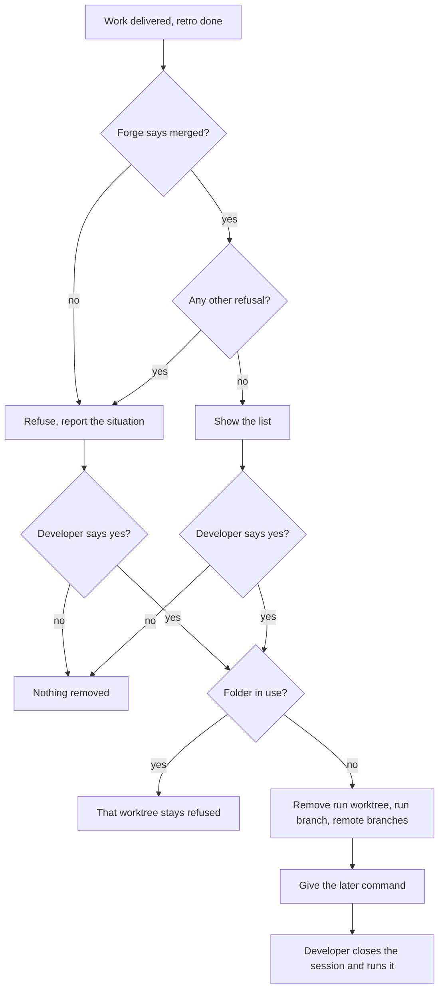

# PRD — 158: /afkv2:gc cleans up a merged piece of work

## Problem Statement

- After a change merges, its run branch (the orphan branch that holds the plan, the journal and the decision ledger) stays forever. A person deletes it by hand, or nobody does.
- The run worktree, the feature worktree and the feature branch, local and remote, stay too. They pile up with each piece of work.
- A plain git removal does not help on the normal path. Git refuses to delete the orphan run branch and a squash-merged feature branch. On Windows, a plain git removal of a worktree folder that a process still uses deletes the files part way and then fails.

## Solution

`/afkv2:gc` cleans up one merged piece of work: the work of the worktree where gc fixes its target. "Feature" is not literal here. It is any piece of work on its own branch and worktree: a new feature, a bug fix, a small enhancement, or a follow-up for a gap found after delivery.

- gc first shows the list of what it will remove (catalog `Items`), and removes nothing until the developer says yes.
- gc goes on only when the forge says the change merged, into any target branch, with no change still open on the branch. Only the forge decides.
- gc refuses first on each risk (catalog `Refusals`) and reports the exact situation. The developer's explicit yes overrides a refusal for that one run. A worktree folder that a process uses stays refused, even after a yes.
- gc removes the run branch and keeps no record of the run ([ADR-0001](adr/requirements/0001-gc-removes-the-run-branch-and-keeps-no-record.md)).
- gc cannot remove the worktree of the session that runs it. It removes everything else and gives the developer one command of its own for the feature worktree and its local branch, to run after the session closes ([ADR-0002](adr/requirements/0002-the-developer-runs-the-last-removal.md)).
- gc is the very last step of the work, after retro.
- The repository README states that afkv2 runs on Windows only.

This change also carries the page engine fixes that the developer asked for during the grill of this ticket: native lavish notes, one card per point with its history, labelled decided cards, the btw control, links in page text, and marks and notes that survive a reload.

## Catalog

### Items

| Id | Item | When it goes | Tip in the report |
|----|------|--------------|-------------------|
| IT-1 | Run worktree | at once, after the yes | — |
| IT-2 | Run branch, local | at once, after the yes | commit id, no link |
| IT-3 | Run branch, remote, when one exists | at once, after the yes | commit id, no link |
| IT-4 | Feature branch, remote | at once, after the yes | commit id and its link on the forge |
| IT-5 | Feature worktree | by gc's later command, after the session closes | — |
| IT-6 | Feature branch, local | by gc's later command, after the session closes | commit id and its link on the forge |

### Refusals

| Id | gc refuses because | The agent tells the developer | On the developer's explicit yes |
|----|--------------------|-------------------------------|---------------------------------|
| RF-1 | The change is closed, still open, or was never opened | the forge's answer and the change link | gc goes ahead |
| RF-2 | The forge call failed | the error | gc goes ahead |
| RF-3 | A worktree has uncommitted or untracked files | each file name | gc goes ahead; those files are lost |
| RF-4 | A branch, local or remote, has commits that are not in the change's head commit | each commit: short id and title | gc goes ahead; the report keeps each branch tip |
| RF-5 | A process uses a worktree folder: a session, a terminal, an editor | the folder, and to close what uses it | still refused |
| RF-6 | The system is not Windows, for a worktree removal | that afkv2 runs on Windows only | still refused |

## User Stories

1. As a developer whose change merged, I want the agent to offer gc with the list of what goes, so that no branch or worktree of that work stays behind.
2. As a developer who comes back to merged work later, I want to run `/afkv2:gc` myself, so that I can clean up after the session that built it has ended.
3. As a developer whose gc refused, I want the exact situation and the choice to go ahead, so that I decide what I lose.
4. As a developer, I want gc never to remove a folder that something still uses, so that no live session or terminal loses its files.
5. As a developer who answers a grill page, I want my notes and marks to stay on the element I annotated and to survive a reload, so that my work on the page is not lost.

## Acceptance Criteria

- [ ] AC-001 gc acts only on the work whose target it fixed in that work's worktree: the items of catalog `Items` for that work → no branch or worktree of other work is listed or removed, abandoned work included.
- [ ] AC-002 Before any removal, gc shows the list of catalog `Items` it will remove, with the change link and the forge state → until the developer's yes in that session, nothing is removed; any answer other than yes removes nothing.
- [ ] AC-003 An agent in the developer's session runs gc only after the developer's yes on the list → without the yes, the agent does not run the removal.
- [ ] AC-004 The developer runs `/afkv2:gc` from the slash menu → gc shows the same list and waits for the same yes as for an agent.
- [ ] AC-005 A hands-off build (`/afkv2:autopilot`, `/afkv2:execute`) → it never runs gc.
- [ ] AC-006 When the work is delivered and retro, where it exists, is done, the agent asks the forge once → merged: the agent asks the developer's yes with the list; not merged yet: the agent tells the developer to run `/afkv2:gc` after the merge.
- [ ] AC-007 A CI watch reports the change as no longer open → the agent offers gc then, as in AC-006.
- [ ] AC-008 The forge says merged, into any target branch, and no change on the branch is open → gc goes on; any other forge answer is a refusal of catalog `Refusals` RF-1 or RF-2.
- [ ] AC-009 For each row of catalog `Refusals`: the cause is present → gc removes nothing, and the agent tells the developer the text of that row's "tells" column.
- [ ] AC-010 After a refusal of RF-1 to RF-4, the developer gives an explicit yes → gc goes ahead for that run only; the next run refuses again on the same cause.
- [ ] AC-011 A refusal of RF-5 or RF-6, then the developer's yes → that worktree is still not removed, and nothing in its folder is touched.
- [ ] AC-012 Before gc deletes a worktree folder, it renames the folder → rename refused: the folder and every file in it stay, and the refusal is RF-5; rename done: gc deletes the folder.
- [ ] AC-013 A merged change whose feature branch was squash-merged, and its orphan run branch → gc removes both branches, which git's normal delete refuses.
- [ ] AC-014 The forge already deleted the remote feature branch at the merge → gc goes on, and the report says it was already gone.
- [ ] AC-015 No remote run branch exists → the report says there is none; one exists → gc removes it.
- [ ] AC-016 A remote delete fails, for example with no push right → gc keeps what it already removed, the report names the failure, and the run exits as failed.
- [ ] AC-017 A second run after AC-016 with the right in place → gc removes only what is left, and removes nothing twice.
- [ ] AC-018 The gc script answers one JSON object: the change link and state, each removed item with each branch's tip commit, each item that waits for the later command, and each refused item with its reason → exit 0 ok, 1 refused, 2 unreadable input.
- [ ] AC-019 A tip commit that the forge holds → the report gives its link on the forge; a run branch tip → the report gives the commit id with no link. (unverified premise: every forge keeps a deleted branch's commit reachable by link)
- [ ] AC-020 After the script answers, the agent tells the developer in plain words what went, what waits for the later command, and what was refused and why.
- [ ] AC-021 gc runs in the session that uses the feature worktree → it removes IT-1 to IT-4 and gives one command of its own for IT-5 and IT-6.
- [ ] AC-022 The later command runs after the session closes, with no process in the folder → the feature worktree and the local feature branch are removed.
- [ ] AC-023 The later command runs inside the folder it removes → it refuses, removes nothing, and says to leave the folder first.
- [ ] AC-024 The later command meets a folder that a process uses → it refuses as RF-5, and nothing in the folder is touched.
- [ ] AC-025 The removal step and the later command run from the main checkout → they act on the target that gc fixed in the feature worktree, not on the folder they run in.
- [ ] AC-026 gc runs on GitHub and on GitLab → each passes a live round trip on a real merged change.
- [ ] AC-027 The repository README → it states that afkv2 runs on Windows only, and that Linux, macOS and WSL are not supported.
- [ ] AC-028 A note made with lavish's own annotation on a page → it reaches the agent with the element it was made on, a table cell included.
- [ ] AC-029 A point that changed over rounds → the page shows it as one card, with its earlier versions folded inside and marked with their round.
- [ ] AC-030 A decided card → the page labels each part: the decision, why, the other options, the evidence, how to undo it, and what it depends on.
- [ ] AC-031 The developer asks a side question with the page's btw control, on Claude or on Codex → it is answered as `/btw` in the CLI answers it, and it stays out of the round.
- [ ] AC-032 A ticket, change, Jira key or commit in page text → it is a link that opens in a new tab.
- [ ] AC-033 Marks and notes the developer sent → they survive a page reload, a failed listener, and a failed agent, until the agent has read them.

## Worked examples

### WE-01 — frequent: merged, retro done, all clean

| Input | Value |
|-------|-------|
| Work | feat/afkv2-gc, run branch feat/afkv2-gc-run |
| Change | merged into feat/afkv2 |
| Worktrees | both clean, no other process in the run worktree |
| Remote feature branch | present |

Result: the agent asks with the list. On the yes, it runs gc from the main checkout. The run worktree, the run branch and the remote feature branch go at once. The report gives the commit id of each branch tip, with a link for the feature branch. gc gives one command for the feature worktree and the local feature branch. The developer closes the session, leaves the folder, and runs it; both go.

### WE-02 — edge: the forge deleted the remote branch at merge

| Input | Value |
|-------|-------|
| As WE-01, but | the forge deleted feat/afkv2-gc on the remote at the merge |

Result: gc goes on. The report says the remote feature branch was already gone. Everything else as WE-01.

### WE-03 — edge: no push right

| Input | Value |
|-------|-------|
| As WE-01, but | the developer has no push right on the remote |

Result: the local part is done. The report names the failed remote delete, and the run exits as failed. A rerun with a push right removes only the remote feature branch.

### WE-04 — risky: closed change, one uncommitted file

| Input | Value |
|-------|-------|
| Change | closed, not merged |
| Run worktree | one uncommitted file, plan/JOURNAL.md |

Result: gc removes nothing. The agent tells the developer: change closed, with its link; plan/JOURNAL.md uncommitted. On the developer's explicit yes, gc removes everything of catalog `Items`, the file included.

## Access & validation policy

| Capability | Permitted | Denied | Data scope | Validation |
|------------|-----------|--------|------------|------------|
| Run gc: list, then remove | an agent in the developer's session, after the developer's yes on the list; the developer from the slash menu, with the same list and yes | a hands-off build (`/afkv2:autopilot`, `/afkv2:execute`) | the work of the worktree where gc fixed its target: its run worktree, run branch, change, feature worktree and feature branch, local and remote | the forge says merged; worktrees clean; no commits outside the change; no process in a worktree folder |
| Override a refusal | the developer, by an explicit yes for that run | an agent without the developer's yes; any actor for RF-5 and RF-6 | the refused items of that one run | the yes comes after the agent reported the exact situation |
| Run the later command | the developer, after the session closes | — | the feature worktree and local feature branch that gc fixed as its target | no process in the folder; the command does not run inside the folder it removes |

## Implementation Decisions

- One gc skill and one script. The script answers one JSON object; the skill tells the developer in plain words.
- "Merged" comes from the forge port's change view, so gc works on GitHub and GitLab by contract. gc does not ask git.
- gc deletes a branch with git's force flag only after its own checks pass: the forge says merged, and the branch tip is the change's head commit or older. The remote feature branch passes the same tip check. The run branch goes after the merge proof. "gc never forces" means: gc never goes past a refusal without the developer's yes. (Decided by agent, accepted 2026-11-03.)
- gc fixes its target in the feature worktree when it lists what it will remove. The removal step and the later command take that fixed target. (Decided by agent, accepted 2026-11-03.)
- The agent offers gc from one forge check after retro, and from a CI watch that reports the change as no longer open. No new watcher: an idle agent cannot receive a merge event after its session ends. (Decided by agent, accepted 2026-11-03.)
- The report links a tip commit only when the forge holds it. No afkv2 code pushes a run branch. (Decided by agent, accepted 2026-11-03.)
- The in-use check is a rename of the folder before the delete. afkv2 runs on Windows only, so on another system gc refuses to remove a worktree.
- gc removes the run branch and keeps no record: [ADR-0001](adr/requirements/0001-gc-removes-the-run-branch-and-keeps-no-record.md). The glossary entry "Run branch" states it.
- The developer runs the last removal with gc's own command: [ADR-0002](adr/requirements/0002-the-developer-runs-the-last-removal.md).
- The hands-off denial is a skill instruction, not a guard. afkv2 has no hook on git branch deletes.
- The page engine fixes of AC-028 to AC-033 were made by hand on this branch during the grill. The plan lists them as done work, so the build does not repeat them.

## Testing Decisions

- A good test proves the observable result: what is gone, what stays, and the JSON answer. It does not prove which git command ran.
- The script gets tests in a scratch repository: an orphan run branch, a squash-merged feature branch, a worktree with an uncommitted file, a branch with a commit after the merge, and a rerun after a failed remote delete.
- The in-use check gets a Windows test for each holder: a process with the worktree folder as its working folder, one in a subfolder, and one with a file open. Each must leave every entry in place.
- The forge part gets a live round trip on GitHub and on GitLab, on a real merged change. Each checks whether a deleted branch's commit link still opens.
- No real run branch exists today, so the first real target is this work's own, once its change merges.
- Prior art: the scratch probes of 2026-11-02 and 2026-11-03 in the grill log.

## Out of Scope

- Spec folder content (PRD, SDD, ADRs, grill log, page documents). It stays with the feature's change.
- Other work, abandoned work included. gc never searches for it. The developer cleans it by hand, or with gc from its own worktree.
- A record of the run for a later retro: [ADR-0001](adr/requirements/0001-gc-removes-the-run-branch-and-keeps-no-record.md).
- Removal of the session's own feature worktree inside the session: [ADR-0002](adr/requirements/0002-the-developer-runs-the-last-removal.md).
- Page tips for feature terms and ids: #159, built on Codex.
- Linux, macOS and WSL: afkv2 runs on Windows only.
- A config key for the target branch. The target, feat/afkv2, is given on the command (dogfood finding F-4 stays open).

## Further Notes

- Gap left to the design: a branch with 2 changes returned one forge answer and no warning. A reused branch with an old merged change and a new open one is not tested. The rule is stated as a result (AC-008: any open change on the branch refuses); the design picks how.
- The run branch normally sits in a sibling worktree named after the feature worktree, with "-run" at the end. The run branch is named after the feature branch, with "-run" at the end.
- A process cannot change the working folder of the session that started it. A shell change of folder inside the session is reset by the harness, and the session process keeps the worktree as its working folder.
- Claude and Codex both fire a session-end hook, but it does not fire when the terminal is closed.
- This repository does not delete merged branches itself, so the remote feature branch is normally present at gc time.

### Assumptions this PRD rests on

- No claim of the grill log is unverified-external. Each premise below was verified in the grill (2026-11-02 to 2026-11-03).
- Git refuses to delete a branch that a worktree has checked out, and refuses an orphan as not merged.
- The forge change view answers opened, merged or closed for a branch, and no change for an unknown branch.
- On Windows, a plain git removal of a worktree folder in use deletes the files first, then fails, and git forgets the worktree.
- On Windows, a rename of a worktree folder in use is refused with nothing touched, and works when no process uses it.
- No afkv2 code pushes a run branch, and nothing in afkv2 deletes a run branch or its worktree today.
- Not verified: every forge keeps a deleted branch's commit reachable by link (AC-019). The design checks it on GitHub and GitLab.
