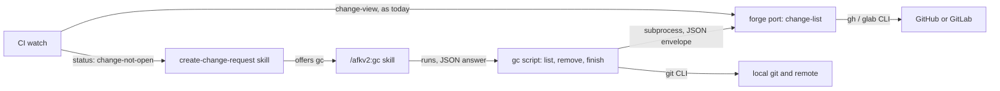
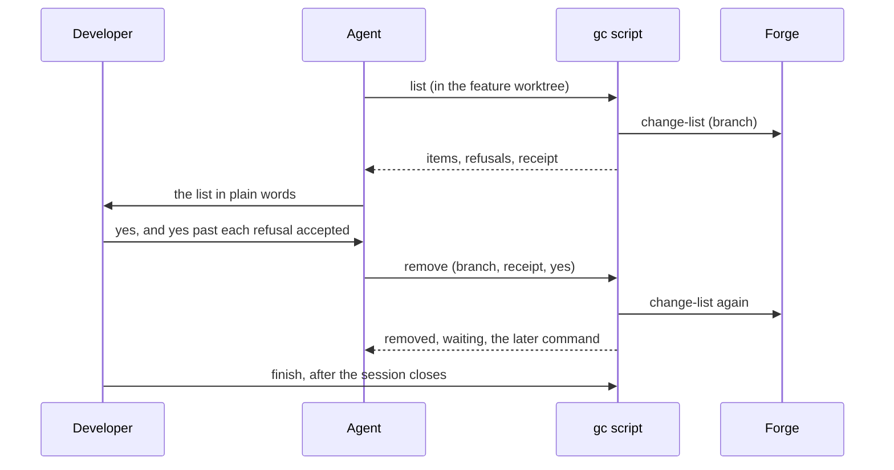
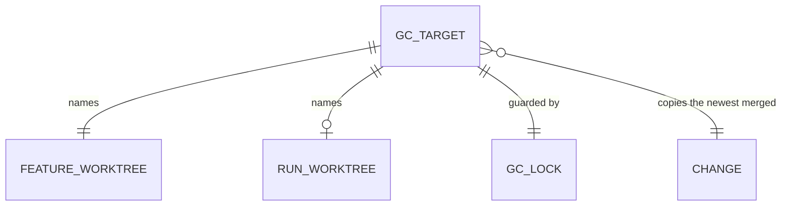
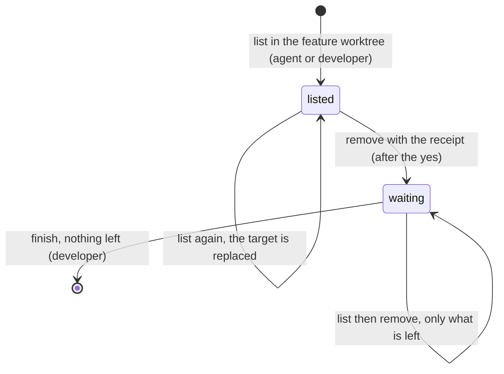
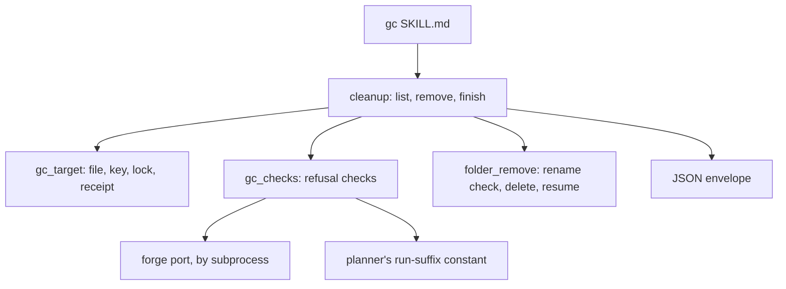

# SDD — 158: /afkv2:gc cleans up a merged piece of work

> Parent PRD: `PRD.md`
> Status: Draft
> Last updated: 2026-11-03

## §0 Binding Contract

This SDD and its accepted ADRs are binding on implementing agents and reviewers.

| Aspect | Locked by SDD/ADR | Executor latitude |
|--------|-------------------|-------------------|
| Pattern choice | yes | no |
| Module public interface | yes | no |
| API contract and schema | yes | no |
| Persisted schema (§4) | yes | no |
| Life cycle states and legal moves (§6) | yes | no |
| Roles per surface (§5) | yes | no |
| Transaction and idempotency strategy | yes | no |
| External-seam contract (§9b) | yes | no |
| File layout inside a named module | no | yes |
| Private helpers, internal names, control flow | no | yes |
| Test fixture structure | no | yes |

**Conflict procedure.** An executor finds a binding decision wrong, infeasible or against reality. A two-way-door correction is recorded in `plan/DECISIONS.md` and built. A one-way door or a tie parks the subtask and returns to `/afkv2:propose-solution` for a new ADR that supersedes the old one. Never override off the record.

**Human sign-off register.** One row per human-locked aspect (`DRAFT.md`).

| Aspect | Section | Status | Signed by / date | Approved wording |
|--------|---------|--------|------------------|------------------|
| HL-1 Persistence and entity design | §4 | signed | developer / 2026-11-03 | the tables of card s-persistence-r3, signed in round 3 (round 2 sign returned by the note on a change that needs fixing, answered: gc refuses an open change); amendment signed in chat 2026-11-03: `change` is null when the forge shows no merged change (plan decision D-7, option A of D-6) |
| HL-2 API surface | §3 | signed | developer / 2026-11-03 | the tables of card s-api-r3, signed in round 3 (round 2 sign returned by the note on more than 100 changes, answered: a long-lived branch; gc refuses) |
| HL-3 Authorization and data scoping | §5 | signed | developer / 2026-11-03 | the tables of card s-access, signed in round 2 with no note |
| HL-4 Life cycle and invariants | §6 | signed | developer / 2026-11-03 | the tables of card s-lifecycle-r3, signed in round 3, with the rename failure told apart by its Windows error as the developer asked in round 2 |
| HL-5 Irreversible and outward side effects | §7 | signed | developer / 2026-11-03 | the table of card s-effects, signed in round 2 with no note |
| HL-6 Change to existing behaviour | §14 | signed | developer / 2026-11-03 | the table of card s-existing, signed in round 2 with no note |

## §1 Context Summary

After a change merges, its run branch, run worktree, feature worktree and feature branches stay behind, and git's own deletes refuse the orphan run branch, a squash-merged branch and, on Windows, a folder in use. gc removes them in a fixed order behind checks that refuse first, and only after the developer's yes on the exact list. The session that runs gc cannot remove its own folder, so the design splits the work into a removal in the session and one later command that the developer runs, joined by a small target file in git's own folder.

## §2 L1 — System Topology

Inherited from afkv2: one skill plus local Python scripts on the developer's Windows machine, run by the agent or the developer. git is called directly. GitHub and GitLab are reached only through the forge port (gh, glab). No service, no background process, no forge-side job (card l1-topology; record 0002 of the requirements).

## §3 L2 — Service Boundaries & Integration



Caption: gc talks to the forge only through the port and to git directly; the CI watch feeds the offer of gc.



Caption: one gc run; the developer's yes sits between list and remove, and finish runs outside the session.

Surface contracts (signed as HL-2):

| Surface | Who | Request and checks | Success answer | Errors (code) |
|---------|-----|--------------------|----------------|---------------|
| gc list | an agent in the developer's session; the developer | no argument: run in the feature worktree, on a branch not ending `-run`. `--branch <name>`: from anywhere in the repository, only to show a `waiting` target | the change (number, link, state, target); each item with its tip, link, `now` or `later`, present or absent; each refusal with its detail; ignored files (count, first 5); the receipt; the state | `not-feature-worktree`, `no-target`, `locked`, `bad-target`. A forge failure is not an error here: it is a refusal in the list |
| gc remove | the same, after the developer's yes | `--branch`, `--receipt`, optional `--yes` with the refusals accepted (folder in use and not-Windows are never accepted). The receipt must match a fresh list | each removed item with its tip, link and seconds; each `already gone`; what waits for the later command; the later command, one line | `stale-list` (with the new list), `refused`, `locked`, `no-target`, `partial` (removed, failed with reasons, left) |
| gc finish (the later command) | the developer, after the session closes | `--branch`, optional `--yes`; refuses inside the folder it removes; state must be `waiting` | the feature worktree and the local feature branch removed; the target file deleted, or what is still left | `inside-folder`, `in-use`, `in-use-or-no-right`, `name-taken`, `rename-failed`, `not-windows`, `not-waiting`, `no-target`, `locked`, `refused`, `partial` |
| forge `change-list` | gc | `branch` (required); `forge` and `repo` as every verb | every change whose source is that branch in this repository: number, link, state `opened`, `merged` or `closed`, head commit, target; newest first; at most 100 | the port's codes (`auth`, `not-found`, `timeout`, `command-failed`, `bad-answer`), and `too-many` when the forge returns 100 |
| CI watch `status` | create-change-request | as today | new state `change-not-open` with `change_state` `merged` or `closed` | as today |

| Rule | Contract |
|------|----------|
| Exit codes | 0 ok, 1 refused or failed part way, 2 unreadable input, on every gc step |
| Paging | none: the forge verb reads one page of 100 (GitHub: `gh pr list --head --state all`; GitLab: `glab mr list --source-branch --all`). A change from a fork with the same branch name is left out |
| GitLab `locked` state | counts as opened |
| Repeat calls | list writes only the target file; remove and finish do only what is left |
| The later command | one PowerShell line: `& "<python>" "<path of the gc script>" finish --repo "<main checkout>" --branch <name>`. When a plugin update removed that path, `/afkv2:gc` with the branch name gives the command again |
| Existing callers | change-view: unchanged. CI watch: its only reader, create-change-request, gets one new state row |

"Merged" means: at least one change of the branch is merged and none is open ([ADR-0002](adr/design/0002-a-forge-verb-lists-every-change-of-a-branch.md)). The newest merged change gives the head commit for every tip check.

## §4 L3 — Data Architecture

| State | Datastore | Partitioning | Replication | Retention | Schema-evolution policy | PII? | Audited? |
|-------|-----------|--------------|-------------|-----------|-------------------------|------|----------|
| gc target | one JSON file per feature branch, `afkv2-gc/<encoded branch>.json` in git's common folder, never committed ([ADR-0001](adr/design/0001-the-gc-target-lives-in-gits-own-folder.md)) | one file per feature branch | none | until finish ends with nothing left; finish deletes it | field `schema`; an unknown value refuses `bad-target`, and the developer lists again | no | no |
| gc lock | an empty file `afkv2-gc/<encoded branch>.lock` beside the target, held by a Windows byte lock | one per target | none | the lock ends with the process, crash included; the file goes with the target | none | no | no |
| CI watch record (exists) | as today | as today | none | as today | gains `change_state`; an old record without it reads as empty | no | no |

gc target, signed as HL-1:

| Field | Type | Null? | Default | Unit / precision | Constraint | Indexed / unique | Note |
|-------|------|-------|---------|------------------|------------|------------------|------|
| schema | text | no | `afkv2.gc/0` | — | an unknown value refuses `bad-target` | — | the file format |
| feature_branch | text | no | — | — | the file name is this name with `\ / : * ? " < > \|` `%` and control characters encoded as `%XX` | unique: one file per name | the identity |
| feature_worktree | text, full folder path | no | — | — | — | — | the worktree gc fixed its target in |
| run_branch | text | no | feature_branch + `-run` | — | — | — | |
| run_worktree | text, full folder path | no | feature_worktree + `-run` | — | stored even when the folder does not exist | — | |
| remote | text | no | `origin` | — | — | — | the remote of both remote branches |
| change | object: number (whole number), url, state (`merged`), head_sha (40 hex), target (branch name) | yes: null when the forge shows no merged change (refusal RF-1 or RF-2) | — | — | the newest merged change; remove and finish read null as "no head commit" | — | amended 2026-11-03, plan decision D-7 |
| tips | object: item → commit id | a value may be empty | — | 40 hex | empty = the branch did not exist | — | each branch tip at the list |
| receipt | text | no | — | 64 hex | SHA-256 of the list shown | — | |
| state | `listed` or `waiting` | no | `listed` | — | `done` is the file deleted | — | |
| left | list of items | no | empty | — | set by the removal | — | items not yet removed |
| listed_at | UTC time | no | — | ISO 8601, seconds | — | — | when the list ran |

| Relation | Target | Cardinality | Owning side | On delete / orphan | Fetch posture |
|----------|--------|-------------|-------------|--------------------|---------------|
| names | feature worktree | 1 to 1 | gc target | the folder goes in finish; the target goes after it | read by path |
| names | run worktree | 1 to 1 | gc target | the folder goes in remove; absent is not an error | read by path |

| Rule | Contract |
|------|----------|
| Identity and uniqueness | one file per feature branch; a second list replaces it while `listed`, and answers the stored target while `waiting` |
| Delete behaviour | deleted by finish when `left` is empty; the lock file goes with it |
| Indexes | none: one file per key |
| Retention | a target never finished stays (about 1 kB) until `/afkv2:gc` runs for that branch again |
| Writes | a temporary file, then an atomic replace; the gc script is the only writer |

**Surface reachability.** The new watch field `change_state` reaches `status`, whose only reader is the create-change-request skill (§14).

**Migration and backfill.** None: no target exists before this change, and an old watch record reads with `change_state` empty. To go back: remove the gc skill; a target file left in git's folder harms nothing.



Caption: the target is the only new state; it points at folders and a change, and nothing points at it.

## §5 L4 — Cross-Cutting & Quality Attributes

Authorization, signed as HL-3:

| Step | Permitted | Denied | Guard above (instructions) | Guard below (script) |
|------|-----------|--------|----------------------------|----------------------|
| list | an agent in the developer's session; the developer from the slash menu | a hands-off build | gc, autopilot and execute skills | none needed: list removes nothing |
| remove | the same, after the developer's yes on the list | anyone without the yes; a hands-off build | gc skill: run only after the developer's yes in this session | the receipt of the list shown; a changed list refuses |
| go ahead past a refusal | the developer's explicit yes for that run | an agent alone; "folder in use" and "not Windows" for anyone | gc skill: pass `--yes` only with the developer's words | `--yes` names refusals the receipt covers; the 2 fixed refusals ignore it |
| finish | the developer, after the session closes | — | gc skill gives the command, never runs it | refuses inside the folder it removes and on a folder in use |
| remote delete | a forge account with push right | no push right | — | the forge refuses; the lease refuses a moved tip |

Data scoping: only the target fixed in the feature worktree; gc never searches for other work. No script can tell a hands-off run, so that denial is an instruction only, as the PRD accepts.

| Call | Attempts | Backoff (s) | Timeout (s) |
|------|----------|-------------|-------------|
| forge `change-list`, 1 per list and 1 per remove, 0 in finish | 1; a failure is the "forge failed" refusal and the developer runs gc again | — | 60, the port default |
| git calls | 1 | — | none |

| Surface | Idempotency key | Window | Ledger |
|---------|-----------------|--------|--------|
| remove | each item; an absent item is `already gone` | the target's life | `left` in the target |
| finish | each item | the target's life | `left` in the target |

| Concern | Posture |
|---------|---------|
| Two runs at once | one run per target: a Windows byte lock; a second run refuses `locked` |
| Platform | Windows only: checked at the list and before each folder delete; elsewhere the folder delete refuses and stays refused |
| Folder delete time | no cap; the answer gives the seconds of each folder delete |
| Observability | the JSON answer of each step; the agent tells it in plain words |

Secrets: none stored; gc uses the sign-in of gh, glab and git.

## §6 L5 — Domain Model

Signed as HL-4. The gc script is the only writer of the target.

| Invariant | Owner | Guardian | Answer to a violation |
|-----------|-------|----------|-----------------------|
| Nothing is removed without the developer's yes on that exact list | gc script | receipt compare in remove | refuse `stale-list`, remove nothing |
| A folder in use is never touched | gc script | the rename before each folder delete, read by its Windows error | error 32: refuse `in-use`; error 5: refuse `in-use-or-no-right`; nothing touched, and its branch stays too |
| A leftover `.gc-removing` folder is gc's own, from a run the developer approved | gc script | the list names it under its item; the removal deletes it before the rename | error 183 cannot then happen; if it does, refuse `name-taken` and touch nothing |
| A folder already gone is not a failure | gc script | the rename's Windows error 2 | `already gone`, then git forgets the worktree |
| Any other rename error stops the delete | gc script | the rename | refuse `rename-failed` with the Windows error text; nothing touched |
| No branch with commits outside the change goes without the developer's yes | gc script | tip check in remove and finish; the lease on remote deletes | refuse with each commit's short id and title |
| One run per target | gc script | the Windows byte lock | refuse `locked` |
| gc acts only on its fixed target | gc script | remove and finish read only the target file | refuse `no-target` |



Caption: a refusal or `locked` leaves the state as it was; `done` is the file deleted.

Domain events: none.

## §7 L6 — Process & Coordination

```mermaid
sequenceDiagram
    participant GC as gc remove
    participant Git
    participant Remote
    GC->>GC: lock; check every rule again; compare the receipt
    GC->>Git: run worktree: rename, delete, worktree prune
    GC->>Git: delete the local run branch
    GC->>Remote: delete the remote run branch, with a lease
    GC->>Remote: delete the remote feature branch, with a lease
    GC->>GC: save the target as waiting with what is left; unlock
```

Caption: no transaction spans the steps; each delete stands alone and a failure never undoes an earlier one.

```mermaid
sequenceDiagram
    participant Dev as Developer
    participant GC as gc finish
    participant Git
    Dev->>GC: finish (outside the feature worktree)
    GC->>GC: lock; state is waiting; Windows; tip check
    GC->>Git: feature worktree: rename, delete, worktree prune
    GC->>Git: delete the local feature branch
    GC->>GC: delete the target when nothing is left
```

Caption: finish runs after the session closes; it needs no forge call.

| Failure point | Detection signal | Automatic recovery | Manual recovery | Owner |
|---------------|------------------|--------------------|-----------------|-------|
| Forge call fails | port error | none | run gc again | developer |
| List changed after the yes | receipt differs | none: `stale-list` with the new list | answer the new list | developer |
| Run worktree in use | rename error 32 or 5 | none; the run branch stays too | close what uses it, run gc again | developer |
| Delete stops half way | a `.gc-removing` folder | the next run deletes it first | run gc or finish again | gc script |
| Remote delete refused (no right, moved tip) | git push error | none; the item stays in `left` | fix the right, run gc again | developer |
| Plugin update moved the script before finish | the command's path is missing | none | `/afkv2:gc` with the branch name gives the command again | developer |

Irreversible effects, signed as HL-5:

| Delete | Trigger and order | Repeat key | A partial failure leaves | Recovery |
|--------|-------------------|------------|--------------------------|----------|
| Run worktree folder (with any file accepted to lose) | remove, step 2, after the lock and the checks | the item; `already gone` when absent | a `.gc-removing` folder | the next run finishes it |
| Local run branch | remove, step 3, after its worktree | the item | the branch, in `left` | a new gc run |
| Remote run branch, when one exists | remove, step 4 | the item; absent = `already gone` | the branch, in `left` | a new gc run with push right |
| Remote feature branch | remove, step 5 | the item; absent = `already gone` | the branch, in `left` | a new gc run with push right |
| Feature worktree folder | finish, first | the item | a `.gc-removing` folder | run finish again |
| Local feature branch | finish, after its worktree | the item | the branch, in `left` | run finish again |

Every report gives each branch tip's commit id, with a link where the forge holds it, so a branch can be recreated by hand. Files accepted to lose are gone, and a deleted run branch's commits are gone once git cleans up (no record: requirement record 0001).

## §8 L7 — Module Decomposition



Caption: one direction only; nothing depends on the CLI module.

| Module | Purpose | Public interface | Depends on |
|--------|---------|------------------|------------|
| gc skill | tells the agent when to list, when to remove, and how to report | the slash command `/afkv2:gc` | cleanup |
| cleanup | the 3 steps and their JSON answers | `list`, `remove`, `finish` (§3) | gc_target, gc_checks, folder_remove, envelope |
| gc_target | the target file, its key, the lock and the receipt | read, write, delete a target; take the lock; compute the receipt | none |
| gc_checks | the refusals: forge state, uncommitted files, commits outside the change, platform | one check per refusal, each returning its detail | forge port, run-suffix constant |
| folder_remove | rename check, delete with read-only files, resume of a leftover | remove one worktree folder, with its Windows error read as a cause | none |
| forge port `change-list` | every change of a source branch | the verb of §3 | gh, glab |

## §9 L8 — Tactical Patterns

| Concern | Pattern | ADR |
|---------|---------|-----|
| Where the target lives | a JSON file in git's common folder, beat no file and a user data folder | [ADR-0001](adr/design/0001-the-gc-target-lives-in-gits-own-folder.md) |
| "None open" on a branch | a forge verb that lists every change, beat change-view alone and change-view plus a tip check | [ADR-0002](adr/design/0002-a-forge-verb-lists-every-change-of-a-branch.md) |
| Folder in use | a rename before the delete, read by its Windows error, beat asking Windows which process holds a file | [ADR-0003](adr/design/0003-a-rename-proves-a-folder-is-free.md) |
| Remote deletes | git push delete with a lease on the checked tip, beat a forge delete verb | [ADR-0004](adr/design/0004-remote-deletes-use-git-with-a-lease.md) |
| Merge seen by the CI watch | the watch ends on a merged or closed change, beat dropping that trigger | [ADR-0005](adr/design/0005-the-ci-watch-ends-on-a-merged-change.md) |
| One run per target | a Windows byte lock that ends with the process, beat a process-id file with a liveness check | — (card l8-lock) |
| The yes binds the list | SHA-256 of the list shown, beat a random token | — (card l8-receipt) |
| Target writes | a temporary file, then an atomic replace, beat a direct write | — |

## §9b External Seams & Failure Affordance

| Boundary | Framework at its pin | What it does to our value | Failure surface | Seam test |
|----------|----------------------|---------------------------|-----------------|-----------|
| GitHub change list | gh on this machine | `--head` matches by branch name, forks included; state `OPEN`, `MERGED`, `CLOSED` | port error codes | port test with the in-process fake; live round trip on scratch branches of this repository |
| GitLab change list | glab on this machine | `--source-branch` with `--all`; state `opened`, `merged`, `closed`, `locked` | port error codes | port test with the in-process fake; live round trip on scratch branches of core-services |
| Windows folder rename | Windows 11, Python 3.14 | refuses with error 32, 5, 183 or 2 by cause | the refusal codes of §6 | script test: a process with the folder as working folder, one in a subfolder, one with a file open |
| git remote delete with a lease | git on this machine | the remote refuses when the tip moved | `partial`, the item in `left` | script test against a bare scratch remote with a push after the check |
| GitLab merge by a push | gitlab.com | marks the change merged when all its commits reach the target | the live test fails at its merge step | the first live run on core-services |

## §10 NFRs

| Concern | Target | Measurement | Owner |
|---------|--------|-------------|-------|
| Forge calls per gc run | at most 2 (1 list, 1 remove); 0 in finish | count in the script tests | gc script |
| Forge call time | at most 60 s each | the port's limit | forge port |
| Live proof | 1 round trip each on GitHub and GitLab before merge: GitHub on scratch branches of this repository; GitLab on scratch branches of gitlab.com nakisainc/core/core-services only, the change marked merged by a push of its commit to the scratch target (fork i-gitlab, option 2, round 1); each run leaves one merged test change in the core-services list, which a Maintainer cannot delete | the live test report | developer |
| Folders touched while in use | 0 | the 3 holder tests | gc script |

## §11 Out of Scope

- The PRD's list: spec folder content, other work and abandoned work, a record of the run, the removal of the session's own worktree in the session, page tips, Linux, macOS and WSL, a config key for the target branch.
- A watcher on the folder delete (round 1 reading).
- A notice when a change merges after every agent stopped; the developer runs `/afkv2:gc`.
- Paging past 100 changes of one branch: gc refuses.
- The full afkv2 rewrite of README.md and the instruction that each plugin change updates it: a spinoff ticket (card l9-readme).

## §12 Reversed Decisions

| Prior ADR | Superseded by | Reason |
|-----------|---------------|--------|
| None | — | — |

## §13 Open Questions

| Question | Layer (L1-L9) | Blocks executor? | Owner | Target resolve date |
|----------|---------------|------------------|-------|---------------------|
| Does a deleted branch's commit link still open on GitLab? | L9 | no | the GitLab live test | the first live run |

## §14 L9 — Implementation Seams & Change Impact

| Seam | Existing contract | Planned change | Impacted flows | Conventions and landmines | Verdict |
|------|-------------------|----------------|----------------|---------------------------|---------|
| Forge port verb table | a verb is a field set and an entry in both adapters (`ports/forge/forge_cli.py:18-30, 72`; `CONTRACT.md:11-23`) | add `change-list` | none existing | a new verb must sit in both adapters and in the field table | extends ([ADR-0002](adr/design/0002-a-forge-verb-lists-every-change-of-a-branch.md)) |
| CI watch loop | reads change-view for the head only until the forge shows the pushed commit, never the state; ends finished, no-verdict or superseded (`create-change-request/scripts/ci_watch.py:248-288`) | read change-view every slice and end with `change-not-open` and the state in the slice where the merge shows | the watch after a push | one change-view call per slice, also after the head shows (developer ruling D-14, 2026-11-04) | reworked |
| CI watch states table | 5 states (`create-change-request/SKILL.md:48-56`) | one row: `change-not-open`, merged → offer gc | the agent after a push | — | extends ([ADR-0005](adr/design/0005-the-ci-watch-ends-on-a-merged-change.md)) |
| mark-ready refusal `change-not-open` | "report it" (`create-change-request/SKILL.md:77`) | merged → offer gc; closed → report | ship | — | extends |
| End of ship | ends at mark Ready (`create-change-request/SKILL.md`, Ship step 3) | one forge check through gc list; merged → ask the yes; not yet → tell the developer to run `/afkv2:gc` after the merge | ship | — | extends |
| Hands-off denial | no "never run gc" line (`autopilot/SKILL.md:6-8`, `execute/SKILL.md:24`) | "Never run /afkv2:gc." | hands-off builds | instruction only | extends |
| Glossary | "Run branch" says gc removes it (`afkv2/GLOSSARY.md:52-53`) | add "Run worktree" and "gc target" | none | — | extends |
| Ownership list | `own`: afkv2 and the spec folder (`.afkv2/config.json`) | add README.md | ownership grades of later skills | — | extends |
| Root README | 895 lines on v1; names no afkv2 (`README.md`) | one afkv2 section: what /afkv2:gc does, and that afkv2 runs on Windows only, not Linux, macOS or WSL; the full rewrite is a spinoff (card l9-readme) | readers of the repository | — | extends |
| The `-run` rule | `RUN_SUFFIX` (`to-subtasks/scripts/check_plan.py:59`) | imported, not copied | none | `start_gate.py:27` holds a second copy today | fits |
| Page links on the design page | `design_round.py` passes the page links (commit 3f6de995) | none: done on this branch | design pages | the plan lists it as done work | fits |

Compatibility findings the developer accepted (card s-existing, round 2):

- A watch on a change that merges or closes now ends at once with `change-not-open`, not later with `finished`; it no longer reports the final CI status of that change.
- On a merged change the agent offers gc instead of only reporting it.
