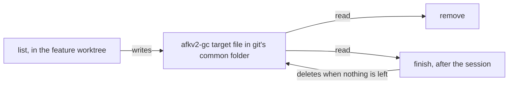

# ADR-0001 — The gc target lives in git's own folder

> Status: Accepted
> Date: 2026-11-03
> Layer: L3
> Context ticket: 158
> Forks: a-entities

## Context

gc fixes its target in the feature worktree, and the removal and the developer's later command take that target (PRD, Implementation Decisions). The later command runs after the session closes and after the run worktree is gone, maybe from the main checkout (SDD §3, §4). So the target must outlive every worktree that gc removes.

## Decision

One JSON file per feature branch, `afkv2-gc/<encoded branch>.json`, in git's common folder. It is never committed, it survives every worktree removal, and the later command names only the branch. The finish step deletes it when nothing is left.

## Alternatives Considered

| Alternative | Pros | Cons | Reason rejected |
|-------------|------|------|-----------------|
| No file: the command carries every value | nothing goes stale | a long command; an edited argument can point gc at other work | the grill rejected a target taken from arguments (i-target) |
| A file in the user data folder, keyed by repository | outside the repository | a second key; a stale file when a clone is deleted | more keys for the same result |

## Consequences

- **Positive** — the later command is short and cannot be pointed at other work.
- **Negative** — a target never finished stays, about 1 kB, until gc runs for that branch again.
- **Follow-ups** — none.
