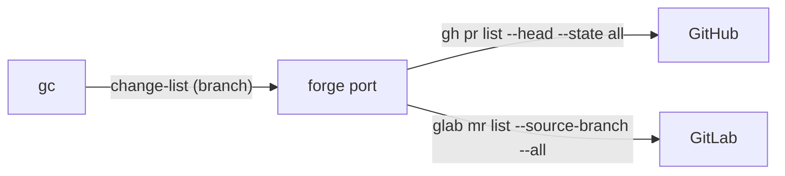

# ADR-0002 — A forge verb lists every change of a branch

> Status: Accepted
> Date: 2026-11-03
> Layer: L2
> Context ticket: 158
> Forks: a-api

## Context

The rule is "merged, into any target branch, and no change on the branch is open" (PRD, acceptance 008). change-view answers one change per branch. A branch of this repository had one merged and one open change, and change-view answered only the open one, so it cannot prove that none is open (SDD §3).

## Decision

The forge port gets the verb `change-list`: every change whose source is the branch, in this repository, with its state, head commit and target, newest first, at most 100. gc goes on when at least one is merged and none is open, and takes the newest merged change for every tip check.

## Alternatives Considered

| Alternative | Pros | Cons | Reason rejected |
|-------------|------|------|-----------------|
| change-view only | no port change | an old open change and a newer merged one read as merged | gc could delete a branch an open change still uses |
| change-view, then a git tip check | catches a new push | misses an old open change on the same tip | does not prove the rule |

## Consequences

- **Positive** — the rule holds on both forges by contract.
- **Negative** — one verb, 2 adapters and their tests; a branch with 100 changes or more refuses.
- **Follow-ups** — none.
