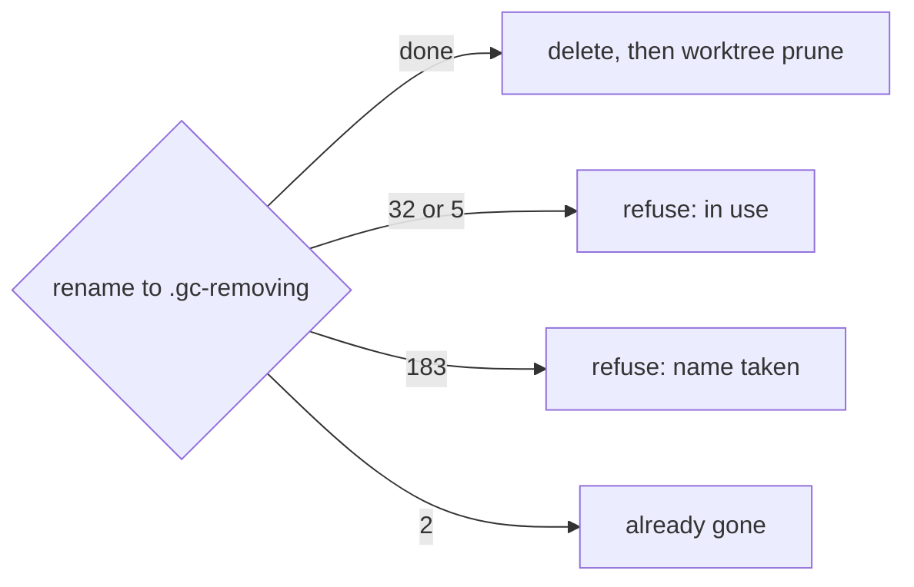

# ADR-0003 — A rename proves a folder is free

> Status: Accepted
> Date: 2026-11-03
> Audited: 2026-11-03
> Layer: L8
> Context ticket: 158
> Forks: none

## Context

On Windows, a plain git removal of a worktree folder in use deletes the files part way and then fails. A rename of a folder in use is refused with nothing touched (PRD, Assumptions). The cause of a refused rename shows in its Windows error (SDD §6).

## Decision

Before each folder delete, gc renames the folder to the same name plus `.gc-removing`, in the same parent. A refused rename touches nothing, and its Windows error names the cause: 32 in use, 5 in use or no right, 183 name taken, 2 already gone, any other error `rename-failed`. After the rename, gc deletes the renamed folder, read-only files included, then runs `git worktree prune`. A leftover `.gc-removing` folder from a stopped run is listed under its item and deleted first.

## Alternatives Considered

| Alternative | Pros | Cons | Reason rejected |
|-------------|------|------|-----------------|
| Ask Windows which process holds a file (Restart Manager or handle.exe) | names the process | an extra tool or an API binding; misses a process whose working folder is the folder | less coverage for more code |
| A plain `git worktree remove` | one call | deletes part way on a folder in use | breaks the rule that a folder in use is never touched |

## Consequences

- **Positive** — a folder in use is never touched, and a stopped delete resumes.
- **Negative** — error 5 cannot tell a process from a missing right, so the refusal names both.
- **Follow-ups** — none.
