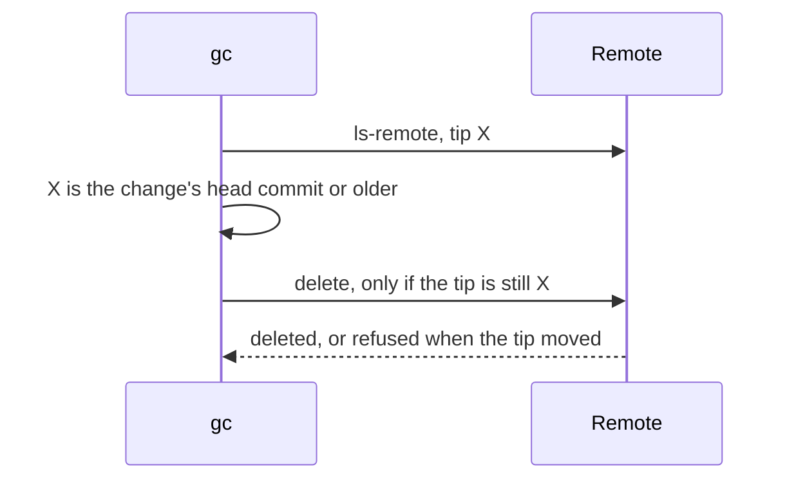

# ADR-0004 — Remote deletes use git with a lease

> Status: Accepted
> Date: 2026-11-03
> Audited: 2026-11-03
> Layer: L8
> Context ticket: 158
> Forks: none

## Context

gc deletes the remote feature branch and, when one exists, the remote run branch, after its tip check (SDD §7). A push to the branch after the check must not be lost.

## Decision

gc reads the remote tip with `git ls-remote`, checks it, and deletes with `git push origin --delete` and a lease on that tip (`--force-with-lease`). The remote refuses when the tip moved; the item stays in `left` and the answer is `partial`. No branch on the remote is `already gone`.

## Alternatives Considered

| Alternative | Pros | Cons | Reason rejected |
|-------------|------|------|-----------------|
| A forge verb `branch-delete` through the GitHub and GitLab APIs | a forge-side delete | 2 adapters; neither API compares the tip | a push after the check is lost |

## Consequences

- **Positive** — one path on both forges, and a moved tip is never lost.
- **Negative** — needs push right through git, not only a forge token.
- **Follow-ups** — none.
