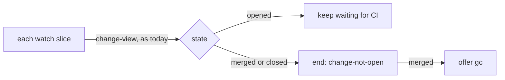

# ADR-0005 — The CI watch ends on a merged change

> Status: Accepted
> Date: 2026-11-03
> Audited: 2026-11-03
> Layer: L9
> Context ticket: 158
> Forks: none

## Context

The PRD offers gc when a CI watch reports the change as no longer open (acceptance 007). The grill took for granted that the watch already ends that way. The code shows it never reads the change state: `change-not-open` is a refusal of mark-ready alone (SDD §14). Each watch slice already asks change-view for the head commit.

## Decision

The watch reads the state from the change view it already asks for each slice. On `merged` or `closed` it ends with the state `change-not-open` and `change_state`. The create-change-request skill offers gc on `merged` and reports `closed`, as on the mark-ready refusal.

## Alternatives Considered

| Alternative | Pros | Cons | Reason rejected |
|-------------|------|------|-----------------|
| Drop the watch trigger; keep only the check at the end of ship | no watch change | changes a settled requirement | would go back to the grill |

## Amendment 2026-11-04

The context above is wrong: the watch reads change-view only until the forge shows the pushed commit (`ci_watch.py:271` before this change). The developer ruled (plan decision D-14, which replaces D-13): the watch reads change-view every slice, and ends in the slice where the merge shows. This costs one change-view call per slice after the head shows.

## Consequences

- **Positive** — the trigger the PRD names has a source, and a merge shows in the slice where it lands.
- **Negative** — one change-view call per slice after the head shows (amendment).
- **Negative** — a watch on a change that merges no longer reports its final CI status.
- **Follow-ups** — none.
