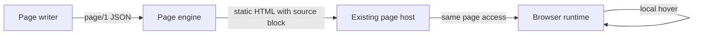
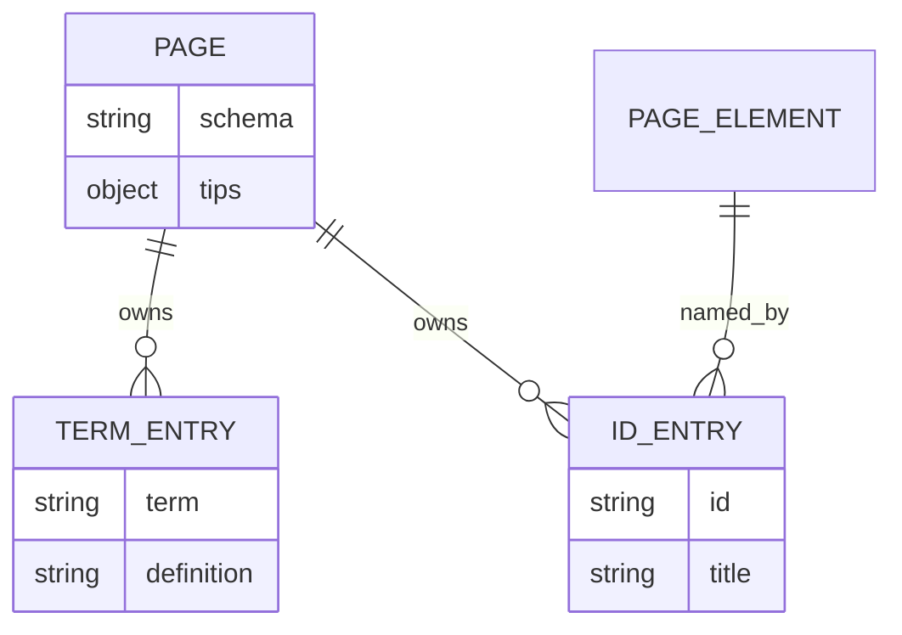
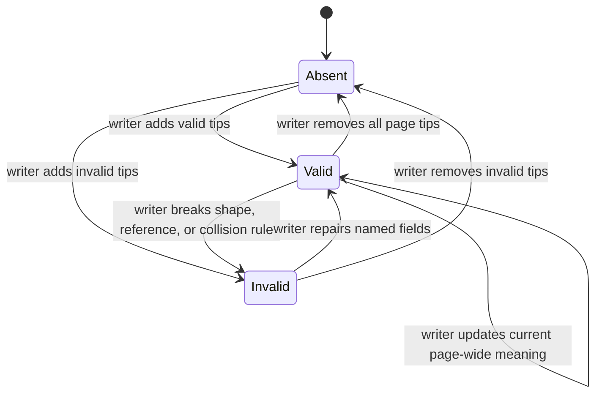
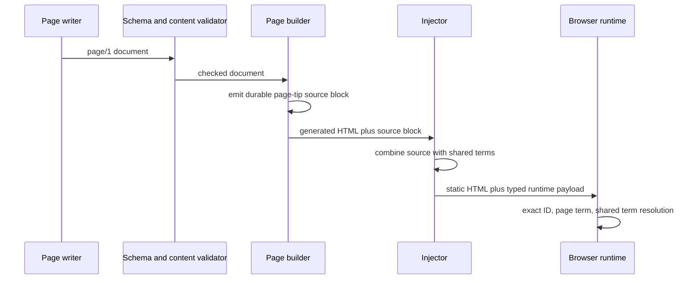
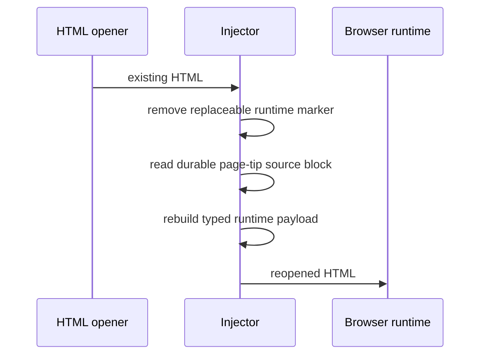
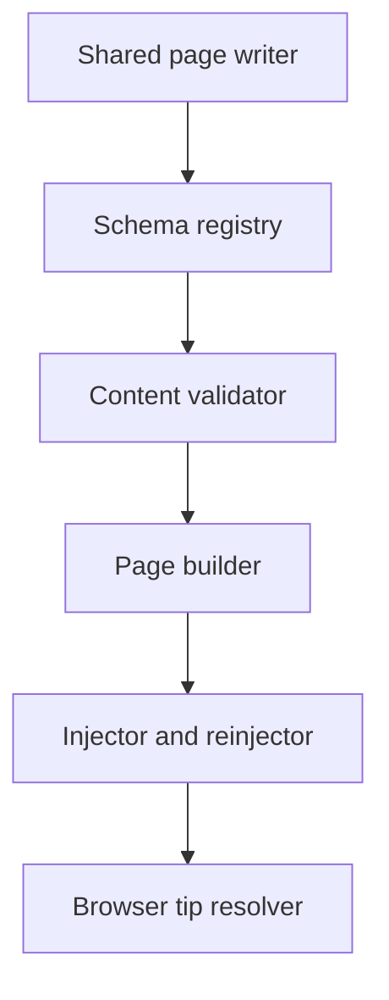

# SDD — Page tips for feature terms and IDs

> Parent PRD: `PRD.md`
> Status: Draft
> Last updated: 2026-11-04

## §0 Binding Contract

This SDD and its accepted ADRs are binding on implementing agents and reviewers.

| Aspect | Locked by SDD/ADR | Executor latitude |
|--------|-------------------|-------------------|
| Pattern choice | yes | no |
| Module public interface | yes | no |
| API contract and schema | yes | no |
| Persisted schema (§4) | yes | no |
| Life cycle states and legal moves (§6) | yes | no |
| Roles per surface (§5) | yes | no |
| Transaction and idempotency strategy | yes | no |
| External-seam contract (§9b) | yes | no |
| File layout inside a named module | no | yes |
| Private helpers, internal names, control flow | no | yes |
| Test fixture structure | no | yes |

**Conflict procedure.** An executor finds a binding decision wrong, infeasible or against reality. A two-way-door correction is recorded in `plan/DECISIONS.md` and built. A one-way door or a tie parks the subtask and returns to `/afkv2:propose-solution` for a new ADR that supersedes the old one. Never override off the record.

**Human sign-off register.**

| Aspect | Section | Status | Signed by / date | Approved wording |
|--------|---------|--------|------------------|------------------|
| HL-1 Persistence and entity design | §4 | signed | developer / 2026-11-04 | Signed `sign-hl-1` in R2: the field, relation, retention, migration, and rollback tables are final. |
| HL-2 API surface | §3 | signed | developer / 2026-11-04 | Signed `sign-hl-2` in R2: page/1 is the only new public contract; engine verbs and page/0 callers stay compatible. |
| HL-3 Authorization and data scoping | §5 | n/a | developer / 2026-11-04 | No new protected surface or scoped entity; tips inherit the page host boundary. |
| HL-4 Life cycle and invariants | §6 | signed | developer / 2026-11-04 | Signed `sign-hl-4` in R2: page-wide meanings, invariant guardians, and refusal results are final. |
| HL-5 Irreversible and outward side effects | §7 | n/a | developer / 2026-11-04 | No write leaves the page artifact; generated HTML and browser state are derived. |
| HL-6 Change to existing behaviour | §14 | signed | developer / 2026-11-04 | Signed `sign-hl-6` in R2: new-session, legacy-session, reopen, matching, compatibility, and rollback behavior is final. |

HL-6 note: Superseded in part on 2026-11-05 by the developer: an existing page/0 session writes page/1 at its next round, by #163 design ADR-0002 (one write path). Stored page/0 files are still not rewritten on read.

## §1 Context Summary

Page readers need feature terms and page IDs to explain themselves on hover. The design adds page-owned tip data without changing legacy page/0 documents, engine commands, access boundaries, or the local static-page topology.

## §2 L1 — System Topology

Inherited from the local page engine and browser host. The feature adds no deployable unit or network boundary.

## §3 L2 — Service Boundaries & Integration

The page schema is the only changed public surface. The engine command surface stays unchanged.

| Surface | Method / path | Roles | Request fields and validation | Success answer | Errors | Paging | Idempotency | Existing callers |
|---|---|---|---|---|---|---|---|---|
| Page document schema | JSON schema value `afkv2.page/1` | Page writers; page readers | Optional `tips` object with `terms[]` and `ids[]`; schema and content invariants run before render | Existing check, render, show, ingest, reply, poll, and end verbs | Bad document with the exact field path; semantic collision with both paths | none | The same document produces the same checked payload and HTML | `afkv2.page/0` stays registered; existing page/0 sessions keep page/0 ([schema registry and command checks](../../../afkv2/engine/engine.py)) |

The flow keeps page access and rendering in one boundary. No new endpoint or command exists.

## §4 L3 — Data Architecture

| State | Datastore | Partitioning | Replication | Retention | Schema-evolution policy | PII? | Audited? |
|-------|-----------|--------------|-------------|-----------|-------------------------|------|----------|
| Page document | Spec-folder JSON | 1 file per design or grill session | Git and local worktree | Repository lifetime | Expand-only schema values; keep every reader for stored documents | Same classification as page content | Git history |
| Generated HTML | Derived file beside the page document | 1 file per page document | Git and local worktree | Regenerated with the document | No independent schema; rebuild from page data | Same classification as page content | Git history |
| Browser tip payload and box | Browser memory | 1 payload per open page | none | Browser-page lifetime | Rebuilt from embedded source and shared terms | Same classification as page content | no |

### Page tip fields

| Field | Type | Null? | Default | Unit / precision | Constraint | Indexed / unique | Note |
|-------|------|-------|---------|------------------|------------|------------------|------|
| `tips` | object | no | empty `terms` and `ids` arrays | 1 per page | Owned by the page | unique root field | Optional in page/1 input. |
| `terms[].term` | string | no | none | 1–128 characters | Existing term-match identity | Unique by term matching | Typed array preserves duplicate input for errors. |
| `terms[].definition` | string | no | none | 1–1,000 characters | Plain text | no | Page-owned term value. |
| `ids[].id` | string | no | none | 1–128 characters | Same-case page element ID | Unique | Must reference one card, component, or map node. |
| `ids[].title` | string | no | none | 1–1,000 characters | Plain text | no | Title of the named item. |

| Relation | Target | Cardinality | Owning side | On delete / orphan | Fetch posture |
|----------|--------|-------------|-------------|--------------------|---------------|
| Page → term entries | Term entry | 1 to 0..n | Page | Page delete removes entries | Eager with page JSON |
| Page → ID entries | ID entry | 1 to 0..n | Page | Page delete removes entries | Eager with page JSON |
| ID entry → page element | Card, component, or map node | n to 1 | Page | Removed element makes the ID entry invalid until repaired | In-memory inventory during validation |

**Surface reachability.** The root `tips` field is visible to the shared page writer, schema reader, content validator, page builder, injector, and browser resolver. Component public shapes do not change.

**Migration and backfill.** New sessions write page/1. An existing page/0 session appends as page/0. Stored page/0 documents receive no rewrite or backfill. Rollback may stop page/1 writes but keeps the page/1 reader.

Superseded in part on 2026-11-05 by the developer: an existing page/0 session writes page/1 at its next round, by #163 design ADR-0002 (one write path). Stored page/0 files are still not rewritten on read.

The page owns every entry; ID entries also reference the existing element inventory.

## §5 L4 — Cross-Cutting & Quality Attributes

### Authorization and data scoping

| Surface | Permitted roles | Denied roles | Guard above UI | Guard below UI | Scope |
|---|---|---|---|---|---|
| Rendered page and embedded tips | Person with page access | Person without page access | Existing page host before HTML delivery | No new endpoint; tip resolution uses delivered DOM data | Current page only |
| Page authoring | Page-document writer | Reader without page write access | Existing repository write access | Schema and content validation | Current page document |

### Idempotency, retry, timeout, and rate posture

| Concern | Surface | Posture |
|---|---|---|
| Idempotency | Render and reopen | Same page data produces the same source payload and runtime payload. The existing changed-content write avoids duplicate output. |
| Retry | Hover | 0 retries and 0 external calls. |
| Retry | DOM mutation rescan | One rescan after the existing 300 ms debounce. A later mutation schedules another rescan. |
| Timeout | First scan and rescan | 1,000 ms target on the defined NFR fixture. |
| Rate limit | Hover | none; local DOM lookup only. |
| Feature flag | All paths | none; schema value selects behavior. |

Validation errors name the field or both colliding fields. Performance tests report first-scan and rescan time. The design introduces 0 secrets.

The browser proof starts the installed Chrome binary with an isolated temporary profile and a local Chrome DevTools Protocol endpoint. It uses Node.js built-in HTTP and WebSocket clients. It downloads no browser and adds no browser-automation framework. It closes the process and removes the profile after every result. A failed proof keeps its diagnostic output.

## §6 L5 — Domain Model

| Invariant | Owner | Guardian | Answer to a violation |
|---|---|---|---|
| Keys and values are non-empty and within field limits. | Page document | Page/1 schema | Refuse with the field path. |
| Each ID tip references an existing page element. | Page document | Engine content validation | Refuse with the stale ID-entry path. |
| One catalog has no 2 entries that match one visible token. | Page document | Engine content validation | Refuse with both conflicting paths. |
| Exact page ID beats page term; page-owned tip beats shared term. | Browser payload | Runtime resolver | Return 1 deterministic tip. |
| Tip values stay plain text. | Browser display | Runtime display | Never execute markup, script, or link action. |

An invalid catalog never replaces the last valid HTML. Page-wide tips hold the current meaning for every visible round. Domain events: none.

## §7 L6 — Process & Coordination

The transaction boundary is one render attempt. Validation completes before HTML generation. The final write replaces output only after successful source and runtime payload generation.

| Failure point | Detection signal | Automatic recovery | Manual recovery | Owner |
|---------------|------------------|--------------------|-----------------|-------|
| Page/1 shape error | Bad-document field path | Keep last valid HTML | Repair the named page field | Page writer |
| Stale ID reference | Stale ID-entry path | Keep last valid HTML | Remove or retarget the ID entry | Page writer |
| Same-catalog collision | Both conflicting paths | Keep last valid HTML | Rename or remove one entry | Page writer |
| Source or payload serialization | Render failure before replacement | Keep last valid HTML | Repair serializable page data | Page engine maintainer |
| Browser payload parse | Runtime reports no page tips; unrelated page chrome continues | Shared terms remain available | Repair payload generation and rerender | Page engine maintainer |
| Chrome proof launch or CDP attach | Process exit, connection error, or protocol error | Close the launched process and remove its temporary profile | Read the preserved command and protocol diagnostics; repair the local prerequisite or fixture | Test maintainer |
| Performance budget failure | NFR test exceeds 1,000 ms | CI fails | Optimize resolver or scan without changing validity | Page engine maintainer |

Irreversible or outward effects: none.

## §8 L7 — Module Decomposition

| Module | Purpose | Public interface | Depends on |
|---|---|---|---|
| Shared page writer | Create page/1 for new sessions and preserve the schema of resumed sessions | Build or append one round with document-level tips | Page schema contract |
| Schema registry | Select page/0 or page/1 validation and reader behavior | Validate and read a page document by schema value | In-tree schema validator |
| Content validator | Enforce element references and same-catalog collision rules | Return field-specific document problems | Checked page document; element inventory |
| Page builder | Render components and emit the durable page-tip source block | Build static HTML from a checked document | Component registry; checked page data |
| Injector and reinjector | Combine durable page source with permitted shared sources | Inject one typed runtime payload into HTML | Page-tip source block; glossaries; legacy page/0 sidecar |
| Browser tip resolver | Match, wrap, and display 1 safe local tip | Scan the DOM and respond to hover or mutation | Typed runtime payload; browser DOM |

The dependency graph has no cycle. Component renderers remain unaware of tip catalogs.

## §9 L8 — Tactical Patterns

| Concern | Pattern | ADR |
|---------|---------|-----|
| Stored compatibility | Expand-only schema adapter with dual readers | [ADR-0001](adr/design/0001-add-page-1-with-dual-readers.md) |
| Authored page tips | Typed entry catalogs with semantic invariants | [ADR-0002](adr/design/0002-use-typed-page-tip-payloads.md) |
| Runtime reconstruction | Durable source block plus replaceable derived payload | [ADR-0002](adr/design/0002-use-typed-page-tip-payloads.md) |
| Meaning over rounds | Page-wide current meaning | [ADR-0003](adr/design/0003-use-current-page-wide-tip-meanings.md) |
| Large catalogs | Measured budget without a count cap | [ADR-0004](adr/design/0004-bound-tip-cost-with-a-performance-contract.md) |
| Browser runtime proof | Installed Chrome through local CDP with Node.js built-ins | [ADR-0005](adr/design/0005-use-installed-chrome-cdp-for-browser-proof.md) |

## §9b External Seams & Failure Affordance

| Boundary | Framework at its pin | What it does to our value | Failure surface | Seam test |
|----------|----------------------|---------------------------|-----------------|-----------|
| Page schema | In-tree schema validator at the feature commit | Checks arrays, required fields, string lengths, and closed shapes | Bad-document field path | Run the real engine check on valid and invalid page/1 fixtures. |
| JSON-to-HTML source block | Python JSON encoder from the setup interpreter | Serializes typed tips and escapes closing-script text | Render failure before output replacement | Render unsafe text, reopen HTML, and compare the reconstructed payload. |
| Browser text scan | Installed Chrome controlled through a local Chrome DevTools Protocol endpoint | Walks eligible text nodes and wraps matches | Missing or incorrect tip span | Drive the real rendered page and assert repeated, exact-case, plural, and unmatched text. |
| Browser hover | Installed Chrome controlled through a local Chrome DevTools Protocol endpoint | Reads local tip data and writes `textContent` | Hidden or misplaced tip box | Hover unsafe text in the real page and assert literal output and 0 network requests. |
| Local file replacement | Existing page engine write contract | Replaces generated HTML only when content changed | Render error leaves old output | Start with valid HTML, render an invalid document, and prove the prior file remains. |

## §10 NFRs

| Concern | Target | Measurement | Owner |
|---------|--------|-------------|-------|
| First tip scan | ≤ 1,000 ms for 2,000 total tips over 200,000 visible characters | Browser fixture in installed Chrome through local CDP | Browser tip resolver |
| Mutation rescan | ≤ 1,000 ms after the existing 300 ms debounce on the same fixture | CI browser fixture | Browser tip resolver |
| Hover network use | 0 requests | Browser network capture during hover | Browser tip resolver |
| Unsafe content execution | 0 markup, script, or link actions from tip values | Browser fixture with active-looking text | Browser tip resolver |
| Stored compatibility | 100% of valid page/0 regression fixtures keep their current rendered tips | Real engine check, render, reopen, and compare | Schema registry and injector |
| Determinism | 100% identical runtime payload for identical page data and shared sources | Render twice and byte-compare payload blocks | Page builder and injector |

## §11 Out of Scope

- A coverage audit that refuses visible terms or IDs without tips.
- `/afkv2:gc` branch cleanup, owned by issue #158.
- A new page service, endpoint, host route, or authorization system.
- A migration that rewrites stored page/0 documents.

## §12 Reversed Decisions

| Prior ADR | Superseded by | Reason |
|-----------|---------------|--------|
| None | — | No design ADR is reversed. |

## §13 Open Questions

| Question | Layer (L1-L9) | Blocks executor? | Owner | Target resolve date |
|----------|---------------|------------------|-------|---------------------|
| None | — | no | — | — |

## §14 L9 — Implementation Seams & Change Impact

| Seam | Existing contract | Planned change | Impacted flows | Conventions and landmines | Verdict |
|------|-------------------|----------------|----------------|---------------------------|---------|
| Page schema and reader registry | page/0 is frozen; each schema value needs a file and reader ([engine.py:52](../../../afkv2/engine/engine.py)) | Add page/1; keep page/0 unchanged; select component validation by document schema | Check, render, ingest, reopen | Unknown schemas refuse; component-shape validation must not stay implicitly tied to page/0 | extends (ADR-0001) |
| Shared round writer | New sessions hard-code page/0; resumes require the same schema ([round_document.py:334](../../../afkv2/skills/grill/scripts/round_document.py)) | New sessions use page/1; resumes preserve their stored schema; accept document-level tip entries | Grill, solution design, subtask planning | One shared writer serves all 3 producers; do not fork writer behavior | extends (ADR-0001) |
| Content invariants | Engine inventories all card, component, and map-node IDs ([engine.py:118](../../../afkv2/engine/engine.py)) | Reuse the inventory for ID references; add term-collision and ID-collision checks with exact paths | Check and render | JSON maps lose duplicates before validation; keep typed arrays | extends (ADR-0002) |
| Page builder | Receives the full checked document and emits static HTML ([page.py:157](../../../afkv2/engine/shell/page.py)) | Emit a durable typed page-tip source block outside the replaceable runtime marker | Render and HTML reopen | Source block is page data; runtime block is derived | extends (ADR-0002) |
| Injector and launcher reopen | Reopen removes and rebuilds the marked block from path sources ([inject.py:184](../../../afkv2/engine/shell/inject.py); [launcher.py:285](../../../afkv2/engine/launcher.py)) | Read the durable source block; ignore legacy sidecar for page/1; retain it for page/0 | Render, show, arbitrary HTML open | Arbitrary HTML may have no source block; keep shared terms and page chrome working | extends (ADR-0002) |
| Browser tip resolver | One flat dictionary gives lowercase keys case-insensitive fallback ([tips.js:8](../../../afkv2/engine/shell/tips.js)) | Resolve exact page IDs, then page terms, then shared terms from separate maps | Initial scan, mutation scan, hover | Do not let harvest override authored IDs; payload parse failure must not disable unrelated chrome | reworked |
| Authoring guide and examples | Page document guidance and fixtures state page/0 | Document page/1 tips and keep explicit page/0 compatibility examples | Agent-authored page documents | Runtime source has one home; guidance points to the schema | extends (ADR-0001) |
| Engine, writer, and browser tests | Existing tests cover dictionary injection and idempotence, not DOM behavior ([test_engine_core.py:917](../../../afkv2/tests/engine/test_engine_core.py)) | Add page/1, resume, collision, reopen, exact-ID, plural, precedence, safety, no-network, and performance proofs; drive the browser proof in installed Chrome through local CDP | Local selective tests and CI | Use real engine entry points; isolate the Chrome profile; clean up the process and profile; preserve diagnostics on failure; browser assertions must inspect rendered output | extends (ADR-0005) |

Accepted compatibility findings: page/0 remains valid; open page/0 sessions remain page/0; the legacy sidecar applies only to page/0; page/1 readers remain after writer rollback; earlier rounds show the latest page-wide tip meaning.
