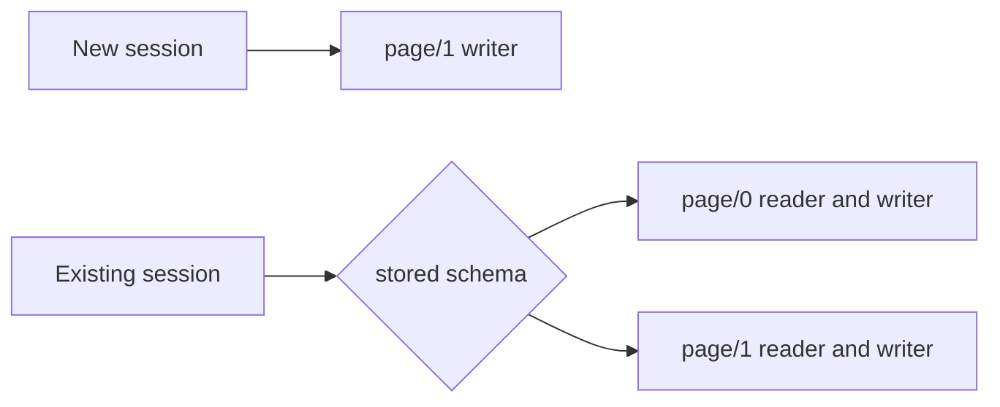

# ADR-0001 — Add page/1 with dual readers

> Status: Accepted
> Date: 2026-11-04
> Audited: 2026-11-04
> Layer: L2
> Context ticket: #159
> Forks: none

## Context

Page/0 is frozen, has no page-owned tip field, and must remain valid. The design needs a stored tip contract without rewriting existing documents. See SDD §3 and §4.

## Decision

Add page/1 with page-owned tips. Keep page/0 and page/1 readers registered. New sessions write page/1; resumed sessions preserve their stored schema.

## Alternatives Considered

| Alternative | Pros | Cons | Reason rejected |
|-------------|------|------|-----------------|
| Change page/0 in place | Small initial diff | Breaks the frozen schema contract | Existing documents must keep their meaning. |
| Rewrite page/0 documents to page/1 | One active schema after migration | Mutates stored session history and complicates rollback | The accepted design requires no migration. |
| Add page/1 with dual readers | Preserves stored documents and adds the contract | Keeps 2 readers | Chosen for compatibility. |

## Consequences

- **Positive** — Existing pages and sessions keep working without a rewrite.
- **Negative** — Schema registration, fixtures, and writer tests cover 2 versions.
- **Follow-ups** — Keep the page/1 reader after any writer rollback.
