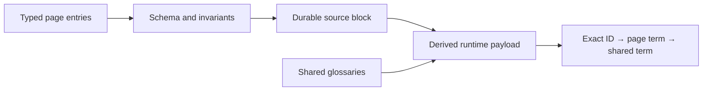

# ADR-0002 — Use typed page-tip payloads

> Status: Accepted
> Date: 2026-11-04
> Audited: 2026-11-04
> Layer: L3
> Context ticket: #159
> Forks: none

## Context

The current flat dictionary cannot keep lowercase IDs case-sensitive, preserve duplicate input for validation, or survive HTML reinjection as page-owned data. See SDD §4, §7, and §9b.

## Decision

Store typed term and ID entry arrays. Render a durable page-tip source block. Build a replaceable runtime payload with separate exact IDs, page terms, and shared terms.

## Alternatives Considered

| Alternative | Pros | Cons | Reason rejected |
|-------------|------|------|-----------------|
| One JSON map | Compact | Duplicate keys disappear; source identity is implicit | Cannot produce precise collision errors. |
| Derive titles in component renderers | Less explicit data for known cards | No universal title field; every component gains policy | Does not cover arbitrary page IDs. |
| Keep the adjacent sidecar | Existing loader path | Page does not own its meanings; reopen lifecycle stays external | Conflicts with the accepted requirement. |
| Typed entries and source block | Explicit validation, precedence, and reopen behavior | Adds conversion and validation code | Chosen for one end-to-end contract. |

## Consequences

- **Positive** — Validation names invalid entries and runtime precedence is explicit.
- **Negative** — The engine maintains a stored shape, a durable HTML source shape, and a derived runtime shape.
- **Follow-ups** — Add render-and-reopen parity and real-browser behavior tests.
