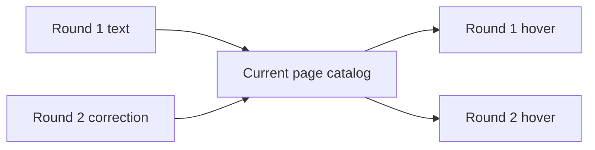

# ADR-0003 — Use current page-wide tip meanings

> Status: Accepted
> Date: 2026-11-04
> Layer: L5
> Context ticket: #159
> Forks: a-lifecycle

## Context

A term can be corrected in a later round. The page can show the latest meaning everywhere or preserve a separate meaning per round. See SDD §6.

## Decision

Use one page-wide catalog. A later valid edit changes hover text for matching content in every visible round. Settled card text remains unchanged.

## Alternatives Considered

| Alternative | Pros | Cons | Reason rejected |
|-------------|------|------|-----------------|
| Page-wide current meaning | One definition and consistent current reading | Old hover wording is not a snapshot | Chosen by the developer in `a-lifecycle`. |
| Round snapshots | Exact historical hover wording | Duplicate data and round-aware resolution | The added complexity does not improve current page understanding. |

## Consequences

- **Positive** — One correction fixes every occurrence on the page.
- **Negative** — Hover wording on an earlier round can differ from what existed when that round settled.
- **Follow-ups** — None.
