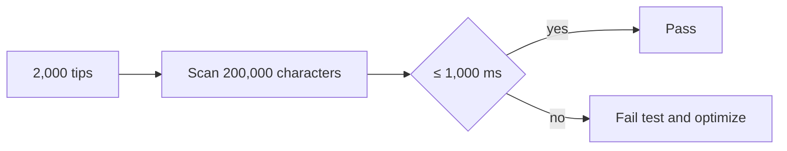

# ADR-0004 — Bound tip cost with a performance contract

> Status: Accepted
> Date: 2026-11-04
> Layer: L4
> Context ticket: #159
> Forks: a-large-data

## Context

Runtime work grows with tip count and visible text. The requirements define no valid catalog maximum. See SDD §5 and §10.

## Decision

Set a measured budget instead of a catalog-count cap. A fixture with 2,000 tips and 200,000 visible characters completes first scan and a debounced rescan within 1,000 ms on the continuous-integration runner.

## Alternatives Considered

| Alternative | Pros | Cons | Reason rejected |
|-------------|------|------|-----------------|
| Measured budget without count cap | Controls cost without changing validity | Very large pages remain possible | Chosen by the developer in `a-large-data`. |
| Refuse more than 2,000 tips | Hard ceiling | Makes count part of validity without a requirement | Could block a legitimate page. |
| No numeric contract | No test cost | Performance can regress silently | Does not satisfy the quality bar. |

## Consequences

- **Positive** — Performance has a repeatable failure signal.
- **Negative** — The benchmark depends on the continuous-integration runner and supported browser.
- **Follow-ups** — Record fixture size and elapsed time in the focused test output.
