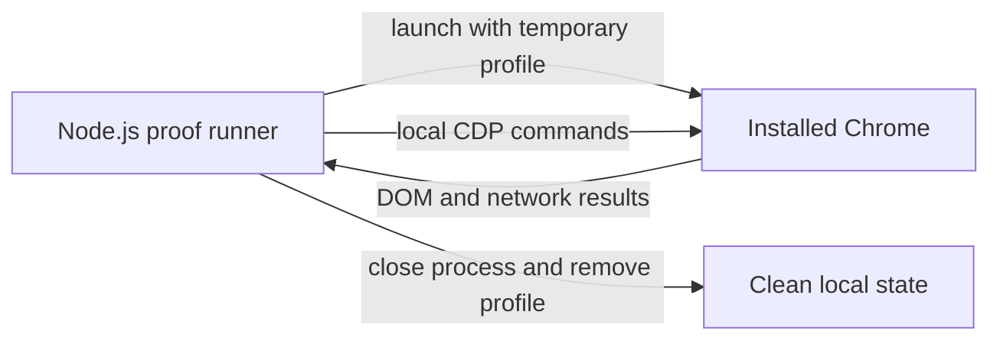

# ADR-0005 — Use installed Chrome CDP for browser proof

> Status: Accepted
> Date: 2026-11-04
> Audited: 2026-11-04
> Layer: L4
> Context ticket: #159
> Forks: chrome-l4, chrome-l9

## Context

The browser proof must exercise the generated page through a real browser. The Computer Use browser host is unavailable in the current environment. Installed Chrome and Node.js are available. The production resolver uses standard DOM APIs and has no browser-vendor contract. See SDD §5, §9b, §10, and §14.

## Decision

Start the installed Chrome binary with an isolated temporary profile and a local Chrome DevTools Protocol endpoint. Use Node.js built-in HTTP and WebSocket clients to control it. Download no browser and add no browser-automation framework. Close the launched process and remove the temporary profile after every result. Preserve command and protocol diagnostics on failure.

## Alternatives Considered

| Alternative | Pros | Cons | Reason rejected |
|-------------|------|------|-----------------|
| Installed Chrome through local CDP | Uses available software; exercises a real browser; adds no framework | The runner must manage protocol messages and cleanup | Accepted by the developer in the Chrome design round. |
| Computer Use browser host | Uses the interactive browser integration | The host is unavailable and cannot attach to the browser | It cannot provide the required proof in this environment. |
| Downloaded browser with an automation framework | Provides a higher-level API | Adds a framework and browser download for one focused proof | The added dependency is not needed for the required assertions. |

## Consequences

- **Positive** — The proof can run through the installed browser without changing production interfaces.
- **Negative** — The focused runner owns Chrome launch, CDP message handling, timeout handling, and cleanup.
- **Follow-ups** — Update the browser fixture instructions and run the full assertion set and performance budgets through this path.
