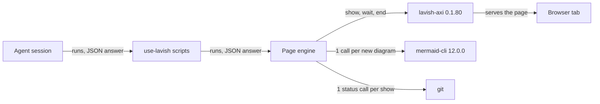
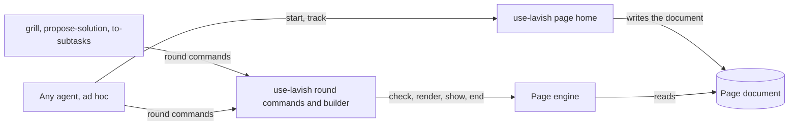
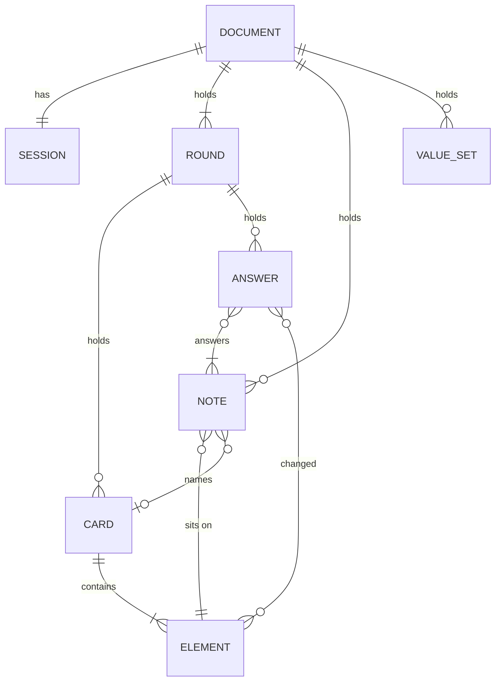
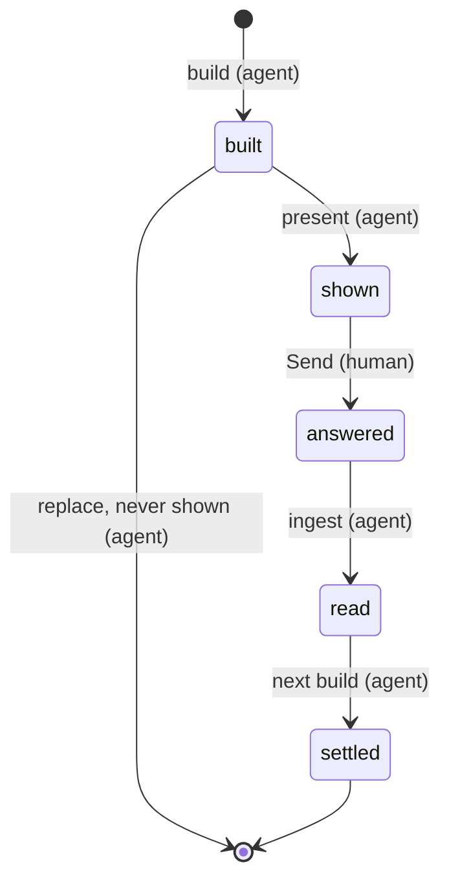
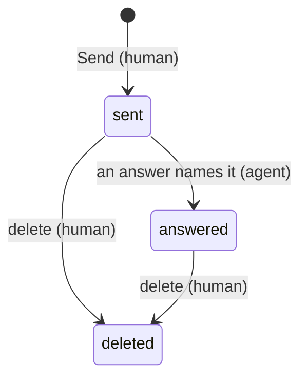
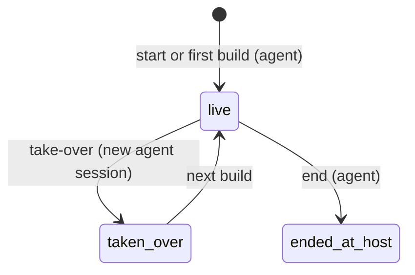
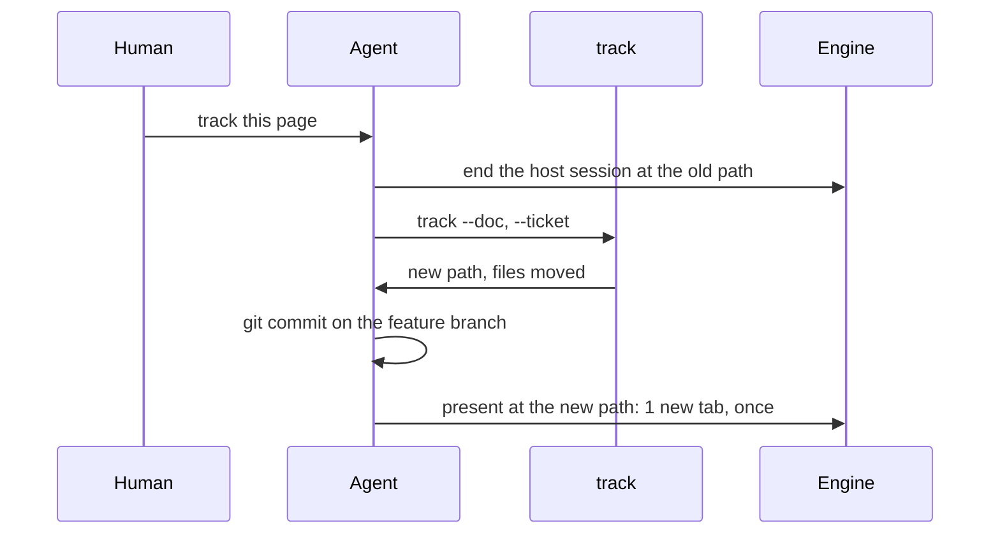
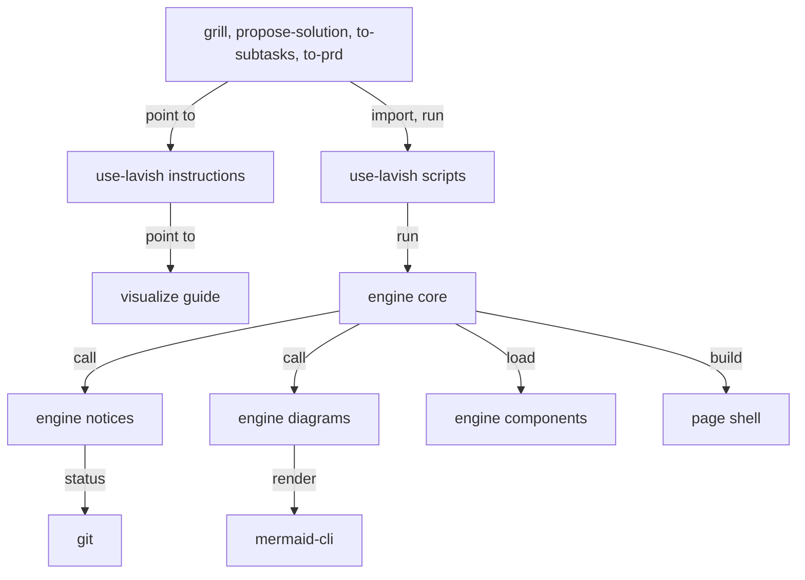

# SDD — #163 use-lavish: how an agent writes a page and answers the human's notes

> Parent PRD: `PRD.md`
> Status: Draft
> Last updated: 2026-11-04

## §0 Binding Contract

This SDD and its accepted ADRs are binding on implementing agents and reviewers.

| Aspect | Locked by SDD/ADR | Executor latitude |
|--------|-------------------|-------------------|
| Pattern choice | yes | no |
| Module public interface | yes | no |
| API contract and schema | yes | no |
| Persisted schema (§4) | yes | no |
| Life cycle states and legal moves (§6) | yes | no |
| Roles per surface (§5) | yes | no |
| Transaction and idempotency strategy | yes | no |
| External-seam contract (§9b) | yes | no |
| File layout inside a named module | no | yes |
| Private helpers, internal names, control flow | no | yes |
| Test fixture structure | no | yes |

**Conflict procedure.** An executor finds a binding decision wrong, infeasible or against reality. A two-way-door correction is recorded in `plan/DECISIONS.md` and built. A one-way door or a tie parks the subtask and returns to `/afkv2:propose-solution` for a new ADR that supersedes the old one. Never override off the record.

**Human sign-off register.** One row per human-locked aspect (`DRAFT.md`).

| Aspect | Section | Status | Signed by / date | Approved wording |
|--------|---------|--------|------------------|------------------|
| HL-1 Persistence and entity design | §4 | signed | owner / 2026-11-04 | sign mark on card s-hl1, round 2 of session s-20261104-064550, no note: the 4 field tables and the rules of page format 1, as §4 states them |
| HL-2 API surface | §3 | signed | owner / 2026-11-04 | sign mark on card s-hl2, round 2 of session s-20261104-064550, no note: the 11 surface rows, as §3 states them |
| HL-3 Authorization and data scoping | §5 | signed | owner / 2026-11-04 | sign mark on card s-hl3, round 2 of session s-20261104-064550, no note: the 5 actions with their permitted and denied roles and guards, as §5 states them |
| HL-4 Life cycle and invariants | §6 | signed | owner / 2026-11-04 | sign mark on card s-hl4, round 2 of session s-20261104-064550, no note: the 4 life cycles and the 7 rules, as §6 states them |
| HL-5 Irreversible and outward side effects | §7 | signed | owner / 2026-11-04 | sign mark on card s-hl5, round 2 of session s-20261104-064550, no note: the 4 effects, as §7 states them |
| HL-6 Change to existing behaviour | §14 | signed | owner / 2026-11-04 | sign mark on card s-hl6, round 2 of session s-20261104-064550, no note: the 6 groups that see a difference, as §14 states them |

## §1 Context Summary

Pages that afkv2 skills write are hard to follow, note answers depend on luck, and only 3 afk steps can open a page. The PRD fixes the quality bar in instructions (the use-lavish skill) and adds engine abilities. This revision follows the merge of the base branch, which already gives each annotation its own note and reuses the page's tab (PR #167); the owner signed every aspect again in session s-20261104-064550. This design says where the round commands live, what page format 1 stores, how the engine draws the new forms, how a page finds its home and reports its git state, and how old pages keep working. The owner's ruling binds every layer: instructions carry the quality bar, and code only warns, never blocks (requirement ADR-0001).

## §2 L1 — System Topology

Inherited from the afkv2 plugin: the agent runs the plugin's Python scripts on the developer's machine, the scripts call the page host lavish-axi 0.1.80, and the host serves the page to the browser. Two local programs join, started by the engine: the diagram renderer mermaid-cli 12.0.0 and git. Nothing reaches a network (card l1-topology).



*One machine, 5 local parts; the only new edges are the renderer and git.*

## §3 L2 — Service Boundaries & Integration

The page skills (grill, propose-solution, to-subtasks) and any ad-hoc agent call the use-lavish scripts. The use-lavish scripts are the only callers of the engine. The engine alone talks to the host, the renderer and git. Every call is a program run that answers one JSON object: `{"ok": true, ...}` or `{"ok": false, "error": {"code", "reason"}}` (card l2-bounds).



*Page skills never call the engine; one shared home holds the round commands.*

```mermaid
sequenceDiagram
  participant A as Agent
  participant P as present
  participant E as Engine
  participant G as git
  participant H as Page host
  A->>P: present, with the files to scan
  P->>E: check
  P->>E: render with notices
  E->>G: status of the page and the scanned files
  E->>E: secret scan; render new diagrams through the cache
  E->>E: write the page, notices in the header
  P->>H: show: reuse the open tab, as on the base
  P->>A: git state, secret hits, diagram counts
```

*One show runs check, notices, render and show; the answer tells the agent what to say in chat.*

**Surface contracts** (HL-2, card s-hl2). "As today" means the contract in the grill skill's round commands at the parent commit.

| Surface | Input | Success answer | Refusals | Repeat | Existing callers |
|---------|-------|----------------|----------|--------|------------------|
| present (use-lavish) | `--doc`; `--scan <file>`, repeatable | `page`, `tab` (reused, as on the base), `git_state` (one of committed, untracked, ignored, outside, unknown), `secrets` [{file, line, shape}], `diagrams` {rendered, cached, as_text} | as today: a failed `verb` of check, render or show; `round-shown` | safe: a second run shows the same page | grill, propose-solution, to-subtasks: path changes |
| wait, reply, end (use-lavish) | as today | as today | as today | as today | path changes only |
| ingest (use-lavish) | as today | as today, plus `notes`: the new note ids | as today | as today: a kept send answers once | path changes only |
| take-over (use-lavish, new) | `--doc` | `session`, `round`, `takeovers` | `unreadable` | safe: a second run in the same round adds nothing | a resuming skill |
| build (use-lavish) | as today; `--ticket` optional; round input adds `short_title` (round 1), `step`, `changed` | as today, plus `warnings`: unanswered notes, an ignored title | as today, plus `bad-link`: an id that names nothing | as today | path changes |
| apply-readings (use-lavish) | readings: a reply is {text, notes, changed}; a settle may add `changed` | as today | as today, plus `bad-link` | as today | path changes |
| start (page home, new) | `--topic`; `--ticket`; `--private` | `doc`, `session`, `raw_file`, `home` (spec or data) | `no-topic` | a new session each run | `/afkv2:use-lavish` |
| track (page home, new) | `--doc`; `--ticket` | `doc` (the new path), `moved`: the files | `needs-ticket`; `private`: the page is marked private, so the agent says what must come out first | safe: a second run moves what is left | `/afkv2:use-lavish` |
| engine render | document; `--notices` with `--scan` files (new) | as today | as today | as today | present |
| Page format | `afkv2.page/1` (new); `afkv2.page/0` still read | — | `unknown-schema` for any other value | — | every page writer |
| Raw answer text | format 1: 1 entry per note: id line, optional quote line, the note's words | — | — | — | ingest; the Codex Stop hook passes it through |

**Raw answer text, format 1.** The first line stays `[round R-<n>]`. A mark stays `<element id> <mark>`. Each note is its own entry: a line `<element id> note <k>`, then an optional line `  on: "<noted text>"`, then the note's words on the following lines, each indented 2 spaces. The grammar has one home, the engine's prompt-lines module; ingest is its one parser. A format 0 page keeps its format 0 grammar.

**Verdict on existing callers.** Only this plugin calls these surfaces. Every caller changes in the same commit, and the old paths are removed. Checked facts: callers `afkv2/skills/propose-solution/SKILL.md:78,88,96,102,122`, `afkv2/skills/to-subtasks/SKILL.md:68,78,86,92,108`, `afkv2/skills/grill/SKILL.md:62,68,78,86,92,98,133`; the Codex Stop hook calls none of them (`afkv2/hooks/codex_stop.py:20-30`); show already reuses the open tab through a tab record (`afkv2/engine/engine.py:11-12,180-187,308-327`).

## §4 L3 — Data Architecture

| State | Datastore | Partitioning | Replication | Retention | Schema-evolution policy | PII? | Audited? |
|-------|-----------|--------------|-------------|-----------|-------------------------|------|----------|
| Page document of a ticket | JSON file in the ticket's spec folder, `pages/` | 1 file per session | git, when committed | with the repository | the `schema` value; one reader per format | no, by the home rule | the grill log and git history |
| Ad-hoc page with no ticket, or private | JSON file in the afkv2 data folder, `pages/<repository name>/` | 1 file per session | none | until the developer deletes it | as above | may hold private content | no |
| Rendered page | HTML file beside its document | 1 per document | as its document | rewritten each render | derived | as its document | no |
| Rendered diagram | SVG file in the data folder, `diagram-cache/`, named by a hash of the text, the theme and the renderer version | 1 per text and theme | none | until the developer deletes it | a new renderer version makes new names | no | no |
| Last notices of a page | JSON file in the data folder, `page-notices/`, named by a hash of the page path | 1 per page | none | overwritten each show | derived | no; a secret hit holds file, line and shape, never the value | no |
| Copies of settled rounds | data folder, `page-copies/` | as today | as today | as today | as today | no | no |
| Tab record of a page | data folder, `page-tabs/`, as on the base | 1 per page | none | while a tab shows the page; forgotten on end or when the host reports the browser left | as on the base | no | no |

The data folder is the afkv2 folder under the local application data, where the settled-round copies already live (card l3-data).

**Page document, format 1** (HL-1, card s-hl1). The format 1 schema file holds these tables word for word.

Session:

| Field | Type | Null? | Default | Unit / precision | Constraint | Indexed / unique | Note |
|-------|------|-------|---------|------------------|------------|------------------|------|
| id, feature, started, links | as format 0 | as format 0 | as format 0 | as format 0 | as format 0 | id unique per pages folder | kept |
| skill | text | no | — | — | a page writer's name: grill, propose-solution, to-subtasks, use-lavish | — | was 1 of 3 names |
| ticket | text | yes | none | — | the ticket key; none on an ad-hoc page with no ticket | — | was required |
| short_title | text | yes, on an upgraded format 0 page | none | 40 characters at most | written in round 1, never changed | — | new |
| step | text | no | — | 40 characters at most | grill: Requirements grill; propose-solution: Solution design; to-subtasks: Plan approval; ad hoc: the topic | — | new |
| private | true or false | no | false | — | true: the content is not for the repository's readers | — | new |
| takeovers | list of {round, at} | no | empty | at: ISO-8601 UTC | 1 entry per new session that took the page over | — | new |

Note (one list for the whole session, card a-entities, [ADR-0001](adr/design/0001-notes-in-one-session-list.md)):

| Field | Type | Null? | Default | Unit / precision | Constraint | Indexed / unique | Note |
|-------|------|-------|---------|------------------|------------|------------------|------|
| id | text | no | — | — | a card note `N-<round>-<card>-<k>`, a steer `N-<round>-<target>-<k>`, k = 1, 2, … in send order; an older merged id `N-<round>-<card>` stays valid | unique in the document | the base's form, one rule for both formats |
| round | number | no | — | — | the round it was sent in | — | kept |
| target | element id | no | — | — | the element it sits on | — | kept |
| item | card id | yes | none | — | the card that holds the element; none for a steer | — | new |
| quote | text | yes | none | 300 characters at most | the text the human selected, apart from their words | — | new |
| text | text | no | — | — | the human's words only | — | changed: no quote inside |
| deleted | true or false | no | false | — | the human deleted it | — | kept |

Answer (in `rounds[].replies`):

| Field | Type | Null? | Default | Unit / precision | Constraint | Indexed / unique | Note |
|-------|------|-------|---------|------------------|------------|------------------|------|
| id | text | no | — | — | `A-<round>-<k>` | unique in the document | new |
| text | text | no | — | — | the answer | — | kept |
| notes | list of note ids | no | — | — | 1 or more; the answer shows in each note's row | — | new |
| changed | list of element ids | no | empty | — | each element the answer changed; each gets a link | — | new |
| about | text | yes | none | — | read on format 0 pages only | — | kept for format 0 |

Other parts:

| Part | Change |
|------|--------|
| Document | `schema` is `afkv2.page/1`; adds `notes` (one list for the session) and `value_sets`: {name: {values, ordered}} |
| Round | adds `changed`: the element ids the agent changed this round; loses `notes` (they move to the session list) |
| Card | loses `notes` (they move to the session list) |
| Component | adds `tip`: text, 300 characters at most; 13 new types: tile, bars, line, bullet, range, signed-bars, box-plot, flame, sparkline, waterfall, diagram, code, diff |
| Graph node, map node, run-strip step, sequence message | add `tip` and `you` (true or false); a sequence message adds `tone`: removed, kept or new |
| Chip | adds `set`, and the tones open, blocked, settled, measured, inferred, estimated, unverified, you |

| Relation | Target | Cardinality | Owning side | On delete / orphan | Fetch posture |
|----------|--------|-------------|-------------|--------------------|---------------|
| note → element | card, component or map node | many to 1 | note | a note is only marked deleted; an element is never removed | the page is read whole |
| note → card | card | many to 0..1 | note | as above | read whole |
| answer → note | note | many to many, each answer 1 or more | answer | the answer stays when its note is marked deleted | read whole |
| answer → element | element | many to many, 0 or more | answer | none | read whole |
| card → card (carries) | earlier card | many to many | the newer card | none | read whole |
| chip → value set | value set | many to 1 | chip | none | read whole |

**Indexes:** none; a page is read whole. **Surface reachability:** the fields reach 3 surfaces: the rendered page (title, notes table, answer links, round marks, notices), the ingest answer (`notes`) and the grill log rows the skills write from notes. No other surface exposes the document.

**Migration and backfill** (card a-migration, [ADR-0002](adr/design/0002-old-pages-move-to-format-1-at-their-next-round.md)). Opening or rendering a format 0 page never rewrites it. The format 0 reader turns it into format 1 in memory: card notes and steers move into the session list with their ids as they are, in either id form, the noted text still inside their words; an answer with only `about` keeps it and is paired the format 0 way; `short_title` is none, so the title uses the feature name. A live format 0 session writes format 1 at its next round. It cannot go back to an older plugin, and that is accepted.



*Notes leave the cards and rounds for one session list; an answer links its notes and changes by id.*

## §5 L4 — Cross-Cutting & Quality Attributes

**Authorization and data scoping** (HL-3, card s-hl3). By the owner's ruling, no code refuses a writer. The page runs on the developer's machine only, so no guard sits above or below the page beyond the host.

| Surface | Permitted roles | Denied roles | Guard above the page | Guard below the page |
|---------|-----------------|--------------|----------------------|----------------------|
| Write a page | an agent session with a human at the page | a hands-off subagent: it parks the question | use-lavish instructions; 1 line in the hands-off brief | none |
| Answer the notes | the session that owns the page, or a new session that took over a page whose session ended | a second live session on the same page | use-lavish instructions; the take-over record | none |
| Read and answer a page | the human, at the page host on their machine | a person who opens the file with no host session: they read, their notes reach no agent | the page host | none |
| Start an ad-hoc page by command | the human, with `/afkv2:use-lavish` and a topic | an agent with no topic: it asks in chat | the start command refuses `no-topic` | none |
| Put content on a page in the repository | content the repository's readers may see | secrets; private content | a secret warning at each show; the home rule; use-lavish instructions for content with no shape | none |

**Data scoping.** A page in the repository holds only what its readers may see. A page with no ticket, or marked private, lives in the data folder (requirement ADR-0002).

| Concern | Posture or number |
|---------|-------------------|
| Secret scan | about 10 shapes (cloud keys, forge tokens, chat tokens, private-key blocks, signed web tokens, passwords inside web addresses), copied from the v1 report-issue redactor; run on each show over the page document and each `--scan` file inside the repository and not ignored; warns on the page and in the present answer, never blocks; reports file, line and shape, never the value; no model, no network |
| Git state | 1 git status call per show covering the page and the scanned files, 10 s timeout; tracked (clean or changed) reads committed; a failure reads unknown and skips the scan; the round still shows |
| Diagram render | 60 s timeout per diagram and theme, no retry; a failure shows the text with 1 line saying why |
| Idempotency | present, take-over, start and track give the same result when run twice; ingest answers a kept send once, as today |
| Retry | none automatic; every failure falls back and the next show tries again |
| Rate limit | none: one human, one machine |
| Feature flags | none: format 1 is the only format new pages get |
| Observability | present answers the git state, each secret hit, the count of diagrams rendered, cached and shown as text, and, as on the base, whether the tab was reused |

Secrets: the feature handles none; the scan only warns about secret-shaped values.

## §6 L5 — Domain Model

| Invariant | Owner | Guardian | Answer to a violation |
|-----------|-------|----------|-----------------------|
| Every id is unique in the document | engine | engine check | the build is refused before the human sees the round |
| One current round; a settled round never changes | engine | engine check and the settled-round copies | refused |
| An answer's note ids, changed ids and card links name real elements | engine | engine check | refused with `bad-link` |
| The short title stays the same | builder | the builder writes it in round 1 only | a later title is ignored, with a warning |
| Every note has an answer before the next round | builder | the builder | a warning; the round still builds |
| One live writer per page | use-lavish | use-lavish instructions; the take-over record | none in code |
| A hands-off agent opens no page | use-lavish | use-lavish instructions and 1 line in the hands-off brief | none in code |

*7 rules (card l5-domain): 3 refused by the check, 2 warned by the builder, 2 held by instructions.*

Life cycles (HL-4, card s-hl4). "Answered" is read from the answers, never stored. A takeover is an event in the session's list.



*A round: 5 states, unchanged.*



*A note: "answered" is derived from the answers.*



*A session: a takeover is recorded, an end lives at the host.*

Card states stay as today: open, blocked, needs reading, settled by mark or by note.

Domain events: none.

## §7 L6 — Process & Coordination

**Show a round.** The diagram in §3 is the flow. No transaction spans files: each write is an atomic replace of one file, and the last writer wins, as today.

**Start an ad-hoc page.**

```mermaid
sequenceDiagram
  participant H as Human
  participant A as Agent
  participant S as start
  participant P as present
  H->>A: /afkv2:use-lavish and a topic
  A->>S: start --topic, --ticket if any, --private if the content is not for the repository's readers
  S->>A: doc path by the home rule, session id
  A->>A: build round 1 with a short title and the topic as step
  A->>P: present
  P->>A: git state; the agent says in chat when git does not track the page
```

*The home rule picks the folder; the notice tells the human what gets committed.*

**Track a page.**



*One move of the page and its side files, then one commit the human asked for.*

**Take over a page.** A resuming skill finds its page open (its start answers resume), runs take-over, writes a takeover row in its log, and answers every note that has no answer.

| Failure point | Detection signal | Automatic recovery | Manual recovery | Owner |
|---------------|------------------|--------------------|-----------------|-------|
| Diagram renderer missing, fails or times out | renderer exit, 60 s | the diagram shows as text, with why | run `/afkv2:setup` | engine |
| git missing or fails | exit, 10 s | an "unknown" git-state line; no scan | none needed | engine |
| The human closed the tab | the host reports the browser left (unverified-external, acknowledged) | the tab record is forgotten; the next show opens a tab | when no report comes, the human opens the page again from the host | engine |
| A track move stops halfway | track answers what moved | a re-run moves the rest | the agent commits | use-lavish |
| A session dies mid-round | a new session finds the page open | none | the new session takes over and answers the open notes | agent |

**Outward effects** (HL-5, card s-hl5). Only the commit reaches the repository's history, and only when the human asks to track a page. Nothing is pushed.

| Effect | Trigger | Order against the local writes | Idempotency key | Partial failure leaves | Recovery |
|--------|---------|--------------------------------|-----------------|------------------------|----------|
| Commit a tracked page | the human asks to track a page | end the old host session; move the page and its side files; the agent commits them on the feature branch | the page's session id: a moved page is skipped | files moved but not committed: the notice says "not committed yet" | the agent commits |
| Open the page in the browser | present | after check and render | the page path and its tab record | no tab open | the host reports the browser left and the next show opens a tab; without that report, the human opens the page from the host |
| Write a rendered diagram | a render meets a new diagram text | before the page renders | hash of text, theme and renderer version | no file: the diagram shows as text | the next render tries again |
| Write the page notices | present | after the git call and the scan | the page path | the last notices stay | the next show |

## §8 L7 — Module Decomposition



*One direction, no cycle: page skills, then use-lavish, then the engine, then the local programs (card l7-modules, [ADR-0004](adr/design/0004-shared-page-code-lives-in-use-lavish.md)).*

| Module | Purpose | Public interface | Depends on |
|--------|---------|------------------|------------|
| use-lavish skill: instructions | page rules, answer rules, forms by kind, page or chat | the skill text other skills point to | visualize |
| use-lavish scripts | round commands, round builder, shared helpers, page home | the commands in §3 | engine |
| engine core | check, render, show, end; the format 0 reader that upgrades to format 1; ingest | the engine verbs; the page format | local programs |
| engine notices (new) | git state and secret scan | 1 function: the notices of a page | git |
| engine diagrams (new) | render diagram text through the cache | 1 function: the picture or the text of a diagram | mermaid-cli |
| engine components | 1 module per component, 13 new | the component types of the format | engine core |
| page shell | title, navigation, back, map clicks, round marks, tones, highlighter | the rendered page | engine core |
| grill, propose-solution, to-subtasks, to-prd | their own steps | unchanged | use-lavish scripts |
| visualize | how each component holds, looks and is used | the component pages | none |

## §9 L8 — Tactical Patterns

| Concern | Pattern | ADR |
|---------|---------|-----|
| New charts (10 forms) | the engine draws each as inline SVG in Python, from theme tokens; beat a chart library in the page (200 KB or more, no test in Python) | [ADR-0005](adr/design/0005-engine-draws-charts-as-inline-svg.md) |
| Diagram text | render with the installed renderer once per text and theme, cache by hash; 2 themes, the page shows the one it uses; beat rendering in the browser (about 3 MB of script) | [ADR-0006](adr/design/0006-diagram-text-rendered-once-and-cached.md) |
| Code blocks and diffs | highlight.js 11.12.0, copied into the plugin, inlined only on a page with code (fork l8-highlight); beat Pygments in the engine | [ADR-0003](adr/design/0003-highlight-js-colours-code-in-the-page.md) |
| Format 0 pages | one reader turns format 0 into format 1 in memory; one write path (fork a-migration); beat 2 write paths | [ADR-0002](adr/design/0002-old-pages-move-to-format-1-at-their-next-round.md) |
| Where notes live | one list for the session (fork a-entities); beat notes on their cards | [ADR-0001](adr/design/0001-notes-in-one-session-list.md) |
| What changed this round | the agent lists the changed elements in the round and in its answers; the banner list and the round marks are drawn from those lists; beat an engine comparison of rounds, which cannot match parts because new cards have new ids | — |
| Back after a jump | the page keeps its own list of the last 20 places, kept across reloads the way folds are kept today; beat browser history, which the host's sandboxed frame does not own (inferred) | — |
| Value colours | one list per named set in the document; colour by position; ordered sets run strong to faint; YOU has one fixed strong colour; beat a colour per chip | — |
| Tab reuse | built on the base: a tab record and a show with no new window while it stands; this design keeps it as it is | — |

*Each pattern names the runner-up it beat (card l8-patterns).*

## §9b External Seams & Failure Affordance

| Boundary | Framework at its pin | What it does to our value | Failure surface | Seam test |
|----------|----------------------|---------------------------|-----------------|-----------|
| Page host | lavish-axi 0.1.80 | serves the HTML; keys a session by the file path; a show with no new window opens none; reloads an open tab when the file changes, keeping unsent annotation text | a closed tab stays closed; the engine keeps a tab record per page (`afkv2/engine/engine.py:180-187`) and forgets it when the host reports the browser left (unverified-external, acknowledged) | live: show a page twice: one tab, reloaded with the new round; close the tab, show again: one new tab |
| Diagram renderer | mermaid-cli 12.0.0, pinned by setup | turns diagram text into SVG; the SVG id must be set per diagram, or 2 diagrams on one page share one id | missing, exit code, 60 s timeout: the text shows with why | render a page with 2 diagrams; 2 distinct SVG ids; with no renderer on the path, the text block shows and the render succeeds |
| Code highlighter | highlight.js 11.12.0, copied into the plugin | colours code by language in the browser; leaves the text unchanged | an unknown language shows uncoloured | render a page with code: the library and its 2 themes are inlined once; a page with no code holds none; a browser check shows coloured spans |
| git | the developer's git | answers the status of the page and the scanned files | missing, exit, 10 s timeout: an unknown line, no scan | in a throwaway repository: 1 test per state (committed, untracked, ignored, outside) |

Source of truth per field: the page document for every page field; git for the git state; the renderer for the picture of a diagram text; the host for marks and notes until ingest writes them. Every invariant's enforcement point is in §6.

## §10 NFRs

| Concern | Target | Measurement | Owner |
|---------|--------|-------------|-------|
| Render time | 2 s at most for a 1 MB page with no new diagram | a test renders a 1 MB made-up page; today 0.4 to 1.2 s for 622 KB (measured) | engine |
| Diagram render | 0 s for a diagram whose text, theme and renderer did not change | a test renders the same page twice and counts renderer calls: 0 the second time | engine |
| Secret scan | 60 ms at most for 2 MB of scanned files | a test times the scan; today 5.3 ms per 182 KB and 52 ms per 1.8 MB (measured) | engine |
| Git calls | 1 per show | a test counts the calls | engine |
| Page weight | the highlighter adds 132 KB at most, on pages with code only; 0 bytes on others | a render test reads the page size with and without code | engine |
| Blocking | 0 refusals for a page rule, an answer rule, a secret or a git failure | render and present tests for each case | engine, use-lavish |

## §11 Out of Scope

- The grill's glossary rule falls back to the v1 root glossary when no glossary map exists: a grill skill defect with its own ticket.
- Goals and non-goals, open questions, quality requirements and always-or-never guarantees as kinds with a suggested form: the agent picks a form.
- Engine checks that force the page rules or the answer rules: ruled out by the owner.
- Engine detection of private content with no secret shape: an instruction to the agent.
- Deleting ad-hoc pages or the 2 caches in the data folder: nothing deletes them in this ticket.
- A lock against a second live session on one page: instructions only, by the ruling.
- A light theme switch for the page: the tokens and the 2 diagram themes exist; choosing the theme stays as today.

## §12 Reversed Decisions

| Prior ADR | Superseded by | Reason |
|-----------|---------------|--------|
| None | — | — |

## §13 Open Questions

| Question | Layer (L1-L9) | Blocks executor? | Owner | Target resolve date |
|----------|---------------|------------------|-------|---------------------|
| None | — | no | — | — |

## §14 L9 — Implementation Seams & Change Impact

Each row was checked against the code at the parent commit by the readers of this session (card l9-seams).

| Seam | Existing contract | Planned change | Impacted flows | Conventions and landmines | Verdict |
|------|-------------------|----------------|----------------|---------------------------|---------|
| Page format | `afkv2.page/0`, frozen; the engine picks a reader by the schema value (`afkv2/engine/schema/page-v0.schema.json:5`, `afkv2/engine/engine.py:48,60,71-74`) | a new value `afkv2.page/1` with its own schema file and reader; the builder stops pinning format 0 (`afkv2/skills/grill/scripts/round_document.py:23,355-356`) | every page | the validator supports few schema keywords (`afkv2/engine/schema/validate.py:11-13`): a length or count rule may need a check in the invariants | extends ([ADR-0002](adr/design/0002-old-pages-move-to-format-1-at-their-next-round.md)) |
| Where a page may live | only `<spec folder>/<ticket>/pages/<skill>-<id>.json`, ticket required, 3 skill names (`afkv2/engine/engine.py:237-254`, `afkv2/engine/schema/page-v0.schema.json:21-26`) | also the data folder's `pages/<repository name>/` for ad-hoc pages; ticket optional; use-lavish and to-subtasks as skill names | ad-hoc pages; to-subtasks pages | tests point the local application data at a temp folder (`afkv2/tests/conftest.py:8-10`) | extends |
| Notes from the host | since the merge, 1 note per annotation, ids by the note rule module, the noted text inside the words as `(on: "…")`, notes on cards and rounds (`afkv2/engine/schema/note_rules.py:1-33`, `afkv2/engine/prompt_lines.py:115`) | one session list; the noted text in its own field; the same id rule ([ADR-0001](adr/design/0001-notes-in-one-session-list.md)) | ingest, the grill log rows (`afkv2/skills/grill/scripts/grill_log.py:120-122,164-165`) | the needs-reading and conflict logic counts notes per card (`afkv2/engine/ingest.py:52,188,215,231`) | reworked |
| Session notes table | shows only notes on no card; folds rounds older than the one before (`afkv2/engine/components/notes_replies.py:20,218-242`) | every note, newest round first, a Noted text column, older rounds as closed groups with a count line | every page | row ids today per note (`afkv2/engine/components/notes_replies.py:168`) | reworked |
| Answer pairing | `about` is a list; an answer pairs with a note whose target, card or note id it holds (`afkv2/engine/components/notes_replies.py:99-109`) | by note ids; `about` read for format 0 only | every page | — | reworked |
| Page title | `<ticket> · <feature> · <skill> R-<n>`, new each round (`afkv2/engine/shell/page.py:142-147`) | `<ticket> · <short title> · <step>`, the same every round | every page | — | reworked |
| Navigation | fixed at the top right over the content (`afkv2/engine/shell/tips.css:9-14`) | the left margin on a wide window; a button on a narrow one; the collapsed state kept | every page | the jump button and the btw? button share the bottom-left corner today (`afkv2/engine/shell/tips.css:26-27`, `afkv2/engine/shell/btw.css:119-120`) | reworked |
| Round commands and shared helpers | in the grill skill's scripts; 13 scripts import the helpers (`afkv2/skills/grill/scripts/grill_common.py:12`) | in the use-lavish skill's scripts; every importer and the 3 skills repointed ([ADR-0004](adr/design/0004-shared-page-code-lives-in-use-lavish.md)) | grill, propose-solution, to-subtasks, to-prd | every Python file name must be unique, so no copy stays (`afkv2/tests/test_module_names.py:9-23`); Codex runs only skill scripts and the engine (`afkv2/skills/setup/scripts/setup.py:470-477`); the helpers find the plugin root by file depth, which stays the same | reworked |
| visualize guide | holds the round pass and the answer rules (`afkv2/skills/visualize/components/card.md:28-63`, `afkv2/skills/visualize/components/notes-and-replies.md:16-29`) | they move to use-lavish; the text that groups notes or repeats a steer goes (`afkv2/skills/visualize/components/notes-and-replies.md:19-20,26-27`, `afkv2/skills/grill/SKILL.md:106`) | every page skill | tests pin the moving text word for word (`afkv2/tests/skills/test_visualize.py:648-695,774-780`); the grill's test allows only 4 skill names in its pointers (`afkv2/tests/skills/test_grill.py:173`) | reworked |
| Diagram renderer install | no version pin (`afkv2/skills/setup/scripts/tools.py:23-25,291`) | pinned at 12.0.0 | setup | with no Edge, setup installs nothing (`afkv2/skills/setup/scripts/tools.py:284-287`): the text fallback covers that machine | extends |
| Hands-off brief | "This prompt is all you get from the run." (`afkv2/skills/autopilot/scripts/walk.py:137-147`) | adds 1 line: no human reads a page | autopilot executors | — | extends |
| Log rows of a takeover | the grill and design logs have fixed row kinds (`afkv2/skills/propose-solution/scripts/design_files.py:26`; the grill log format) | each skill that writes a log gains a Takeover row kind, written after take-over | grill, propose-solution resume | a row kind lives in the skill's log format and its row command together | extends |

**Change to existing behaviour** (HL-6, card s-hl6):

| Who sees it | What changes | Compatible? | Rollback |
|-------------|--------------|-------------|----------|
| The human, on every afk page | a stable title; navigation in the left margin; every note in the session table, each in its own row; links to what an answer changed (one note per annotation and tab reuse are already on the base) | yes: same marks, same Send | revert the change; format 1 pages then no longer open |
| The grill, design and plan skills | call the round commands at the use-lavish path; point to use-lavish for page order and answers; the grill stops repeating a steer in its answer | yes, in the same commit | revert the commit |
| to-subtasks pages | their skill name becomes to-subtasks, step Plan approval (today they say propose-solution, `afkv2/skills/to-subtasks/scripts/plan_files.py:35-37`) | yes | revert |
| Live format 0 pages | move to format 1 at their next round | one way | none for a page already moved |
| Setup | pins mermaid-cli at 12.0.0 | yes: 12.0.0 is the installed version | remove the pin |
| The hands-off executor | its brief gains 1 line | yes | remove the line |

Compatibility findings the human accepted: a format 1 page cannot go back to an older plugin (card a-migration, signed on s-hl6); a script outside this plugin that calls the grill's old command path breaks, and none was found (signed on s-hl2).
