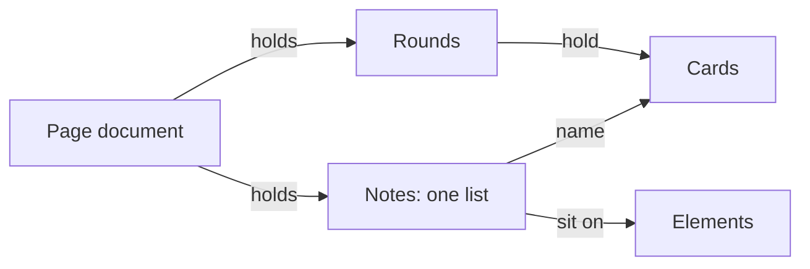

# ADR-0001 — Notes live in one list for the session

> Status: Accepted
> Date: 2026-11-04
> Layer: L3
> Context ticket: 163
> Forks: a-entities

## Context

Format 0 keeps a card's notes on the card and a steer on its round. A note on a card of an earlier round rewrites that settled round, and the engine saves the settled copy again to allow it. Page format 1 must give each annotation its own note and row, and one session notes table must list every note (SDD §4, §14).

## Decision

The page document holds one list of notes for the whole session. Each note names its round, its element and, when it sits on one, its card. A card finds its notes by id when the page renders. No note write touches a round.

## Alternatives Considered

| Alternative | Pros | Cons | Reason rejected |
|-------------|------|------|-----------------|
| Notes on their cards, as today | smallest change | a note on an old card still rewrites a settled round; the session table gathers notes from every card | the owner picked one list, card a-entities, round 1 |

## Consequences

- **Positive** — the session notes table reads one list as it is; a settled round is never rewritten for a note.
- **Negative** — each card looks its notes up at render: no measurable cost at 113 cards and 28 notes (inferred).
- **Follow-ups** — none.
