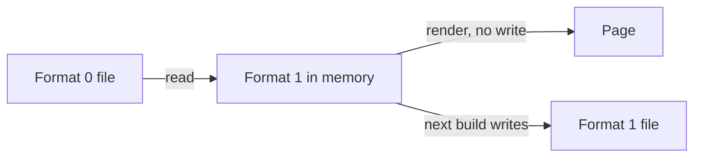

# ADR-0002 — A live format 0 session moves to format 1 at its next round

> Status: Accepted
> Date: 2026-11-04
> Layer: L3
> Context ticket: 163
> Forks: a-migration

## Context

Every format 0 page must still open and render, and opening must never rewrite it (PRD AC-042). Format 0 pages exist on this branch, and some on other branches may be live (inferred). The builder and ingest must handle a live format 0 session that builds a round after the upgrade (SDD §4 "Migration and backfill").

## Decision

One reader turns a format 0 document into format 1 in memory: card notes and steers move into the session list with their old ids, and an answer with only `about` keeps it. Render reads that form and never writes the document. The next round a live format 0 session builds writes format 1. There is one write path.

## Alternatives Considered

| Alternative | Pros | Cons | Reason rejected |
|-------------|------|------|-----------------|
| It stays format 0 until it ends | an older plugin can still read the page | 2 write paths in the builder and in ingest, the old one with notes joined | the owner picked the move, card a-migration, round 1 |
| It cannot resume | one write path, no conversion | the human sees a new page mid-session, and its open points start again | as above |

## Consequences

- **Positive** — one write path; old pages render unchanged.
- **Negative** — a page that moved cannot go back to an older plugin; its old notes keep their old ids.
- **Follow-ups** — none.
