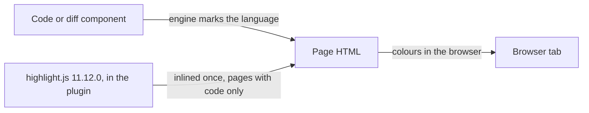

# ADR-0003 — highlight.js colours code blocks and diffs in the page

> Status: Accepted
> Date: 2026-11-04
> Layer: L8
> Context ticket: 163
> Forks: l8-highlight

## Context

Code blocks and diffs use a popular, proven highlighter library, and afkv2 builds none (PRD EG-15). The page loads nothing from a network: every script is inlined (SDD §9b). The engine uses only the Python standard library today.

## Decision

highlight.js 11.12.0 (BSD-3-Clause) is copied into the plugin at that version: its prebuilt common-language bundle of 129,254 bytes and 2 themes of about 1.3 KB each. The engine inlines it once, only on a page that holds a code or diff component. The engine marks each block with its language; the library colours it in the browser.

## Alternatives Considered

| Alternative | Pros | Cons | Reason rejected |
|-------------|------|------|-----------------|
| Pygments in the engine | colours at render; no script; a Python test sees the colours | the engine's first outside Python package; setup must install it into the developer's Python on every machine | the owner picked highlight.js, card l8-highlight, round 2 |

## Consequences

- **Positive** — no new Python dependency; 190+ languages.
- **Negative** — a Python test sees the language marks, not the colours; a browser check proves the colours. A page with code grows by about 132 KB.
- **Follow-ups** — none.
