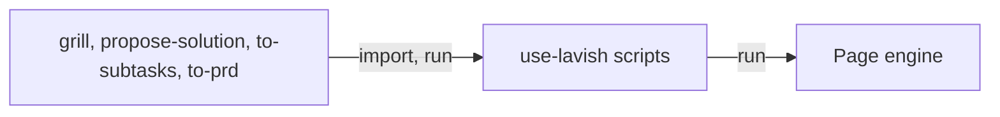

# ADR-0004 — The shared page code lives in the use-lavish skill's scripts

> Status: Accepted
> Date: 2026-11-04
> Audited: 2026-11-04
> Layer: L7
> Context ticket: 163
> Forks: none

## Context

The round commands, the round builder and the shared helpers live in the grill skill's scripts, and 13 scripts of 4 skills import them. The requirements move the round commands to one shared home that use-lavish names (card i-r7-d-commands). Codex lets the plugin run only the engine and skill scripts. Every Python file name in the tree must be unique (SDD §8, §14).

## Decision

The round commands, the round builder, the shared helpers and the page home sit in the use-lavish skill's scripts. The grill, propose-solution, to-subtasks and to-prd import and run them there. The old files are removed, with no copy. Dependencies run one way: page skills, then use-lavish, then the engine.

## Alternatives Considered

| Alternative | Pros | Cons | Reason rejected |
|-------------|------|------|-----------------|
| Keep the shared code in the grill skill | no move | every page writer depends on the grill | one fact, one home; card l7-modules |
| A shared folder outside the skills | neutral name | Codex does not run scripts outside the engine and the skills | the Codex rule |

## Consequences

- **Positive** — the grill no longer hosts code other skills import; ad-hoc pages use the same commands.
- **Negative** — 13 imports, 3 skills, their Codex live checks and the tests change in one commit.
- **Follow-ups** — none.
