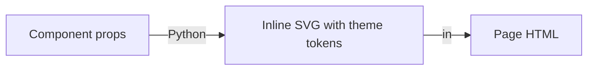

# ADR-0005 — The engine draws the 10 chart forms as inline SVG

> Status: Accepted
> Date: 2026-11-04
> Audited: 2026-11-04
> Layer: L8
> Context ticket: 163
> Forks: none

## Context

10 accepted forms need a new component: tile, bars, line chart, bullet graph, range bars, signed bars, box plot, flame graph, sparkline and span waterfall (PRD table K, EG-24). Every form follows the colour and caption rules, in both themes. The page is inlined and loads nothing from a network (SDD §9).

## Decision

Each form is one engine component that draws inline SVG in Python from its props and the theme tokens. The page gets no chart script. Each component has its own props schema, styles and render test.

## Alternatives Considered

| Alternative | Pros | Cons | Reason rejected |
|-------------|------|------|-----------------|
| A chart library inlined in the page | many forms ready | 200 KB or more per page; a Python test cannot read the chart; a colour rule per library | page weight and testability; card l8-patterns |

## Consequences

- **Positive** — every chart is testable from the HTML; no new dependency.
- **Negative** — afkv2 owns 10 small renderers.
- **Follow-ups** — none.
