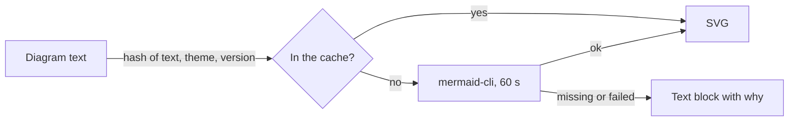

# ADR-0006 — Diagram text renders once per text and theme, through a cache

> Status: Accepted
> Date: 2026-11-04
> Audited: 2026-11-04
> Layer: L8
> Context ticket: 163
> Forks: none

## Context

One diagram-text component (Mermaid) draws the "diagram text" kinds with the renderer setup installs, and renders a diagram again only when its text changes (PRD EG-13, AC-031 to AC-033). One render takes 3.7 to 6.1 s. With no renderer, the page must still render (SDD §9b).

## Decision

The engine renders each diagram text into SVG with mermaid-cli 12.0.0, pinned by setup. It renders once per theme (dark and default), with a distinct SVG id per diagram and theme. It keeps each picture in the data folder's diagram cache, named by a hash of the text, the theme and the renderer version. The page shows the picture of the theme it uses. A missing renderer, a failure or a 60 s timeout shows the text as a code block, with 1 line that says why.

## Alternatives Considered

| Alternative | Pros | Cons | Reason rejected |
|-------------|------|------|-----------------|
| Render in the browser with the Mermaid library | no renderer install | about 3 MB of script per page; against the PRD's renderer decision | page weight; card l8-patterns |
| Render 1 theme only | half the first renders | wrong colours in the other theme | the colour rules hold in both themes |

## Consequences

- **Positive** — an unchanged diagram costs 0 s; a machine with no renderer still gets its page.
- **Negative** — a new diagram costs 2 renders the first time; the cache grows until the developer deletes it.
- **Follow-ups** — none.
