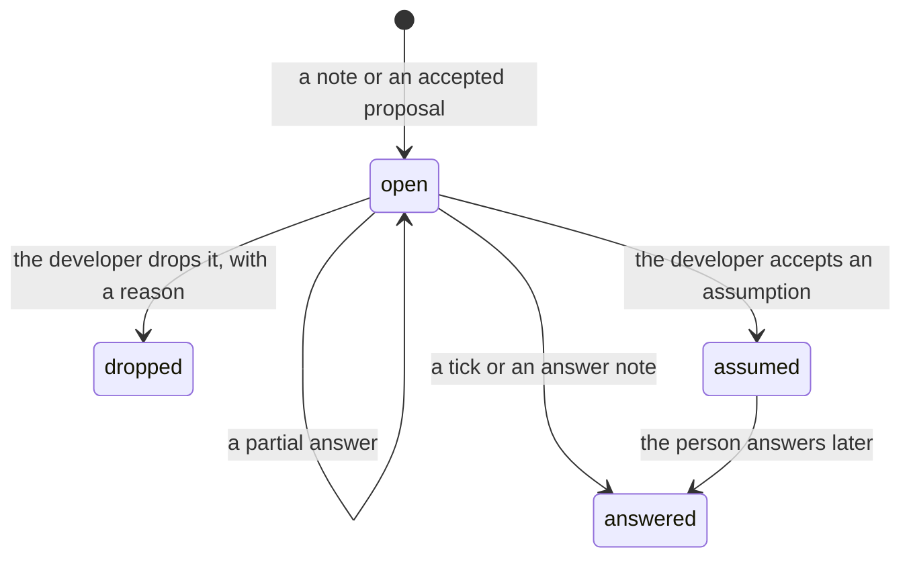

# PRD — Living page sections and questions for others (#174)

## Problem Statement

A grill is rarely linear: the developer thinks about many parts of a feature at once, and needs a page where every thought has a place. Today's page is built around one round of questions, so 5 pains follow:

- **Lost picture.** The page shows this round's questions; the state of the whole topic drops out of view as rounds pass.
- **Lost thoughts.** A thought about another part of the topic, or one already passed, has no natural place, so it gets forgotten.
- **Lost trajectory.** Older changes fold away, so the path the conversation took is hard to follow and to audit.
- **Questions only others can answer.** When the developer cannot answer a point, nothing records the question, its context and who must answer it.
- **Outsiders cannot read the page.** Round codes, card ids and internal decisions confuse a product owner, a tester or a director on a shared screen.

In the developer's words: "I need a page where I can freely note, steer everything. that's the only way that I can dump my thinking to the agents most completely and effectively."

## Solution

A page becomes a document of the whole topic, from the overview down to the detail, kept current every round. Each part of the topic has a section; the round's questions sit in one block on top; worked examples are a standing section. The developer annotates anything at any time; the agent reads each note for everything it says and answers each note on its own. Every section shows its own changes, round by round, with their cause.

> Amended 2026-11-10 (#185): the round's questions now sit last, above the settled points. The page skill `afkv2/skills/use-lavish/SKILL.md` owns the order.

The grill gains questions for others: points that neither the developer nor the code can settle. They live in one section of the grill page, written for people outside the session, with a filter by who to ask. The developer shares the screen in a meeting, ticks or writes the answers, and the agent brings their effect back as points to confirm. The grill cannot end while such a question is open, unless the developer accepts an assumption for it. A finished grill can be called again when new facts arrive, and it continues from where it ended.

The content of a session is the same with or without a page: the page only lays it out and adds pictures.

## Catalog

The parts of a question for others:

| Id | Part | Content |
|----|------|---------|
| QP-1 | Who to ask | 1 or more roles (product owner, tester, director, another team), or everyone |
| QP-2 | The question | 1 sentence the person can answer |
| QP-3 | Context | what the feature is about, only as much as the question needs |
| QP-4 | Why we need it | what waits on the answer, and what goes wrong if we guess |
| QP-5 | The ways we see | the options, when there are any, in plain words; no recommendation unless the developer wants one shown |
| QP-6 | Choices | the known answers, when the answer is one or several of a few, to tick |
| QP-7 | Example | a small case with sample data, when the point is complex |
| QP-8 | Links | the sections that help the discussion, and the question it waits on |
| QP-9 | Answer | what was said, who said it, when |

The states of a question for others:

| Id | State | Counts as closed |
|----|-------|------------------|
| QS-1 | open | no |
| QS-2 | answered | yes |
| QS-3 | dropped, with a reason | yes |
| QS-4 | assumed: the developer accepted the agent's written assumption on a card | yes |

## User Stories

1. As a developer, I want every part of the topic in sections that are always current, each with its own changes, so that I keep the whole picture and its history.
2. As a developer, I want to annotate any section or card at any time, about any part, so that no thought gets lost.
3. As a developer, I want to see every note with the agent's reply at the top of each round, so that it reads as a conversation.
4. As a developer, I want to say in a note that I cannot answer, and see the question for others appear with all its parts, so that I can take it to the right person.
5. As a developer, I want to share my screen, filter the questions for others by role, open the sections they link, and tick or write each answer, so that a meeting needs no other tool.
6. As a developer, I want the grill to end only when every question for others is answered, dropped or assumed, so that no guess reaches the requirements unmarked.
7. As a developer, I want to call a finished grill again when new facts arrive, so that the solution can change without starting over.
8. As a developer working without lavish, I want the same content asked round by round in chat, so that a skill works with or without a page.

## Acceptance Criteria

The page, for every skill that writes one:

- [ ] AC-001 A section shows its current text in every round → a section of an earlier round never moves to the settled part of the page.
- [ ] AC-002 In round 1, each part of the topic named in the ticket, in the developer's round 0, or reached by the code reading has a section → a part no question has reached yet shows a section that says so.
- [ ] AC-003 A note or an answer adds, merges or removes a section → the change shows in the next round, and the banner of that round names each added, merged or removed section.
- [ ] AC-004 A section that depends on another → it holds a link that opens the other section.
- [ ] AC-005 A round has questions → they show in one block above the sections, after the notes and replies, each with a link to its section.
- [ ] AC-006 A section has open questions → it shows a chip with their count; a section with none shows no chip.
- [ ] AC-007 A section or card changed in a round → its change list gains one line for that round, newest first, naming the cause: a note, an answer to a question, an answer from someone else, or an agent finding.
- [ ] AC-008 A round changed sections → its banner lists each change, each linking to its section.
- [ ] AC-009 A change list of any length → it shows open; it never folds.
- [ ] AC-010 A round follows notes → the notes and their replies show at the top of the page.
- [ ] AC-011 The developer notes any element (a section, a card, a question, a map, the banner) → the note reaches the agent with its element.
- [ ] AC-012 2 or more notes on one element → each gets its own reply, written for that note; no reply is a copy of another note's reply.
- [ ] AC-013 A note with several meanings (an answer, a new idea, a question) → its reply states each reading.
- [ ] AC-014 A note on a settled point that the agent reads as agreement, a typo fix, or a thought about another part → the point stays settled, and a thought about another part shows as a change in that part.
- [ ] AC-015 A note on a settled point that changes, doubts or adds to it → the point returns as a question in the next round.
- [ ] AC-016 Any visible text of a page → it holds no raw card id, element id or round code; a round reads "round 3", not "R3".
- [ ] AC-017 An identifier a person must see → it shows its meaning on hover.
- [ ] AC-018 A grill has worked examples → they show as a section, kept current, each marked frequent, edge or risky.
- [ ] AC-019 The grill's end check → it fails while a story has no worked example, or while frequent, edge or risky has none.
- [ ] AC-020 A round leaves a section unchanged → that section keeps its text exactly, and its change list gains no line.
- [ ] AC-021 A page above the size budget → a test fails; the budget is set in the design.
- [ ] AC-022 The agent's reply to a note → the glossary names it "Reply"; the everyday word "answer" on a page carries no glossary tooltip.
- [ ] AC-023 A page made before this change → it opens and shows as it does today.
- [ ] AC-024 A grill resumed inside its own session on a page made before this change → it keeps that page's layout until the session ends.
- [ ] AC-025 Sections, questions for others, worked examples and change lists → they are stored in the session's files, with or without a page shown.
- [ ] AC-026 A grill without a page → it asks round by round in chat, each question with only the context it needs, from the same files, and its end check gives the same verdict as with a page.
- [ ] AC-027 The page layout rules → they live in the page skill alone; the grill and the other content skills hold no layout rule.

Questions for others:

- [ ] AC-028 A note says the developer cannot answer, or names who would → a question for others appears in the next round with each part of the QP table that applies.
- [ ] AC-029 The agent finds a point only someone else can answer → it proposes the question on a card; the question joins the list only when the developer accepts that card.
- [ ] AC-030 A question for others without who to ask (QP-1) → the agent cannot add it.
- [ ] AC-031 The visible text of a question for others → it names no internal decision, no plan term and no id; a term this session made up is explained where it first appears.
- [ ] AC-032 Questions for others exist → they show as one section of the grill page, in the agent's order, with a filter by who to ask.
- [ ] AC-033 The filter is set to a role → the section shows that role's questions and the questions for everyone, in the same order.
- [ ] AC-034 A question waits on another → it says so and links to it.
- [ ] AC-035 A note moves a question → the new order holds from the next round on.
- [ ] AC-036 A question with choices (QP-6) → the developer can tick one, or several when the question allows several; "something else" is a note.
- [ ] AC-037 A tick or an answer note on a question for others → the answer is recorded with who and when, the question moves to answered, and no other point settles.
- [ ] AC-038 An answer touches settled or open points → each returns in the next round as a card for the developer to confirm, and each changed section names "an answer from" the role.
- [ ] AC-039 Who answered → the role the note names; else the question's single role; for a question for everyone or for several roles with no role named, the agent asks the developer and records no answer yet.
- [ ] AC-040 When → the date the note names; else the day the note was sent.
- [ ] AC-041 A partial answer → the question stays open, with what is known added to its context.
- [ ] AC-042 An answer raises a follow-up → the follow-up joins the list right after that question.
- [ ] AC-043 The developer asks for the questions as text → the agent prints the open questions for others as Markdown, in order, filtered by role when asked, each with all its parts.
- [ ] AC-044 The end check with a question for others open → it fails and names the question.
- [ ] AC-045 Dropping a question without a reason → refused; the question stays open.
- [ ] AC-046 An assumed answer (QS-4) → the requirements document lists it as a risk, marked assumed, naming who must confirm it.
- [ ] AC-047 A grill log with no questions for others → its end check passes or fails as it does today.

Coming back to a finished grill:

- [ ] AC-048 The grill is called on a ticket whose grill ended → it takes over the newest finished session and adds a round to that page; the banner names the session taken over.
- [ ] AC-049 Coming back with new input → a settled point stays settled unless the new input touches it.
- [ ] AC-050 A grill that came back → it ends only after its end check passes again.
- [ ] AC-051 A grill that came back ends → it names every later document of the ticket that exists (requirements, design, plan) as possibly out of date, and lists the settled points that changed.
- [ ] AC-052 Coming back to a finished page made before this change → its sections are built from its settled points, and the page says so.

## Worked examples

All examples use a made-up order-export feature.

### WE-01 — frequent: one note, two meanings

| Start | Result |
|-------|--------|
| Round 3. On the section "File format" the developer writes: "PO wants CSV, not sure about Excel, ask her. Also: exports must be audited." | Round 4: a question for the product owner, "Must the export also open as an Excel file?", with 2 choices, CSV only / CSV and Excel, and 3 sample orders as rows; a new section "Audit"; "File format" lists "round 3: changed by your note". |

### WE-02 — frequent: a thought ahead of its questions

| Start | Result |
|-------|--------|
| Round 2. The developer notes the section "Who may export", which no question has reached: "managers only, I think". | The section records it as the developer's lean, not as settled; when that part's questions come, the card starts from the lean. |

### WE-03 — frequent: the meeting

| Start | Result |
|-------|--------|
| The developer shares the page with the product owner and filters the questions for others to "product owner". | For the question with choices the developer ticks "CSV and Excel"; for an open question, a note with her words; the developer opens the linked section "File format" to show her. Next round: each answer is recorded with "product owner" and the date; each touched point returns as a card to confirm. |

### WE-04 — edge: an answer contradicts a settled point

| Start | Result |
|-------|--------|
| Round 6. The product owner's answer: "Excel too, but only for admins." | The settled point "everyone may export" returns as a new card; after the developer confirms it, "Who may export" lists "round 6: changed by an answer from the product owner". |

### WE-05 — edge: a half answer

| Start | Result |
|-------|--------|
| The tester: "yes for orders, no idea for refunds." | The question stays open with "yes for orders" in its context; a follow-up about refunds joins the list right after it; the end check still waits on the follow-up. |

### WE-06 — edge: a note that agrees

| Start | Result |
|-------|--------|
| On a settled card the developer writes "yes, that is right." | The point stays settled; the note gets its own reply; no new card. |

### WE-07 — edge: no page

| Start | Result |
|-------|--------|
| No page can show, or the skill runs without lavish. The developer asks for the questions for others. | The grill asks round by round in chat; the open questions print as Markdown, each with all its parts, ready to paste into an email. |

### WE-08 — risky: ending on assumptions

| Start | Result |
|-------|--------|
| Round 9. 2 questions for the tester are open; the tester is away for a week. | The developer accepts the assumption written for each; the end check passes; the requirements list both as risks, "assumed, the tester must confirm". |

### WE-09 — risky: an assumption fails after the end

| Start | Result |
|-------|--------|
| 2 weeks after the grill ended, the tester rejects one assumption; the requirements and the design exist. | The developer calls the grill again; it takes over the finished page and adds a round; the point returns; at the end the grill names the requirements and the design as possibly out of date and lists the changed point. |

## Access & validation policy

| Capability | Permitted | Denied | Data scope | Validation |
|------------|-----------|--------|------------|------------|
| Marks, notes, ticks, the filter, accepting an assumption, dropping a question | the developer running the grill | a stakeholder looking at the shared screen; the agent | the whole page of the session | an assumption needs the developer's accept on its card; a dropped question needs a reason |
| Reading the page | the developer; a stakeholder through the developer's screen | — (everyone who sees the screen may read it) | what the developer shows | a stakeholder's answer counts only as the developer's note or tick |
| Writing sections, questions for others, examples and replies | the agent | — | the session's page and log | each question names who to ask (QP-1); an answer on a question for several roles or for everyone names its role, else the agent asks |
| Settling a point on a relayed answer | the developer, by confirming its card | the agent alone | the points the answer touches | a tick or answer note settles no point by itself |

## Implementation Decisions

- **Page engine.** Holds sections as living content beside the round's questions; draws no raw id or round code in visible text; takes ticks of one or several choices; a note on a settled point waits for the agent's reading instead of opening the point; a tick on a question for others records an answer and settles nothing. Pages of the earlier formats keep opening as today.
- **Page skill (use-lavish).** The one home of every layout rule: what goes first, sections, the questions block, the change lists. One reply per note replaces the rule that repeats a reply across notes. Rewrites only the sections that changed.
- **Visualize.** Picks the picture for each part; holds no page-layout rule.
- **Grill.** Keeps the whole picture in the session's files: sections, questions for others, worked examples, change lists. Reads notes for every meaning; adds and orders questions for others; checks examples coverage and open questions at the end; continues a finished session when called again. Without a page, asks round by round from the same files.
- **Glossary.** The agent's reply to a note is named "Reply".
- Questions for others are a section of the grill page, not a separate page: [ADR-0001](adr/requirements/0001-questions-for-others-are-a-section.md).
- A relayed answer never settles a point without the developer's confirm: [ADR-0002](adr/requirements/0002-a-relayed-answer-settles-nothing-alone.md).
- The end check blocks on an open question for others, unless an assumption is accepted: [ADR-0003](adr/requirements/0003-open-questions-for-others-block-the-end.md).
- Coming back continues the finished page and flags every later document: [ADR-0004](adr/requirements/0004-coming-back-continues-the-finished-page.md).
- Each section keeps its own change list, open, with no list of every change of every round: [ADR-0005](adr/requirements/0005-each-section-keeps-its-own-changes.md).

## Testing Decisions

A good test here proves an observable page or log outcome from a page document and a human send, never the internal shape of the code.

- **Page engine:** a page of each earlier format renders as before; a section survives rounds; no raw id or round code in visible text; ticks of several choices; a note on a settled point waits for reading; a tick on a question for others settles nothing; the page-size budget.
- **Page skill:** one reply per note; an unchanged section keeps its text exactly.
- **Grill:** a question for others needs who to ask; the end check fails on an open question, a dropped question without reason, a story without an example and a missing example kind; it passes an old log; coming back takes over the newest finished session; the out-of-date list on a second end.
- Prior art: the existing page-shell, page-format, ingest and grill-log tests, with their local document builders.

## Out of Scope

- The solution-design skill adopting sections, questions for others and coming back in its own content: a spinoff ticket; it gets the new page layout from the page skill.
- The plan approval page: it stays one sign-off card.
- Tracing each assumption to the exact lines that rest on it: coming back flags every later document instead (ADR-0004).
- A separate page or hidden view for outsiders: questions for others are a section (ADR-0001).

## Further Notes

Facts about today's plugin that this PRD changes, all checked against the code in the grill:

- An information card of an earlier round moves to the folded settled part; only maps are rewritten in place each round.
- A note with no element, or on a map, binds the rest of the session as a steer.
- Any note on a settled card opens the point again, and a single settling mark settles a card before the agent reads it.
- One reply of the reading tool goes to every note of its card, and the page rules ask a reply to repeat across notes.
- Card headings show raw card ids; the page always writes the current format.
- A grill called after its end check passed starts a new, empty page.
- The glossary term "Answer" tips every "answer" on every page.

**Assumptions this PRD rests on:** none. No requirement rests on an unverified claim.
