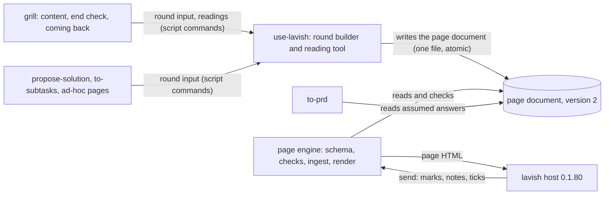
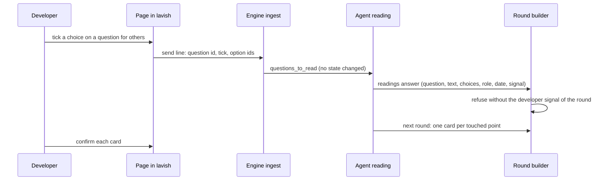
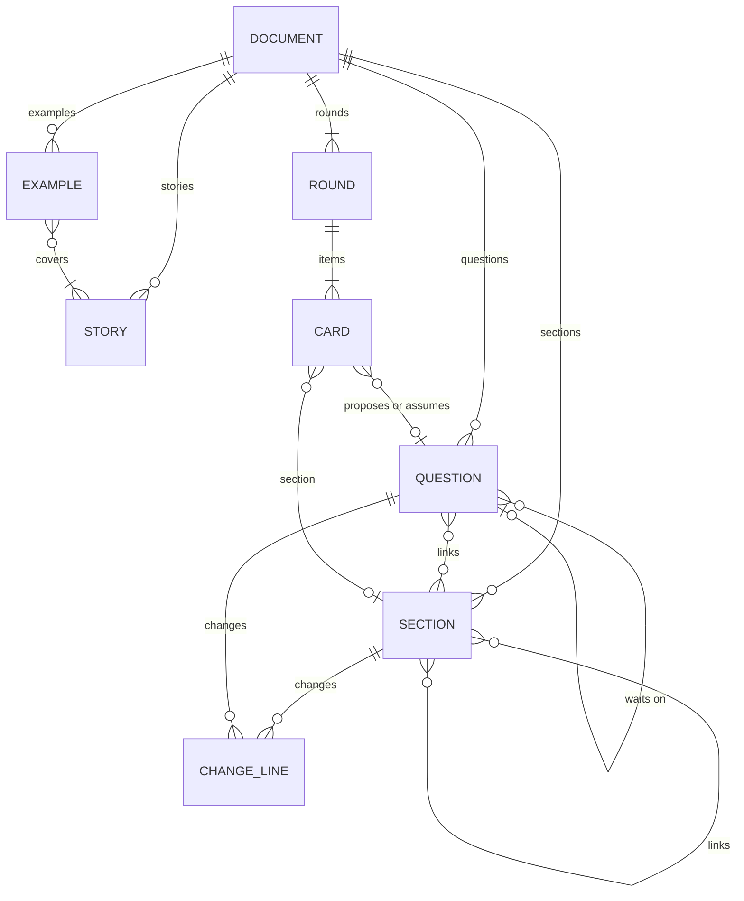
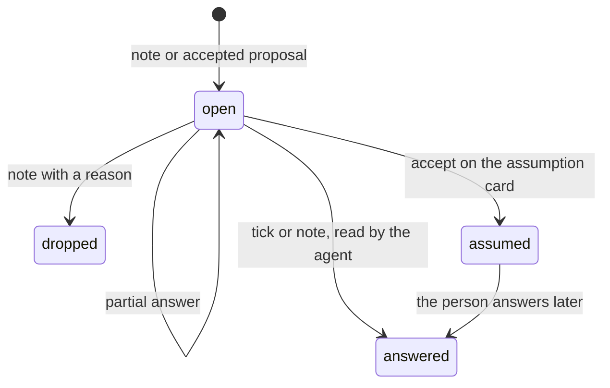
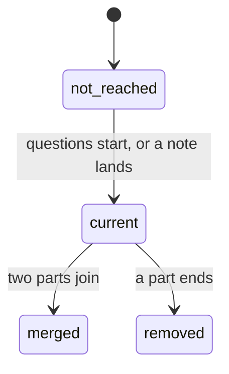
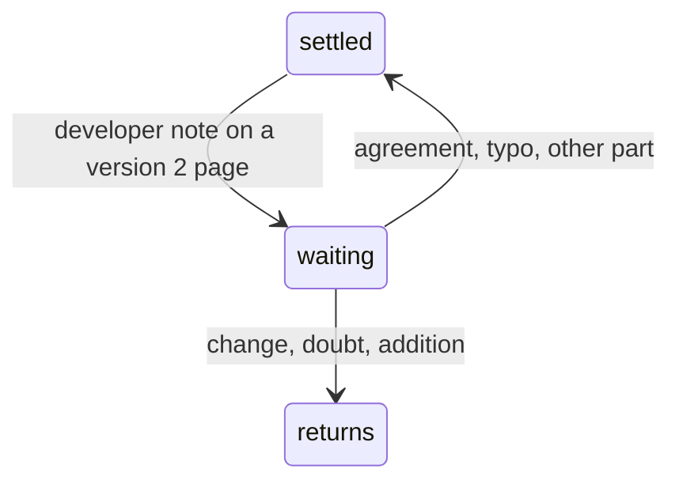
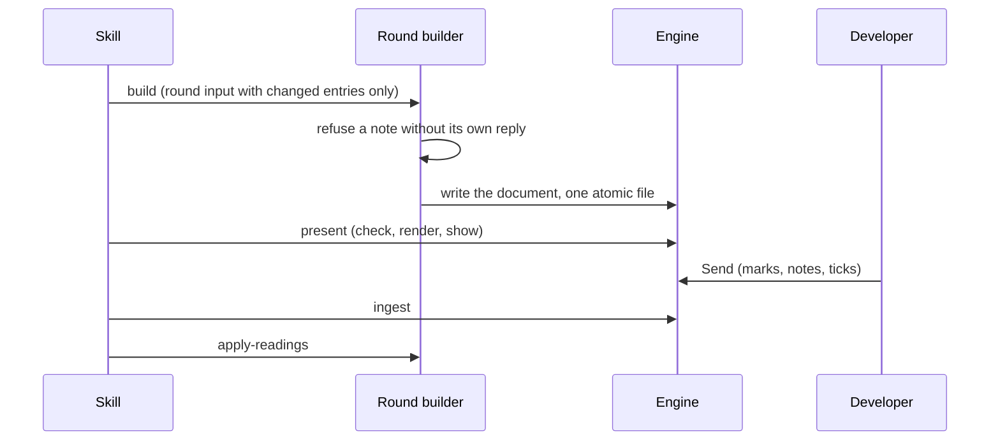
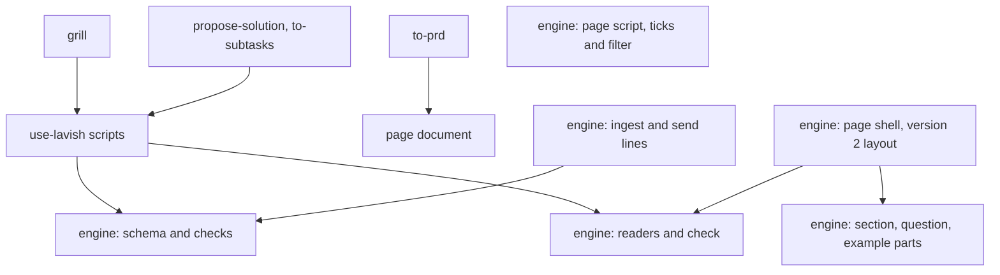

# SDD — Living page sections and questions for others

> Parent PRD: `PRD.md`
> Status: Draft
> Last updated: 2026-11-06

## §0 Binding Contract

This SDD and its accepted ADRs are binding on implementing agents and reviewers.

| Aspect | Locked by SDD/ADR | Executor latitude |
|--------|-------------------|-------------------|
| Pattern choice | yes | no |
| Module public interface | yes | no |
| API contract and schema | yes | no |
| Persisted schema (§4) | yes | no |
| Life cycle states and legal moves (§6) | yes | no |
| Roles per surface (§5) | yes | no |
| Transaction and idempotency strategy | yes | no |
| External-seam contract (§9b) | yes | no |
| File layout inside a named module | no | yes |
| Private helpers, internal names, control flow | no | yes |
| Test fixture structure | no | yes |

**Conflict procedure.** An executor finds a binding decision wrong, infeasible or against reality. A two-way-door correction is recorded in `plan/DECISIONS.md` and built. A one-way door or a tie parks the subtask and returns to `/afkv2:propose-solution` for a new ADR that supersedes the old one. Never override off the record.

**Human sign-off register.** One row per human-locked aspect (`DRAFT.md`).

| Aspect | Section | Status | Signed by / date | Approved wording |
|--------|---------|--------|------------------|------------------|
| HL-1 Persistence and entity design | §4 | signed | the developer / 2026-11-06 | `sign` mark on card i-hl1, round 2: the stored shape of version 2 pages, as in §4 |
| HL-2 API surface | §3 | signed | the developer / 2026-11-06 | `sign` mark on card i-hl2, round 2: the 7 callable surfaces, as in §3 |
| HL-3 Authorization and data scoping | §5 | signed | the developer / 2026-11-06 | `sign` mark on card i-hl3, round 2: who may do what on a page, as in §5 |
| HL-4 Life cycle and invariants | §6 | signed | the developer / 2026-11-06 | `sign` mark on card i-hl4, round 2: the life cycles and invariants, as in §6 |
| HL-5 Irreversible and outward side effects | §7 | n/a | — | Not live: the feature writes only its own page document, rendered page and log; the round 2 banner listed it as parked for that reason |
| HL-6 Change to existing behaviour | §14 | signed | the developer / 2026-11-06 | `sign` mark on card i-hl6, round 2: what existing callers and pages see differently, as in §14 |

## §1 Context Summary

A page today is built around one round of questions: the state of the whole topic folds away, a thought about another part has no place, and a question only someone else can answer is not recorded. This design makes the page document the store of the whole picture — living sections, user stories, worked examples and questions for others, each kept current and each with its own change lines — and adds a version 2 layout that draws them, while every page of version 0 and 1 opens and shows as before.

## §2 L1 — System Topology

Inherited from afkv2: local Python scripts, the page document in the feature spec folder, the pinned lavish host and the browser. Nothing new runs (card i-l1, decided by the agent; runner-up a local server that holds the sections, rejected because the engine already rebuilds the page from one file on each render).

## §3 L2 — Service Boundaries & Integration

One writer for the page document, the shared round builder; the rules live in the engine; the content comes from the skills ([ADR-0002](adr/design/0002-one-writer-for-the-page-document.md), card i-l2).



*The builder is the only writer of the page document; the engine checks and draws it; the host carries the developer's send back.*

| Part | Owns | Does not own |
|------|------|--------------|
| Page engine | the version 2 file shape, the document checks, drawing sections, questions and examples, the tick input, the ingest rules | what a section says; layout rules in prose |
| use-lavish | the one writer of the page document; the merge of changed entries; every layout rule in prose | what the topic holds |
| visualize | which picture fits each part | page layout |
| grill | sections, stories, examples, questions for others; the end check; coming back | any layout rule |
| to-prd | assumed answers in the requirements, as risks | — |
| propose-solution, to-subtasks | their own content | — |



*A tick only records the developer's signal; the agent writes the answer, and every touched point returns as a card ([ADR-0004](adr/design/0004-a-tick-records-a-signal.md)).*

Each surface answers one JSON object; exit 0 is ok, 1 refused, 2 unreadable. No surface pages its results.

| Surface | Called by | Request and its checks | Success answer | Errors, by code | Idempotency | Callers of today |
|---------|-----------|------------------------|----------------|-----------------|-------------|------------------|
| round builder `build` (`round_document.py`) | every skill with a page | + `sections`, `stories`, `examples`, `questions`: only the entries that changed, each whole; + `after` on a question, to place a follow-up; + `section` on a card; each changed entry carries 1 change line for this round; + `upgrade: true`, accepted only on a version 0 or 1 page taken over in the current session, writes it as version 2 (sent only by the grill when it comes back) | as today, + the ids of each changed entry | `unchanged-entry`, `no-change-line`, `everyone-answered`, `answer-no-signal`, `drop-no-reason`, `assume-no-card`, `reply-many-notes`, `unanswered-note`, `upgrade-not-taken-over` | a refused build writes nothing | keep working: every new field is optional; version 0 and 1 pages refuse the new fields by name, unless the same round input upgrades the page |
| reading tool `apply-readings` (`round_document.py`) | every skill with a page | + `keep` {note, reply}: the point stays settled; + `answer` {question, text, choices, role, date, signal}; + `drop` {question, reason, note}; + `assume` {question, text, card}; a reply names 1 note on version 2 | as today | as today, + `not-a-question`, `answer-no-signal`, `everyone-answered`, `drop-no-reason`, `assume-no-card` | all or nothing, as today | version 0 and 1 pages: as today |
| the page's send (`prompt_lines.py`) | the page, through lavish | + 1 line per ticked question: its id, the word `tick`, the ticked option ids | — | an unknown question or option is refused at ingest | 1 queued answer per question, replaced on change | old sends read as today |
| `ingest` (`ingest.py`) | every skill with a page | the raw send | as today, + `questions_to_read` and `settled_notes_to_read` | as today, + `bad-tick` | a send is ingested once, as today | version 0 and 1 pages: as today |
| grill start (`grill_start.py`) | grill | `--ticket` | as today, + `takeover`: the finished session it takes over, or none | as today | a second call finds the same session | propose-solution and to-prd: unchanged answers |
| grill end check `gate` (`grill_log.py`) | grill | `--doc`, `--log` | as today, + `stale`: each later document that exists, + `changed`: each settled point that changed since the take-over | as today, + `question-open`, `drop-no-reason`, `story-without-example`, `kind-missing` | a check; writes only the gate row | a log with no questions passes as before |
| requirements writer `start` (`prd_files.py`) | to-prd | as today | as today, + `assumed`: each assumed answer with who must confirm it | as today | a read | unchanged when there are none |

## §4 L3 — Data Architecture

The whole picture is stored as new lists in the page document, beside the maps, rewritten in place each round (fork card i-entities, option A; [ADR-0001](adr/design/0001-store-the-whole-picture-in-the-page-document.md)).

| State | Datastore | Partitioning | Replication | Retention | Schema-evolution policy | PII? | Audited? |
|-------|-----------|--------------|-------------|-----------|-------------------------|------|----------|
| Page document, version 2 | JSON file in the feature spec folder | 1 file per session | git, with the spec folder | with git | new value `afkv2.page/2`; the engine keeps a reader for 0, 1 and 2; the builder writes the version the page has | no | no |
| Rendered page | HTML beside the document | per page | none | not kept; rebuilt every render | follows the document | no | no |
| Unsent ticks | lavish store for the browser tab | 1 queued answer per question | none | until Send | as marks today | no | no |
| Filter by who to ask | browser storage | per session | none | per browser; harmless if lost | key change only | no | no |
| Saved copy of settled rounds | engine data folder | per page | none | as today | now also holds each change line of a settled round | no | no |
| Grill log | `GRILL-LOG.md` | per ticket | git | with git | no new row kind; the end check reads the page document's lists | no | no |

**Document, new fields** (version 2).

| Field | Type | Null? | Default | Unit / precision | Constraint | Indexed / unique | Note |
|-------|------|-------|---------|------------------|------------|------------------|------|
| schema | string | no | — | — | `afkv2.page/2` for a new page | — | version key |
| sections | list of section | yes | empty | — | in page order | — | rewritten in place |
| stories | list of story | yes | empty | — | — | — | rewritten in place |
| examples | list of example | yes | empty | — | — | — | rewritten in place |
| questions | list of question for others | yes | empty | — | in asking order | — | rewritten in place |

**Section.**

| Field | Type | Null? | Default | Unit / precision | Constraint | Indexed / unique | Note |
|-------|------|-------|---------|------------------|------------|------------------|------|
| id | string | no | — | — | element id rules; never reused | unique in the document | 1 id for life |
| title | string | no | — | at most 90 characters | — | — | |
| state | not reached, current, merged, removed | no | not reached | — | legal moves in §6 | — | |
| body | 1 component | no | — | — | the current text | — | |
| links | list of section ids | yes | empty | — | each names a section; never itself | — | |
| merged_into | section id | when merged | — | — | names a current section | — | |
| reason | string | when removed | — | at most 300 characters | — | — | |
| changes | list of change line | no | empty | — | rounds never go down; at most 1 line per round | — | append-only |

**Change line.**

| Field | Type | Null? | Default | Unit / precision | Constraint | Indexed / unique | Note |
|-------|------|-------|---------|------------------|------------|------------------|------|
| round | integer | no | — | — | 1 to the current round | — | |
| cause | note, answer, answer from, finding | no | — | — | — | — | |
| text | string | no | — | at most 300 characters | what changed | — | |
| notes | list of note ids | when cause is note | — | — | each names a note | — | |
| card | card id | when cause is answer | — | — | names the card the developer answered | — | |
| question | question id | when cause is answer from | — | — | names an answered question | — | the role comes from its answer |

**Story.**

| Field | Type | Null? | Default | Unit / precision | Constraint | Indexed / unique | Note |
|-------|------|-------|---------|------------------|------------|------------------|------|
| id | string | no | — | — | never reused | unique in the document | |
| text | string | no | — | at most 300 characters | — | — | |
| changes | list of change line | no | empty | — | as on a section | — | |

**Worked example.**

| Field | Type | Null? | Default | Unit / precision | Constraint | Indexed / unique | Note |
|-------|------|-------|---------|------------------|------------|------------------|------|
| id | string | no | — | — | never reused | unique in the document | |
| title | string | no | — | at most 90 characters | — | — | |
| kind | frequent, edge, risky | no | — | — | — | — | |
| stories | list of story ids | no | — | — | at least 1; each names a story | — | |
| body | 1 component | no | — | — | from starting data to the result | — | |
| changes | list of change line | no | empty | — | as on a section | — | |

**Question for others.**

| Field | Type | Null? | Default | Unit / precision | Constraint | Indexed / unique | Note |
|-------|------|-------|---------|------------------|------------|------------------|------|
| id | string | no | — | — | never reused | unique in the document | |
| who | list of role words | no | — | — | at least 1; `everyone` is a role word here; compared without case | — | free words, so a new team needs no list change |
| question | string | no | — | at most 300 characters | 1 sentence | — | |
| context | Markdown string | no | — | — | no ids, no plan terms | — | grows with a partial answer |
| why | Markdown string | no | — | — | no ids, no plan terms | — | |
| ways | list of string | yes | empty | — | — | — | |
| choices | {options: list of {id, text}, several: yes or no} | yes | none | — | 2 to 12 options | — | |
| example | 1 component | yes | none | — | — | — | |
| links | list of section ids | yes | empty | — | each names a section | — | |
| waits_on | question id | yes | none | — | names a question earlier in the list | — | |
| origin | {note} or {card} | no | — | — | the note that said the developer cannot answer, or the proposal card the developer accepted | — | |
| state | open, answered, dropped, assumed | no | open | — | legal moves in §6 | — | |
| answer | {text, choices, role, date, signal, round} | when answered | — | date: ISO-8601 day | role is not `everyone`; signal is the developer's tick or note of that round | — | |
| dropped | {reason, note, round} | when dropped | — | — | reason not empty | — | |
| assumption | {text, card, round} | when assumed; kept after an answer | — | — | the card is settled by the developer's accept | — | |
| changes | list of change line | no | empty | — | as on a section | — | |

**Changed entities of today** (version 2 pages only).

| Entity | Before | After |
|--------|--------|-------|
| Card | no section field | + `section`: the section it asks about, optional |
| Note | owner is a card, or the element of a session rule | owner may be a section, story, example or question |
| Reply | names 1 or more notes | names exactly 1 note |
| Session | no upgrade field | + `upgraded`: the first version 2 round, written by the builder on `upgrade: true`, optional; the 1-note rule for a reply checks only that round and later (amended 2026-11-06 in the build, the developer's call: replies of settled version 1 rounds name several notes and can never be rewritten) |

| Relation | Target | Cardinality | Owning side | On delete / orphan | Fetch posture |
|----------|--------|-------------|-------------|--------------------|---------------|
| section → section | section | N : N | the linking section | never deleted; a link to a merged section goes on to the section it merged into | whole file |
| question → section | section | N : N | question | never deleted | whole file |
| question → question (waits on) | question | N : 0..1 | the waiting question | never deleted; a dropped question stays in place | whole file |
| example → story | story | N : N | example | never deleted | whole file |
| change line → note | note | N : N | change line | a deleted note keeps its id, marked deleted | whole file |
| change line → question | question | N : 0..1 | change line | never deleted | whole file |
| note → section, story, example or question | element | N : 1 | note | never deleted | whole file |
| reply → note | note | 1 : 1 on version 2 | reply | — | whole file |
| card → question (proposes or assumes) | question | N : 0..1 | card | never deleted | whole file |
| card → section | section | N : 0..1 | card | never deleted | whole file |

Nothing is ever deleted: every note must find the element it was written on. A merged or removed section stays as 1 line where it was, with a link or its reason (card i-cascade).

**Surface reachability.** The new fields reach the page through the version 2 layout only. The round input, the readings, the send and the ingest answer gain optional fields (§3); version 0 and 1 pages expose none of them.

**Migration and backfill.** No stored page is converted, except a finished grill page called again: after the take-over, the grill's first round input carries `upgrade: true`, and the builder writes the page as version 2, with sections the agent builds from its settled points; the banner says so (amended 2026-11-06 at slicing, the developer's call: no surface triggered the upgrade). A page resumed inside its own session keeps its version; version 0 still becomes 1 at its next write, as today. Going back is forward only for version 2 pages: there is no down-conversion, and an engine without the version 2 reader refuses such a page by name (card i-migration).



*Every new list hangs off the document, not off a round, so it is rewritten in place while each entry keeps its own trail.*

## §5 L4 — Cross-Cutting & Quality Attributes

**Authorization** (card i-hl3, signed).

| Surface | Permitted roles | Denied roles | Guard on the page | Guard below the page |
|---------|-----------------|--------------|-------------------|----------------------|
| Mark, note, tick, filter | the developer running the session | a watcher of the shared screen; the agent | the controls exist only in the developer's lavish session | only ingest writes signals, each stamped |
| Accept an assumption | the developer | a watcher; the agent | the accept mark on its card | document check: assumed needs that settled card |
| Drop a question for others | the developer, with a reason | a watcher; the agent | the developer's note | document check: a reason and the note |
| Record an answer | the agent, from the developer's tick or note | the agent alone | the developer's tick or note | document check: the answer names the developer's signal of that round |
| Settle a point from a relayed answer | the developer, by confirming its card | the agent; a watcher | the card's mark | the reading tool: an answer settles no card |
| Read the page | the developer; a watcher sees what the developer shows | — | — | the secret scan at each show |

**Data scoping.** Unscoped: a page shows its whole session to whoever sees the screen. A person at the developer's keyboard counts as the developer (accepted risk).

**Idempotency.**

| Surface | Key shape | Window | Ledger |
|---------|-----------|--------|--------|
| ingest | round number of the send | the current round | the round's responses, as today |
| a repeated note | round, target, text, quote | one send | the session note list, as today |
| ticks | question id | until Send | 1 queued answer per question in lavish |
| readings | the readings file | one call | written once, all or nothing |

**Retry and timeout.** None: every step is local. A refused send is kept aside, as today.

**Plain text.** A version 2 page shows titles and "round 3", never a raw id or round code; an id shows only as hover text where a person must see it.

**Secrets.** The scan at each show, first 2 MB of each file, as today.

## §6 L5 — Domain Model

| Invariant | Owner | Guardian | Answer to a violation |
|-----------|-------|----------|-----------------------|
| A relayed answer settles no point | engine | ingest (a tick never changes a card) and the reading tool (an answer settles no card) | nothing settles; the touched points come back as cards the agent writes |
| A question closes only by answer, drop with reason, or accepted assumption | engine | the document checks | refused by name |
| No move outside the tables below exists | engine | the document checks | refused by name |
| A merged or removed section never returns | engine | the document checks | refused; a new section starts instead |
| A settled round and its change lines never change | engine | the saved copy | refused by name |
| An unchanged section keeps its text exactly | use-lavish | the round builder: an entry not in the round input is not touched | a resent unchanged entry is refused |
| Each note gets its own reply | use-lavish | the round builder, before it writes the next round | refused, naming the note |
| The grill ends with no open question for others, every story covered, every kind present | grill | the end check | fails, naming each gap |

Which settled points an answer touches is the agent's reading, not a check (accepted risk, card i-hl4).

| Entity | From | To | Trigger | Who |
|--------|------|----|---------|-----|
| Question | new | open | the developer's note says the developer cannot answer, or the developer accepts the agent's proposal card | developer |
| Question | open | open | a partial answer: the context grows; a follow-up joins right after | developer, read by the agent |
| Question | open | answered | the developer's tick or note | developer, read by the agent |
| Question | open | dropped | the developer's note with a reason | developer |
| Question | open | assumed | the developer's accept on the agent's assumption card | developer |
| Question | assumed | answered | the person answers later | developer, read by the agent |
| Section | not reached | current | its questions start, or a note lands on it | agent |
| Section | current | merged or removed | a note, an answer or a finding of the agent | agent, from the developer's input |
| Settled point | settled | settled | the note reads as agreement, a typo fix or a thought about another part | agent |
| Settled point | settled | returns as a new card | the note changes, doubts or adds | agent |



*A question for others moves only on the developer's signal.*



*A section never comes back from merged or removed.*



*A note on a settled point waits for the agent's reading; a lone settling mark on an open card still settles it at once ([ADR-0005](adr/design/0005-a-note-on-a-settled-point-waits-for-reading.md)).*

Domain events: None.

## §7 L6 — Process & Coordination



*One round is one atomic write per step; a refused build writes nothing.*

```mermaid
sequenceDiagram
  participant Grill as Grill
  participant Start as Grill start
  participant Build as Round builder
  participant Gate as End check
  Grill->>Start: start on a ticket whose grill ended
  Start-->>Grill: takeover: newest finished session
  Grill->>Build: take over, then a round; a version 0 or 1 page becomes version 2 with sections from its settled points
  Grill->>Gate: gate after the rounds
  Gate-->>Grill: pass, stale later documents, changed points
```

*Coming back continues the finished page and names every later document as possibly out of date.*

The meeting flow: the developer filters by role (nothing is sent), ticks or notes, opens linked sections, and sends once. The no-page flow: the builder writes the same document; the agent asks round by round in chat, each question with only its context, writes the developer's reply as the send, and ingests as usual, so the end check gives the same verdict.

| Failure point | Detection signal | Automatic recovery | Manual recovery | Owner |
|---------------|------------------|--------------------|-----------------|-------|
| A note left without its own reply | the builder refuses with `reply-many-notes` or `unanswered-note` | none | the agent writes the reply and builds again | use-lavish |
| A browser reload before Send | — | lavish keeps the unsent ticks, as it keeps marks | none | lavish host |
| A send that does not parse | ingest refuses and keeps the send aside | none | fix the cause, run wait and ingest again | engine |
| Later documents are stale after coming back | the end check lists `stale` and `changed` | none | the developer calls the next skill again | grill |
| No lavish host | `present` refuses at show | none | the round runs in chat from the same files | grill |

HL-5: not live; the feature writes only its own files.

## §8 L7 — Module Decomposition



*Skills call use-lavish, use-lavish calls the engine, and the engine imports no skill; there is no cycle.*

| Module | Purpose | Public interface | Depends on |
|--------|---------|------------------|------------|
| engine: schema | the version 2 file shape and the document checks | the version 2 schema file; the checks | — |
| engine: readers and check | open every version | the format readers; `check` | schema |
| engine: ingest and send lines | turn a send into signals | `ingest`; the send grammar | schema, readers |
| engine: page shell | draw a page; a version 2 layout beside today's, which is not edited | `render` | readers, page parts |
| engine: page parts | draw sections, questions for others, examples, change lines | called by the shell | — |
| engine: page script | ticks and the filter in the browser | the queued answer per question | lavish host |
| use-lavish scripts | the one writer of the page document | `build`, `apply-readings` | engine |
| use-lavish and visualize guides | layout and answer rules in use-lavish; pictures in visualize | the rules | — |
| grill | content, coming back, the end check | start, the log, `gate`, the guides | use-lavish scripts |
| to-prd | assumed answers as risks | `start`, the format guide | page document |
| plugin glossary | terms | the term list | — |

## §9 L8 — Tactical Patterns

| Concern | Pattern | ADR |
|---------|---------|-----|
| Page versions | 1 schema, 1 reader and 1 layout per version; beat 1 layout with version checks inside it | [ADR-0003](adr/design/0003-one-layout-per-page-version.md) |
| Change lines | an append-only list on each entry, guarded by the saved copy; beat a diff of old and new text at render, which cannot name the cause | [ADR-0001](adr/design/0001-store-the-whole-picture-in-the-page-document.md) |
| Unchanged sections | merge by id; an entry left out of the round input is untouched; beat sending every section every round | [ADR-0002](adr/design/0002-one-writer-for-the-page-document.md) |
| Ticks | 1 queued answer per question, replaced on change; beat 1 queued line per checkbox | [ADR-0004](adr/design/0004-a-tick-records-a-signal.md) |
| Filter | in the page only, sends nothing; beat a page drawn per role | — |
| Plain text | 1 label helper for every element, used by every drawing part, plus a visible-text test; beat a fix at each place that prints an id | [ADR-0003](adr/design/0003-one-layout-per-page-version.md) |
| Coming back | today's take-over, on the finished session; beat a new session that imports the old one | — (requirement ADR-0004) |
| Note on a settled point | the point waits for the agent's reading; beat opening it at once | [ADR-0005](adr/design/0005-a-note-on-a-settled-point-waits-for-reading.md) |

## §9b External Seams & Failure Affordance

| Boundary | Framework at its pin | What it does to our value | Failure surface | Seam test |
|----------|----------------------|---------------------------|-----------------|-----------|
| Ticks on a question for others | lavish host 0.1.80 | treats checkboxes inside a question wrapper as answers; a new queued answer with the same queue key replaces the unsent one | a tick lost on reload, or 2 queued answers for 1 question | a live browser check: tick 2 choices, untick 1, reload, send; the raw send holds 1 line with the 1 remaining choice |
| Diagram pictures | the setup's diagram renderer | draws Mermaid text, unchanged | a diagram shows as text with its reason | the existing diagram tests |

## §10 NFRs

| Concern | Target | Measurement | Owner |
|---------|--------|-------------|-------|
| Page size | at most 1 MB of HTML | a test page of 20 sections, 12 rounds, 240 change lines, 100 notes, 30 questions, 15 examples | engine |
| Render time | at most 2 s | the same test page | engine |
| Term dictionary | written once per page, about 60 KB less than today | the size of the dictionary block | engine |
| Plain text | 0 raw ids, 0 round codes in visible text | a test over every version 2 fixture | engine |
| Old pages | the same visible text as before | a test over each stored version 0 and 1 fixture | engine |
| Readable states | 0 states by colour alone | every state and cause shows as a word; the filter is a native select | engine |

## §11 Out of Scope

- The solution-design skill adopting sections, questions for others and coming back in its own content: a spinoff ticket; it gets the version 2 layout through the builder.
- The plan approval page: it stays one sign-off card.
- Tracing each assumption to the exact lines that rest on it: coming back flags every later document instead.
- A separate page or hidden view for outsiders.
- Converting stored version 0 and 1 pages, except a finished grill page called again.
- Removing raw ids and round codes from version 0 and 1 pages.
- Any change to the lavish host or to the v1 plugin.

## §12 Reversed Decisions

None.

## §13 Open Questions

None.

## §14 L9 — Implementation Seams & Change Impact

| Seam | Existing contract | Planned change | Impacted flows | Conventions and landmines | Verdict |
|------|-------------------|----------------|----------------|---------------------------|---------|
| Format readers | 2 readers, 0 and 1 (`afkv2/engine/engine.py:122`) | + a reader for version 2 | every open | a new version is a new schema file (`afkv2/AGENTS.md`) | extends (ADR-0003) |
| Builder's version | always writes version 1 (`afkv2/skills/use-lavish/scripts/round_document.py:27`) | writes the page's own version; version 2 for a new session or a taken-over finished grill | every build | version 0 still becomes 1 | reworked |
| Note on a settled card | opens the point (`afkv2/engine/ingest.py:61`) | on version 2, waits for the agent's reading | every round | a lone settling mark on an open card still settles | reworked |
| Note off every card | a session rule (`afkv2/engine/ingest.py:100`) | on version 2, a note on a section, story, example or question is a plain note | every round | a note on a map or the banner stays a rule | reworked |
| Mark input | 1 radio per card (`afkv2/engine/components/base_card.py:53`) | + checkboxes or radios for a question for others | meetings | 1 queued answer per question | extends (ADR-0004) |
| Reply for a card's notes | 1 reply names every note (`afkv2/skills/use-lavish/scripts/round_document.py:554`) | on version 2, 1 reply per note | every round | the answer rule that repeats a reply goes | reworked |
| Ids in headings | the card id shows (`afkv2/engine/components/base_card.py:95`) | on version 2, none shows | every page | ids stay as hover text where needed | extends (ADR-0003) |
| Round codes | chips, history and note numbers (`afkv2/engine/components/base_card.py:79`, `afkv2/engine/shell/page.py:154`, `afkv2/engine/components/notes_replies.py:200`) | on version 2, "round 3" | every page | old pages keep them | extends (ADR-0003) |
| Term dictionary | embedded twice (`afkv2/engine/shell/inject.py:196`) | once, every version | every render | same visible text | reworked |
| Glossary "Answer" | tips every "answer" (`afkv2/GLOSSARY.md:128`) | the term becomes "Reply" | every page | the everyday word carries no tip | reworked |
| Grill start | a finished grill starts a new page (`afkv2/skills/grill/scripts/grill_start.py:53`) | takes over the newest finished session | coming back | sync voids the passed gate until the grill ends again (`afkv2/skills/grill/scripts/grill_log.py:185`) | reworked |
| End check | an Examples row is enough (`afkv2/skills/grill/scripts/grill_log.py:240`) | on version 2, reads the stories, examples and questions lists | grill end | a log with no questions passes as before | extends (ADR-0001) |

Compatibility findings the developer accepted (card i-hl6, signed):

- A note on a settled card, a note on a section or question, and replies change only on version 2 pages.
- Version 0 and 1 pages keep raw ids and round codes.
- The builder writes the page's own version on every page; version 0 still becomes 1.
- The term dictionary is written once on every page, with the same visible text.
- The tip on the everyday word "answer" goes on every page; "Reply" carries it.
- A grill called after its end takes over the finished page on every version.
- New propose-solution and to-subtasks sessions get version 2 pages, with no sections unless they send some.
- After a grill comes back, to-prd and the design gate refuse until the grill ends again, as the log rule does today.
- Rollback: revert the release; version 0 and 1 pages open as before, and a version 2 page is refused by name until the release returns.
