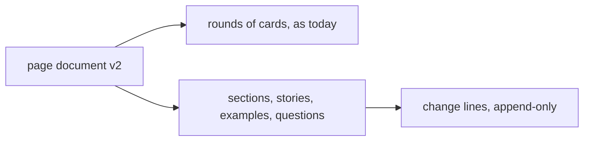

# ADR-0001 — Store the whole picture as lists in the page document

> Status: Accepted
> Date: 2026-11-06
> Layer: L3
> Context ticket: #174
> Forks: i-entities

## Context

The page must show the whole topic, current every round, with or without a page shown, and each part must keep its own change lines (SDD §4). Today a page holds only rounds of cards, and an earlier card folds away. The end check must also see which stories have a worked example and which questions for others are open.

## Decision

The page document gains 4 lists at its top, beside the maps: sections, stories, worked examples and questions for others. Each list is rewritten in place each round. Each entry has 1 id for life and keeps an append-only list of change lines; the saved copy guards the lines of settled rounds. The file version becomes `afkv2.page/2`. A session without a page writes the same file and never shows it.

## Alternatives Considered

| Alternative | Pros | Cons | Reason rejected |
|-------------|------|------|-----------------|
| Cards, as today: each round writes every section again as a new card that carries the old one | no new kind of record | every section re-sent every round; the change list is a folded card history; the end check digs stories out of card text | the developer picked A on the fork card |
| Markdown files beside the log, one per section, plus a questions file | files a person can edit by hand | 2 places to keep in step; a parser per file; notes still land on page elements | the developer picked A on the fork card |

## Consequences

- **Positive** — one file holds the whole picture; the no-page flow and the end check read the same lists.
- **Negative** — a new file version and new document checks; a version 2 page does not open on an engine without its reader.
- **Follow-ups** — none.
