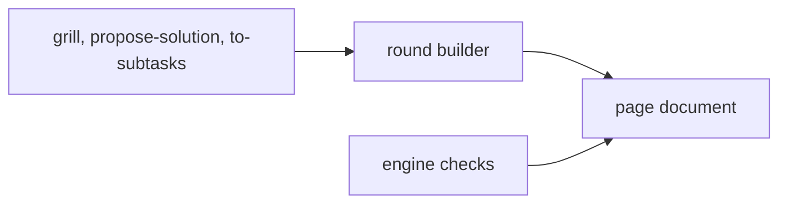

# ADR-0002 — One writer for the page document

> Status: Accepted
> Date: 2026-11-06
> Audited: 2026-11-06
> Layer: L2
> Context ticket: #174
> Forks: none

## Context

The new lists hold grill content, but any skill with a page may hold sections (SDD §3). The shared round builder already writes the pages of the grill, propose-solution and to-subtasks.

## Decision

The shared round builder stays the only writer of the page document. Its round input takes the changed entries of each list, whole, with 1 change line each; an entry left out is not touched. The engine holds the rules as document checks. The skills supply the content.

## Alternatives Considered

| Alternative | Pros | Cons | Reason rejected |
|-------------|------|------|-----------------|
| The grill writes its own lists through a grill script | the grill owns its data end to end | 2 writers of 1 file: a race and 2 merge rules | breaks the single-writer rule |
| An engine writer: skills call new engine verbs | 1 interface for any future writer | a new paradigm; the engine stops being read-only towards skills | more change, and no reader needs it |

## Consequences

- **Positive** — 1 writer per file; every skill can have sections.
- **Negative** — the builder learns 4 new lists.
- **Follow-ups** — none.
