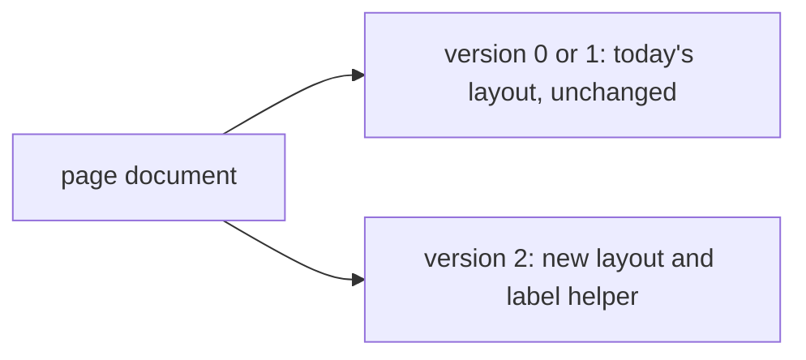

# ADR-0003 — One layout per page version

> Status: Accepted
> Date: 2026-11-06
> Audited: 2026-11-06
> Layer: L8
> Context ticket: #174
> Forks: none

## Context

A page made before this change must open and show as it does today, while a version 2 page shows sections, a questions block and no raw ids or round codes (SDD §9, §14).

## Decision

Each page version has its own schema, its own reader and its own layout. Today's drawing code for versions 0 and 1 is not edited; a version 2 page takes a new layout path. In that path, 1 label helper gives every element its visible text, and a test reads every visible text of every version 2 fixture for raw ids and round codes. A second test renders each stored version 0 and 1 fixture and compares its visible text with the text before the change.

## Alternatives Considered

| Alternative | Pros | Cons | Reason rejected |
|-------------|------|------|-----------------|
| 1 layout with version checks inside it | less code | an old page can change by accident | old pages must show as today |
| Fix each place that prints an id | small diffs | a new drawing part can print an id again | no single guard |

## Consequences

- **Positive** — old pages stay as they are; the plain-text rule has one guard.
- **Negative** — 2 layout paths to keep.
- **Follow-ups** — none.
