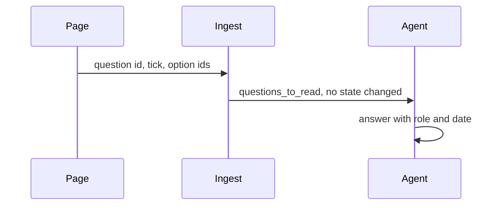

# ADR-0004 — A tick records a signal; the agent writes the answer

> Status: Accepted
> Date: 2026-11-06
> Audited: 2026-11-06
> Layer: L2
> Context ticket: #174
> Forks: none

## Context

A relayed answer must settle no point by itself, and who answered and when follow rules that need the developer's note (SDD §3, §6).

## Decision

The page queues 1 answer per question for others, replaced on change, with the ticked option ids. Ingest records it as a signal in `questions_to_read` and changes no state. The agent writes the answer through the reading tool, which refuses an answer without the developer's tick or note of that round, and refuses `everyone` as who answered. Each settled point the answer touches returns as a card.

## Alternatives Considered

| Alternative | Pros | Cons | Reason rejected |
|-------------|------|------|-----------------|
| Ingest writes the answer itself | 1 step less | a second path for the role and date rules | 2 places for 1 rule |
| 1 queued line per checkbox | a simpler page script | the lavish guide forbids it; a change of mind sends 2 lines | host guidance |

## Consequences

- **Positive** — 1 path writes every answer; no answer exists without the developer's signal.
- **Negative** — every tick needs a reading before it counts.
- **Follow-ups** — none.
