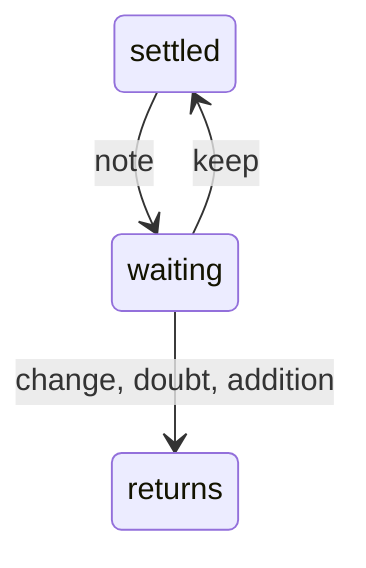

# ADR-0005 — A note on a settled point waits for the agent's reading

> Status: Accepted
> Date: 2026-11-06
> Audited: 2026-11-06
> Layer: L5
> Context ticket: #174
> Forks: none

## Context

Today any note on a settled card opens the point at once, before anyone reads it, so a note that only agrees, fixes a typo or talks about another part costs a new card (SDD §6, §14).

## Decision

On a version 2 page, a note on a settled card leaves the point settled and goes to `settled_notes_to_read`. The agent reads it: agreement, a typo fix or a thought about another part keeps the point settled (`keep`); a change, a doubt or an addition returns it as a new card. A lone settling mark on an open card still settles it at once. Version 0 and 1 pages keep today's rule.

## Alternatives Considered

| Alternative | Pros | Cons | Reason rejected |
|-------------|------|------|-----------------|
| Open the point at once, as today | no reading step | a note that agrees reopens a settled point | refused in the requirements |

## Consequences

- **Positive** — a settled point changes only when the note asks for it.
- **Negative** — a new reading key and a new list in the ingest answer.
- **Follow-ups** — none.
