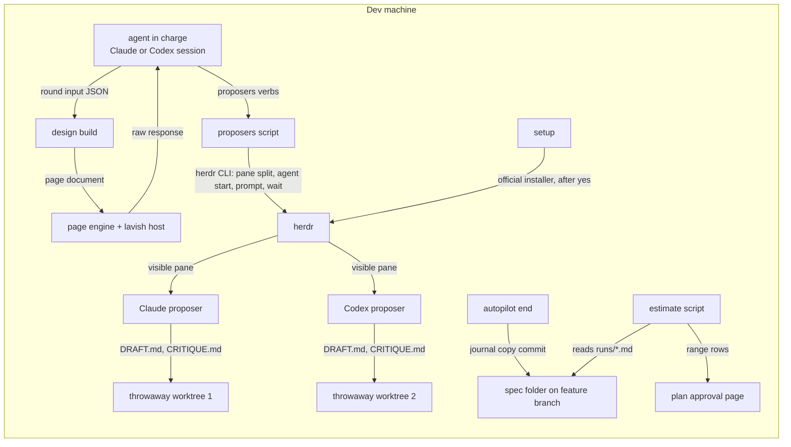
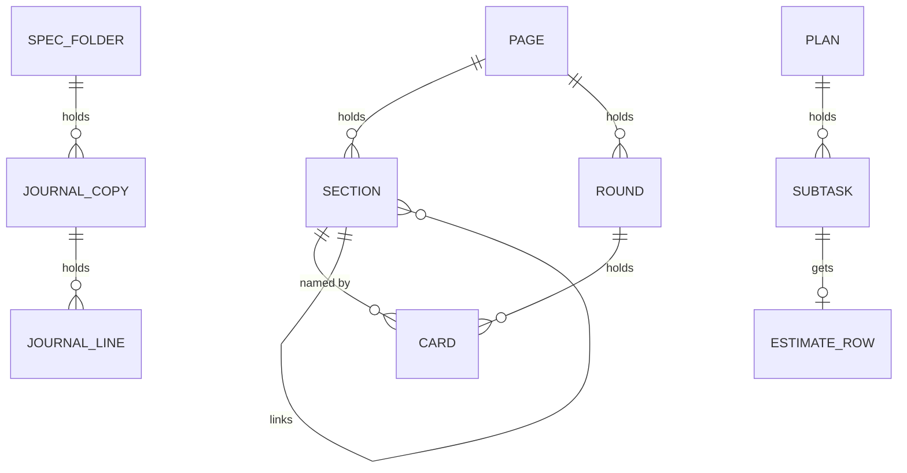
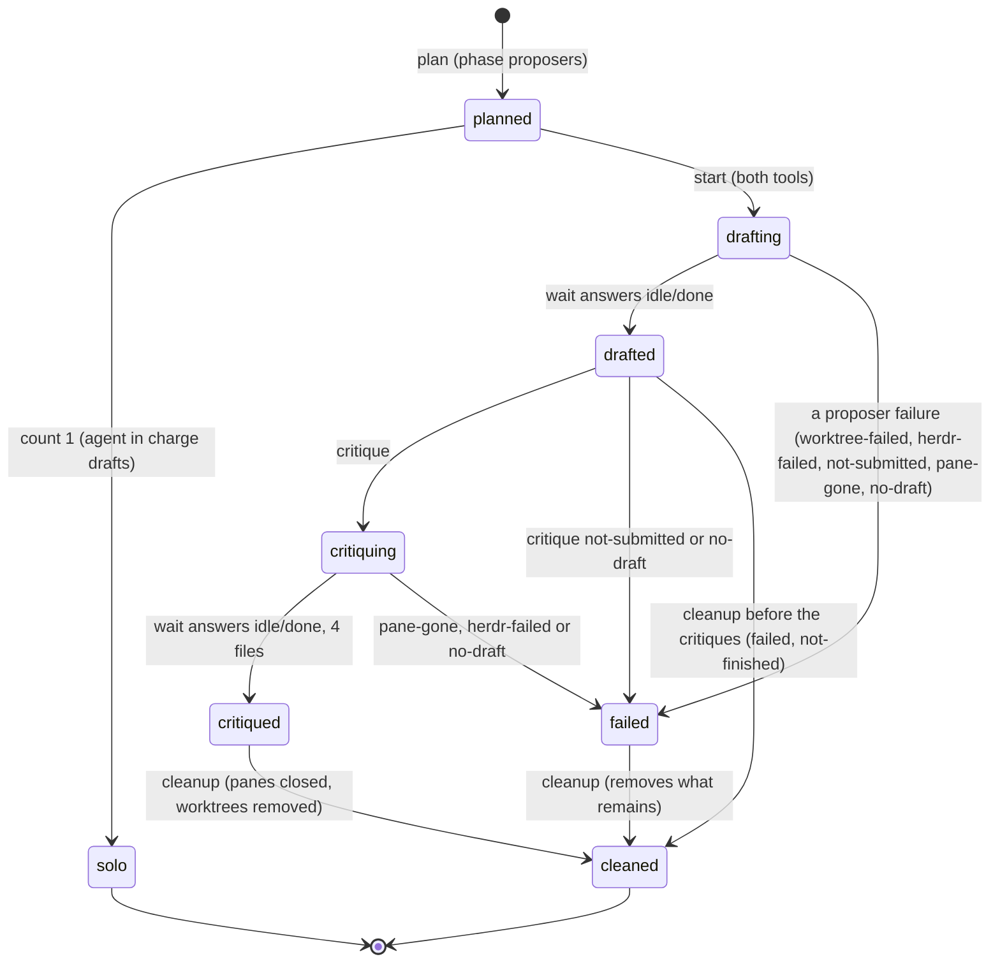
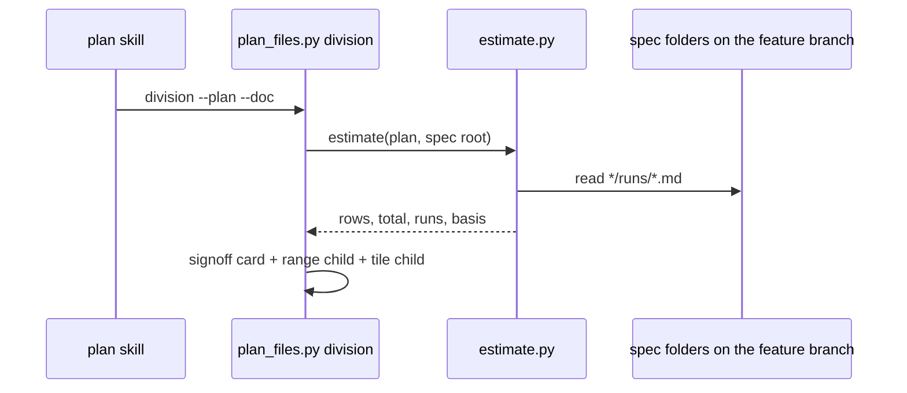
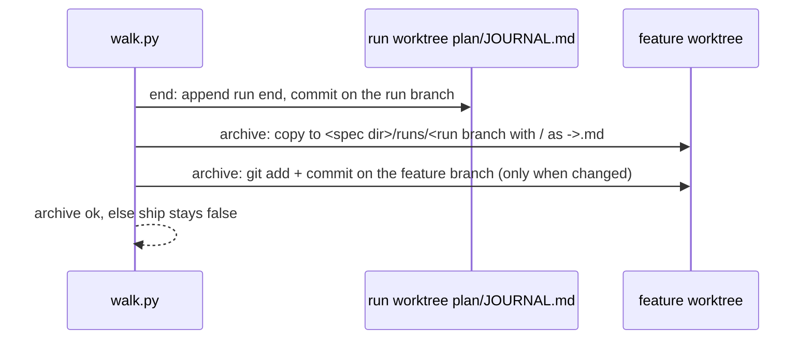
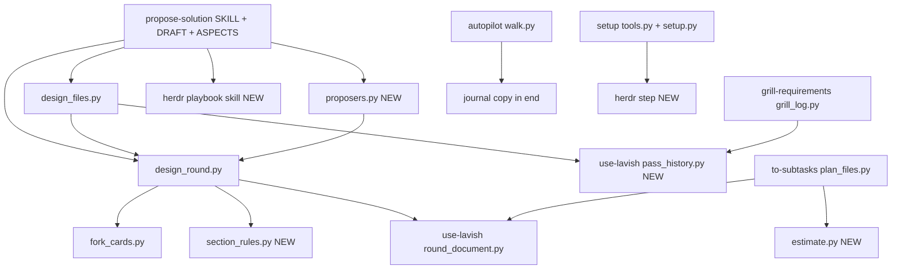

# SDD — #178: the design page shows the whole design, like the grill page

> Parent PRD: `PRD.md`
> Status: Draft
> Last updated: 2026-11-07

## §0 Binding Contract

This SDD and its accepted ADRs are binding on implementing agents and reviewers.

| Aspect | Locked by SDD/ADR | Executor latitude |
|--------|-------------------|-------------------|
| Pattern choice | yes | no |
| Module public interface | yes | no |
| API contract and schema | yes | no |
| Persisted schema (§4) | yes | no |
| Life cycle states and legal moves (§6) | yes | no |
| Roles per surface (§5) | yes | no |
| Transaction and idempotency strategy | yes | no |
| External-seam contract (§9b) | yes | no |
| File layout inside a named module | no | yes |
| Private helpers, internal names, control flow | no | yes |
| Test fixture structure | no | yes |

**Conflict procedure.** An executor finds a binding decision wrong, infeasible or against reality. A two-way-door correction is recorded in `plan/DECISIONS.md` and built. A one-way door or a tie parks the subtask and returns to `/afkv2:propose-solution` for a new ADR that supersedes the old one. Never override off the record.

**Human sign-off register.** One row per human-locked aspect (`DRAFT.md`). Every row was signed under the owner's written delegation of 2026-11-07 (page note N-1-m-aspects-1): "I authorize you to always take your recommendations as the decision." The owner reviews the result on the final page before the merge.

| Aspect | Section | Status | Signed by / date | Approved wording |
|--------|---------|--------|------------------|------------------|
| HL-1 Persistence and entity design | §4 | signed | owner by delegation (N-1-m-aspects-1) / 2026-11-07 | card hl-1-persistence, R-2: the 5 persisted shapes of §4 as written, signed under the delegation |
| HL-2 API surface | §3 | signed | owner by delegation (N-1-m-aspects-1) / 2026-11-07 | card hl-2-api, R-2: the 9 surfaces of §3 as written, signed under the delegation |
| HL-3 Authorization and data scoping | §5 | signed | owner by delegation (N-1-m-aspects-1) / 2026-11-07 | card hl-3-authorization, R-2: the role table of §5 as written, signed under the delegation |
| HL-4 Life cycle and invariants | §6 | signed | owner by delegation (N-1-m-aspects-1) / 2026-11-07 | card hl-4-lifecycle, R-2: the proposer run states and the 9 invariants of §6, signed under the delegation |
| HL-5 Irreversible and outward side effects | §7 | signed | owner by delegation (N-1-m-aspects-1) / 2026-11-07 | card hl-5-effects, R-2: the 5 outward effects of §7, signed under the delegation |
| HL-6 Change to existing behaviour | §14 | signed | owner by delegation (N-1-m-aspects-1) / 2026-11-07 | card hl-6-change, R-2: the seam table of §14 and its compatibility findings, signed under the delegation |

## §1 Context Summary

The requirements grill already shows the developer the whole picture every round, through page format 2 lists (sections, stories, examples, questions). The design skill builds on the same round builder but sends none of those lists in any structured way, has no section order, no "driven by" block on a decided card, no second voice, and no estimate. This design keeps the page engine and page format 2 frozen, and adds the missing pieces at the edges: an order rule and checks in the design build, one optional `after` field on sections in the shared builder, a "driven by" block on decided cards, a proposers script that drives herdr, a herdr playbook skill, a herdr step in setup, a journal copy that survives cleanup, and an estimate on the plan page.

## §2 L1 — System Topology

Inherited from the afkv2 plugin: local Python scripts invoked by skills, one page engine, the lavish page host, git worktrees. New neighbours, all on the developer's machine:



Caption: everything stays on one machine; herdr is the only new external program, and only setup installs it.

## §3 L2 — Service Boundaries & Integration

Integration style: CLI calls with one JSON answer each (`{"ok": true, ...}` or a refusal), as every afkv2 script. herdr is called through its CLI only.

```mermaid
sequenceDiagram
  participant A as agent in charge
  participant P as proposers.py
  participant H as herdr CLI
  participant C as Claude proposer pane
  participant X as Codex proposer pane
  A->>P: plan (phase proposers: every aspect settled)
  P-->>A: count 2, tools [claude, codex], reason null
  A->>P: start --brief F (launches both tools)
  P->>H: per tool: git worktree add --detach; pane split --cwd; agent start --kind; agent prompt --wait
  P-->>A: per tool: pane, worktree, submitted
  A->>P: wait (both)
  P->>H: agent wait --until idle|done|blocked
  A->>P: critique (each gets the other's DRAFT.md path)
  A->>P: wait (both)
  P-->>A: 4 paths: 2 DRAFT.md, 2 CRITIQUE.md
  A->>A: read the 4 files; reconcile R-4 into round input (forks credited)
  A->>P: cleanup
  P->>H: pane close; git worktree remove (each recorded resource)
```

Caption: the agent in charge never reads a proposer's pane output as the result; only the 4 declared files come back, then every pane and worktree goes.

Contract rows, at HL-2 grade. Each surface is a CLI verb run from the repository root; each answer is one JSON object; exit 0 ok, 1 refused, 2 unreadable input.

| # | Surface | Who calls | Request fields and validation | Success answer | Errors (code) | Idempotency | Existing callers |
|---|---------|-----------|-------------------------------|----------------|---------------|-------------|------------------|
| S-1 | `design_round.py build` and `next` (changed) | agent in charge | build: as today, + `--ticket-file F` (optional, the read ticket); round input may hold `sections` with `after`, `proposers {count, tools, reason}`, decided `driven_by`, and typed alternatives `{option, why_lost}`. next: a new phase `proposers` between `aspects` and `draft`, until the proposers state file records cleanup done or count 1 | as today, + `section_order` (ids in page order) | as today + `section-order`, `section-shape`, `section-caption`, `driven-by-unknown`, `bad-proposers`, `proposers-open` (a draft round while a recorded pane or worktree is not cleaned up) | `--replace` as today | the design skill only; unchanged rounds build the same |
| S-2 | `round_document.py build` / `_merge_entries` (changed) | grill, design build | a section may hold `after`: the id of a stored or same-round section | as today | `bad-entry` when `after` names no section | as today | grill rounds that send no `after` are unchanged |
| S-3 | `design_files.py start` (changed) | design skill | as today | as today, + `takeover` (a session whose gate passed, for new input) | as today | writes the `## Solution design` heading of the log when it is missing, and on a takeover the `Last pass` row of the taken-over session; a second run adds nothing | unchanged fields keep their meaning |
| S-4 | `design_files.py sync --doc D --log L` (new) | design skill step 8 | doc and log exist | `{"ok", "notes": n, "rows": n}`: each new note of the doc copied word for word under `## Solution design` as a `Note` row | `missing-input` | a note id already in the log is skipped | none |
| S-5 | `design_files.py gate` (changed) | design skill step 10 | as today | as today, + `stale` (later documents: `plan/` of the run branch, when it exists) and `changed` (settled points changed since the last passed gate); each list empty when nothing applies | as today + `question-open` per open question for others, `section-missing` per missing P-01, P-04, P-05 section | rewrites its own gate row | the `design-gate` refusal shape is unchanged |
| S-6 | `proposers.py plan --doc D` (new; replaces `second_provider.py review`) | design skill, in phase `proposers` | the design phase is `proposers` | exactly `{"count": 1 or 2, "tools": [...], "reason": null or one of no-herdr, outside-herdr, no-other-tool, bypass-forbidden, proposer-failed}`, with no `ok` key: the `proposers` input of the design build, as it is; count 1 starts nothing: the agent in charge drafts; the fence statement is a banner line of the build | `aspects-open` when an aspect is unsettled | the first call writes the state file (stage `planned`); each later call, after `cleanup` too, answers from it; after a proposer failure: count 1, reason `proposer-failed` | `second_provider.py` is deleted; its one caller (the design SKILL step 4) moves here |
| S-7 | `proposers.py start --doc D --brief F --base REF` (new) | design skill | count 2 from `plan`; no recorded resource of this session | `{"ok", "proposers": [{tool, pane, worktree, submitted}]}`: 1 Claude and 1 Codex, launched in 1 call (AC-025) | `same-tool` (a tool already recorded), `not-planned` (no count 2 plan, or it failed or was cleaned up), `aspects-open`, `no-herdr`, `missing-input` (brief), `worktree-failed`, `herdr-failed`, `not-submitted` | a second `start` refuses `same-tool` | none |
| S-8 | `proposers.py wait`, `critique`, `cleanup` (new) | design skill | `--doc D` | wait: `{"ok", "states"}`; critique: `{"ok", "submitted"}` (each tool gets the other's DRAFT.md path); wait after critique also answers `files`: the 4 paths; cleanup: `{"ok", "closed", "removed", "proposers"}`, `proposers` being the plan object (absent when no plan was recorded); it keeps the state file with `cleaned` true and every pane and worktree null (D-7) | wait: `not-started` (both proposers must run), `pane-gone`, `herdr-failed`, `no-draft` (a DRAFT.md or CRITIQUE.md is missing); critique: `not-started`, `not-drafted` (critique runs once, after both drafts), `no-draft`, `not-submitted`; cleanup: `cleanup-failed` (names each resource left in `left`). After start, a refusal coded no-herdr, worktree-failed, herdr-failed, not-submitted, pane-gone or no-draft records a failure, and so does a cleanup of a count 2 run before the critiques; the plan object then has count 1 and reason `proposer-failed` (banner: a solution proposer failed, D-10) | cleanup acts only on recorded resources and may run again | none |
| S-9 | `estimate.py --plan P --spec-root R` (new) and the division card (changed) | plan skill step 6 (`plan_files.py division` calls it) | plan passes `check_plan.py` | `{"ok", "rows": [{subtask, low, likely, high}], "total": {low, likely, high}, "runs": n, "basis": "journals" or "estimated", "skipped": n, "notes": [...]}`, days to 2 decimals (D-13); a run with a `parked(...)` line between `developing` and `done` gives no sample (D-14) | none: each unreadable line is skipped and named in `notes` as `bad-journal` | read-only | the division card gains 1 child; `plan_digest` is unchanged because the estimate is outside the plan files |
| S-10 | setup herdr status (changed) and `setup.py herdr --answer yes|no` (new) | setup skill | status: read-only check of `herdr` on PATH and the record key `herdr`; the verb runs only with the developer's answer from the session | status `{"herdr": "present" or "declined" or "ask"}`; verb `{"herdr": "installed" or "declined"}` | `install-failed` with the installer's last line | an answer `declined` is recorded once and never asked again (fork d2-setup-decline) | setup runs that find herdr present ask nothing (AC-030) |

The herdr playbook skill (`afkv2/skills/herdr-playbook/SKILL.md`) is a document surface, read by agents, with H-1 to H-9.

## §4 L3 — Data Architecture

| State | Datastore | Partitioning | Replication | Retention | Schema-evolution policy | PII? | Audited? |
|-------|-----------|--------------|-------------|-----------|-------------------------|------|----------|
| Page document (design session) | JSON file in `<spec dir>/pages/`, format afkv2.page/2 | 1 file per session | git, on the feature branch | lives with the spec folder | format 2 is frozen; only optional input-side fields are added | no | git history |
| Section `after` | round input only; the stored section list order holds the result | — | — | — | not stored as a field: the order of the list is the record | no | — |
| Decided `driven_by` | inside the card body, as 1 labelled text component | per card | git | with the page | a new labelled component; format 2 accepts any text component | no | git history |
| Run journal copy | Markdown file `<spec dir>/runs/<run branch, '/' as '-'>.md` on the feature branch (D-12) | 1 file per run branch | git | lives with the spec folder; gc never deletes it | the journal line grammar of `JOURNAL-FORMAT.md` | no | git history |
| Install record key `herdr` | the setup install record (per machine) | 1 key | none | until setup runs again | a new key; old records without it read as "ask" | no | no |
| Proposer files | `DRAFT.md`, `CRITIQUE.md` in each throwaway worktree | 1 per proposer | none | deleted with the worktree at `cleanup`, after the agent in charge read them | free Markdown | no | no |
| Proposers state file | `<doc>.proposers.json` beside the page document | 1 per session | none | kept by `cleanup`, with `cleaned` true and every pane and worktree null (D-7) | `version: 1`: `{version, count, tools, reason, stage, brief, proposers: [{tool, agent, pane, worktree, created}], cleaned, failed}`; `created` is true once `git worktree add` exits 0; `failed` is `{stage, code}` | no | no |
| Design log rows | `GRILL-LOG.md` section `## Solution design` | 1 section | git | with the spec folder | new row kind `Note` | no | git history |

Per entity, at HL-1 grade:

**Section entry (page format 2, input side).**

| Field | Type | Null? | Default | Unit / precision | Constraint | Indexed / unique | Note |
|-------|------|-------|---------|------------------|------------|------------------|------|
| id | string | no | — | — | in page order: `sec-system`, `sec-crit-<slug>`, `sec-l1`..`sec-l7`, `sec-logic` (key logic, after the modules), `sec-l8`, `sec-l9`, `sec-patterns`, `sec-performance` | unique in the document, never reused | the prefix names the catalog part (ADR-0001) |
| after | string | yes | absent | — | names a section already stored or sent earlier in the same round | — | input only; the builder places the entry, then drops the field |
| links | list of section ids | yes | filled by the design build | — | each id names a section | — | a level section links to the next level and to each of its critical sections |

**Decided card fields (input side).**

| Field | Type | Null? | Default | Unit / precision | Constraint | Indexed / unique | Note |
|-------|------|-------|---------|------------------|------------|------------------|------|
| driven_by | list of strings | no on a design page | — | — | each id is an acceptance criterion id, a requirement record id or a catalog id the PRD holds, or a page id | — | missing: the card degrades to `confirm` (AC-009) |
| alternatives | list of `{option, why_lost}` | no | — | — | both fields are non-empty text | — | the design build turns each row into the line "option — why it lost" for the shared builder; a missing `why_lost` degrades the card |

**Journal copy.** One file per run branch; its lines are the run journal's lines, unchanged.

| Field | Type | Null? | Default | Unit / precision | Constraint | Indexed / unique | Note |
|-------|------|-------|---------|------------------|------------|------------------|------|
| stamp | text | no | — | local time, minute | `YYYY-MM-DD HH:MM` | — | as written by the run |
| writer | text | no | — | — | execute, autopilot, ... | — | — |
| subject | text | no | — | — | subtask id or `run` | — | — |
| event | text | no | — | — | `developing`, `done`, `complexity <class>` (new, written when a subtask starts), `run end ...` | — | the estimate reads `developing` → `done` per subject, and its class |

**Install record key.**

| Field | Type | Null? | Default | Unit / precision | Constraint | Indexed / unique | Note |
|-------|------|-------|---------|------------------|------------|------------------|------|
| herdr | text | yes | absent = ask | — | `present`, `installed`, `declined` | 1 per record | `declined` stops the question for good on that machine |

| Relation | Target | Cardinality | Owning side | On delete / orphan | Fetch posture |
|----------|--------|-------------|-------------|--------------------|---------------|
| section → card | card `section` field | 1 section to 0..n cards | card | a card names a section that exists; the engine checks it | read with the document |
| section → section (links) | section | 0..n | linking section | a link to a missing id refuses at build | read with the document |
| journal copy → run branch | run branch name | 1 to 1 | the copy (file name) | gc deletes the branch; the copy stays | read by the estimate |

**Surface reachability.** The new card component and the section order show through the existing page renderer; no surface outside the page reads them. The install record key is read only by setup and by `proposers.py plan` (through `herdr` on PATH, not the key).

**Migration and backfill.** The 8 existing design pages (format 0 or 1, 4 to 158 KB) stay as they are. A page reopened by a new session is upgraded once by the existing `upgrade: true` path, with its sections built from its settled points (AC-033). No afkv2 journal copy exists yet; the estimate reads every compatible journal line it finds and says when it found none. Every change goes back by reverting the commit.



Caption: the only new stored files are the journal copies; everything else lives inside the page document that exists today.

## §5 L4 — Cross-Cutting & Quality Attributes

**Authorization (HL-3).** The page has no login; "roles" are the actors of the PRD access policy, and each guard is a script check, not a UI-only rule.

| Surface | Permitted | Denied | Guard above the UI | Guard below the UI |
|---------|-----------|--------|--------------------|--------------------|
| sign a locked aspect | the developer (sign mark) | proposers, agent in charge | the page shows the sign mark only on a signoff card | `apply-readings` refuses `settle` on a signoff card; the gate refuses a signed row with no sign mark |
| pick a disputed fork | the developer | agent in charge, proposers | a debate card has no decided form | a debate card settles only by a mark from the raw response; `proposers` forks carry `by` credits and never a `decided` field (`section-shape` refuses a decided card that names a credited option) |
| draft, critique | each proposer | — | — | the brief names only its worktree; `wait` answers only the paths of `DRAFT.md` and `CRITIQUE.md`; the worktree holds no page, no notes, no tracker config |
| write page, SDD, ADRs | agent in charge | proposers | — | proposers run in a throwaway worktree detached from the feature branch, removed at `cleanup` |
| install herdr | setup, after the developer's yes | any other script | the question is asked in session | setup runs the installer only on a `yes`; `declined` is recorded |

Data scoping: a proposer sees the PRD, the requirement records, the log's premise rows and the settled aspects, written into its brief; it does not see the page document or the notes (AC-020).

**Idempotency.**

| Surface | Key shape | Window | Ledger |
|---------|-----------|--------|--------|
| `proposers.py start` | tool name per session | the session | the state file `<doc>.proposers.json` |
| `proposers.py cleanup` | each recorded pane and worktree | the session | the same state file; kept with `cleaned` true when every resource is gone |
| journal copy | run branch name | forever | the file name; a commit only when the content changed |
| setup herdr step | install record key | per machine | the install record |

**Retry and timeout.**

| Call | Attempts | Backoff (s) | Timeout (s) |
|------|----------|-------------|-------------|
| `herdr agent start` | 1 | — | 90 |
| `herdr agent prompt --wait --until working` | 1; on `agent_prompt_stalled`, `pane read`: the brief still in the input line gets 1 Enter after a 2 s pause (fork d2-prompt-submit); then `agent wait --until working`, and a failed wait refuses `not-submitted` | 2 | 30 each |
| `herdr agent wait` | 1 | — | none (PRD: no time cap) |
| official herdr installer, with TMP, TEMP and TMPDIR set to `<data>/herdr-download` for the installer process only; the folder is removed after the run (D-11) | 1 | — | 300 |

Rate limit: none. Feature flags: none; the fallback rules of AC-024 are the switch. Observability: each `proposers.py` verb answers JSON; the banner names the proposer count and the reason (R-5). Performance: every performance fact stands in `sec-performance` and §10; this layer only points there (AC-014).

Secrets: none are read or written; a proposer runs under the developer's own login; the page scan for secrets runs as today.

The fence statement (AC-021), shown in the banner whenever a proposer ran: "Each solution proposer ran with full auto-approval in a throwaway worktree. The worktree fences only the working folder; it is not a sandbox."

## §6 L5 — Domain Model

| Invariant | Owner | Guardian | Answer to a violation |
|-----------|-------|----------|-----------------------|
| I-1 sections follow the catalog order (AC-003) | design build | `design_round.py` order check on the merged list | refuse `section-order`, naming the first id out of place |
| I-2 a level section opens with its picture, a caption and a summary of at most 2 lines; the rest folds (AC-004, AC-008) | design build | section shape check | refuse `section-shape` or `section-caption` |
| I-3 a decided card on a design page holds D-1 to D-5 (AC-009) | design build | decided check before the shared builder | the card degrades to `confirm` and is listed in `degraded` |
| I-4 1 proposer per tool per session (AC-025) | proposers script | state file check in `start` | refuse `same-tool` |
| I-5 no proposer starts before every aspect settles (AC-018) | proposers script | `plan` and `start` read `next_step` | refuse `aspects-open` |
| I-6 every pane and worktree the session opened is removed (AC-026) | proposers script | `cleanup` removes and records; the design build refuses a draft round and the gate fails while the state file holds a resource | refuse `proposers-open`; gate failure `pane-open` |
| I-7 no estimate on a design page (AC-042) | design build | no estimate field exists in the design build | — (nothing to violate) |
| I-8 an open question for others blocks the gate (AC-035) | design gate | `pass_history.open_questions`, shared with the grill gate | gate failure `question-open` |
| I-9 the journal copy is never deleted by gc | gc | gc lists only run branches and worktrees; the spec folder is outside its scope | — |

Proposer run life cycle (HL-4), kept in `<doc>.proposers.json`:



Caption: every 2-proposer path ends in `cleaned`, so no pane or worktree outlives the session; on a failure, the agent in charge drafts alone, and the banner says why.

Domain events: none.

## §7 L6 — Process & Coordination

Top use case 1, 2 proposers (WE-01): the sequence of §3. There is no transaction: each step writes 1 file. Reconcile (R-4) runs in the agent in charge: a design part both critiques accept in writing becomes 1 design; every other difference becomes 1 fork card, options credited with `by`.

Top use case 2, the estimate on the plan page:



Caption: the estimate is computed when the division round is built, so the developer sees it on the card they sign.

Top use case 3, the journal copy:



Caption: the copy rides the feature branch into the merge, so gc deleting the run branch no longer erases the run times.

| Failure point | Detection signal | Automatic recovery | Manual recovery | Owner |
|---------------|------------------|--------------------|-----------------|-------|
| herdr missing or session outside herdr | `HERDR_ENV` unset or `herdr` not on PATH | `plan` answers count 1 with the reason | run setup, start the session in herdr | proposers script |
| other tool missing | `which codex` / `which claude` empty | count 1, reason `no-other-tool` | install the tool | proposers script |
| full auto-approval forbidden | Claude `permissions.disableBypassPermissionsMode: "disable"` in managed-settings files, the `HKLM` or `HKCU` `SOFTWARE\Policies\ClaudeCode` value `Settings`, or the macOS domain `com.anthropic.claudecode`; Codex requirements (`requirements.toml`, macOS `com.openai.codex:requirements_toml_base64`) whose `allowed_sandbox_modes` omits `danger-full-access`, `allowed_approval_policies` omits `never`, or `allowed_permission_profiles` does not set `:danger-full-access` true | count 1, reason `bypass-forbidden` | — | proposers script |
| prompt not submitted | `agent_prompt_stalled`, then `agent wait --until working` fails | 1 Enter when `pane read` shows the brief in the input line; refuse `not-submitted` when the wait fails | read the pane | proposers script |
| proposer writes no draft | `DRAFT.md` absent after `wait` | refuse `no-draft`; `cleanup`; the agent in charge drafts alone | — | proposers script |
| worktree remove fails (file lock on Windows) | `git worktree remove` exit not 0 | retry once with `--force`, only for a worktree with `created` true; then refuse `cleanup-failed`, naming the path; a folder left by a failed `git worktree add` is never forced and is named too; the design round stays blocked | delete the folder by hand, run `cleanup` again: it prunes the worktree record | proposers script |
| journal copy commit fails | git exit not 0 | `archive` refuses; `ship` stays false | run `archive` again | autopilot |
| herdr installer fails | installer exit not 0 | answer `install-failed`; 1 proposer | install by hand | setup |
| journal line unreadable | grammar mismatch | the line is skipped and counted in `skipped` | — | estimate script |

Outward effects at HL-5 grade:

| Effect | Trigger | Order against local writes | Idempotency key | Partial failure leaves | Recovery |
|--------|---------|----------------------------|-----------------|------------------------|----------|
| E-1 herdr install | setup, after the developer's yes | after the yes, before the record write | install record key | herdr partly installed, no record | setup asks again next run; the official installer is re-runnable |
| E-2 pane open/close | `proposers.py start` / `cleanup` | state file written after each herdr call | tool name, pane id | an open pane recorded as open | `cleanup` closes it; the gate fails `pane-open` until then |
| E-3 throwaway worktree add/remove | `start` / `cleanup` | worktree added before the pane; removed after the pane closes | worktree path | a leftover folder | `cleanup` retries; `cleanup-failed` names the path and blocks the round |
| E-4 agent sessions under the developer's login | `start` | after the worktree | tool name | a running agent | `cleanup` closes its pane |
| E-5 journal copy commit on the feature branch | autopilot `archive`, after `end` | after the run-branch commit | run branch name | an uncommitted copy; `ship` false | run `archive` again |

## §8 L7 — Module Decomposition



Caption: new modules sit at the skill edges; the page engine and the shared builder gain only the optional `after` on sections and the "driven by" block.

| Module | Purpose | Public interface | Depends on |
|--------|---------|------------------|------------|
| `section_rules.py` (new, propose-solution) | the catalog order, shape and caption checks, auto links | `catalog() -> rows` (read from the section table of DRAFT.md, the one home), `order_key(id)`, `check_sections(doc_sections) -> list[str]`, `fill_links(sections) -> sections` | DRAFT.md |
| `design_round.py` (changed) | design build | `build` adds `--ticket-file`, `proposers`, decided `driven_by` check, section checks; `next` unchanged | `section_rules`, `fork_cards`, `round_document` |
| `fork_cards.py` (changed) | fork → debate card | `expand_fork` accepts option `by` and renders "<tool> proposes" | none |
| `round_document.py` (changed, shared) | round builder | `_merge_entries` accepts `after` on sections; `_decided_fields` renders "Driven by" when present | engine |
| `design_files.py` (changed) | start, row, sync, gate | `start` takeover, `sync` verb, `gate` stale/changed/question-open/section-missing/pane-open | `pass_history` |
| `pass_history.py` (new, use-lavish) | the passed-session take-over and the stale and changed lists, shared by both gates | `last_pass(log, section)`, `stale(spec_dir, writers)`, `changed(doc, since_round)`, `open_questions(doc)` | `round_document` |
| `grill_log.py` (changed) | the grill's log | calls `pass_history` in place of its private helpers; its answers stay the same | `pass_history` |
| `proposers.py` (new) | drive herdr for solution proposers | verbs `plan`, `start`, `wait`, `critique`, `cleanup`; `HerdrRunner`, a Runner the tests replace (fork d2-transport) | `design_round.next_step` |
| herdr playbook skill (new) | teach H-1 to H-9 | `SKILL.md` with frontmatter | official herdr docs |
| `estimate.py` (new, to-subtasks) | agent run time range | `estimate(plan, spec_root) -> dict`; CLI as S-9; reads every journal copy and compatible old journal line | `plan_contract` |
| `plan_files.py` (changed) | division card | `_division_card` adds Low, Likely and High day columns per subtask, and 1 total and basis line | `estimate` |
| `walk.py` (changed) | `complexity` line at start; `archive` verb after `end` | `archive` answer `{ok, path, committed}`; `end` answers `ship` false until `archive` passed | git |
| `tools.py` / `setup.py` (changed) | herdr status and install | `herdr_status(run, record)`; `setup.py herdr --answer` runs `install_herdr(run)` | `Runner` |

## §9 L8 — Tactical Patterns

| Concern | Pattern | ADR |
|---------|---------|-----|
| section order without a new page format | a named section catalog (1 table in DRAFT.md) plus an `after` placement, checked at build | ADR-0001 |
| run times surviving cleanup | copy-on-end into the merged spec folder | ADR-0002 |
| driving 2 tools | an adapter per tool kind behind one `Runner` (the herdr CLI), a versioned state file as the ledger | ADR-0003 |
| shared pass history | extract a shared module from one skill's private helpers | ADR-0007 |
| self-explaining decisions | a required labelled block (`driven_by`) with ids resolved to hover text from the PRD | ADR-0004 |
| the estimate | weighted empirical percentiles of past durations, with a size table fallback | ADR-0005 |
| herdr install | ask once, record the answer (the existing ask-once pattern of `repo_config.py`) | ADR-0006 |

## §9b External Seams & Failure Affordance

| Boundary | Framework at its pin | What it does to our value | Failure surface | Seam test |
|----------|----------------------|---------------------------|-----------------|-----------|
| herdr CLI | herdr 0.9.1 (local), docs v0.9.5 | returns JSON with `agent_status`; `pane split --cwd` sets the working folder | non-zero exit, `agent_status` idle after a prompt | a fake `Runner` replays recorded herdr JSON; 1 live check by the owner on the trial run |
| claude CLI | installed version | `--dangerously-skip-permissions` = bypassPermissions; managed settings can disable it | the agent starts in normal mode | fake runner asserts the flag; `plan` reads the managed setting |
| codex CLI | installed version | `--yolo` = `--dangerously-bypass-approvals-and-sandbox`; `-C` sets the cwd | requirements restrict sandbox modes, approval policies and permission profiles; `plan` reads them | fake runner asserts the flag |
| git worktree | git on PATH | `worktree add --detach <path> <ref>` makes a folder; `remove` may fail on a Windows lock | exit not 0 | test with a temporary repository |
| herdr official installer | install.ps1 / install.sh at the docs pin | installs herdr to the user's path | exit not 0 | fake installer in tests: yes, no, present |
| page engine | format afkv2.page/2 (frozen) | renders sections in list order, cards, labelled text | `check` refuses a broken rule | render a mocked page with every part; browser UAT |

## §10 NFRs

| Concern | Target | Measurement | Owner |
|---------|--------|-------------|-------|
| design build time with 17 sections and 40 cards | under 3 s | timed in a test fixture (estimated) | design build |
| page document size, 1 design session of 6 rounds | under 600 KB | measured: largest existing design page 158 KB with no sections (inferred × 4) | design build |
| estimate over 100 journal copies of 50 lines | under 1 s | test fixture (estimated) | estimate script |
| proposer overhead outside the drafting itself | under 60 s per proposer (start + cleanup) | herdr calls timed in the trial run (estimated) | proposers script |
| panes left open after a session | 0 | gate check `pane-open` | proposers script |

Performance section of this design (`sec-performance`): PF-1 problems are the page size growth per round and the journal read at plan time; PF-2 sizes are in the table above; PF-3 the build sends only changed entries (already true) and the estimate reads only `runs/*.md`; PF-4 budgets are the rows above, each marked.

## §11 Out of Scope

- A security section in the design (PRD).
- A time cap or hang handling for a solution proposer (PRD).
- Styling of page format 2 parts (PRD; done in #180).
- Nested sections, and a new page format (PRD).
- Changes to the requirements grill, other than the optional `after` on sections that the grill may also use (PRD; the shared builder change is backward compatible).
- Any tracker write of the estimate (PRD).
- A backfill of journals for run branches gc already deleted (design: the data is gone).

## §12 Reversed Decisions

| Prior ADR | Superseded by | Reason |
|-----------|---------------|--------|
| none | — | — |

## §13 Open Questions

| Question | Layer (L1-L9) | Blocks executor? | Owner | Target resolve date |
|----------|---------------|------------------|-------|---------------------|
| None; the terms-of-use premise is acknowledged as unverified-external (card i-terms) and stands in the design log | — | no | — | — |

## §14 L9 — Implementation Seams & Change Impact

| Seam | Existing contract | Planned change | Impacted flows | Conventions and landmines | Verdict |
|------|-------------------|----------------|----------------|---------------------------|---------|
| design build | passes ticket=None, no section rules (`design_round.py:183`) | `--ticket-file`, `proposers`, section checks, decided `driven_by` check | design rounds | keep refusals before any write | extends (ADR-0001, ADR-0004) |
| shared section merge | only a question takes `after` (`round_document.py:481-482`) | a section takes `after` too | grill and design rounds | a grill round with no `after` builds the same | extends (ADR-0001) |
| decided card fields | 6 fields, no driven-by (`round_document.py:198-223`) | optional "Driven by" block rendered when sent | grill and design decided cards | grill cards without it render the same | extends (ADR-0004) |
| fork cards | options `{name, text}` (`fork_cards.py`) | option `by` adds a credit chip | design forks | — | extends (ADR-0003) |
| second-provider slot | stub answering `off` (`second_provider.py:22-27`) | deleted, replaced by `proposers.py` | design step 4 | update the SKILL step and the tests that call it | reworked |
| design start | no take-over of a passed session (`design_files.py:76-97`) | `takeover` like the grill's | coming back with new input | reuse `grill_log` take-over helpers | extends |
| design gate | no stale/changed, no question refusal (`design_files.py:251-273`) | adds them, + `section-missing`, `pane-open` | design gate | through the shared `pass_history` module | extends (ADR-0007) |
| grill log helpers | private take-over and stale/changed helpers (`grill_log.py:246-262,299-361`) | moved to `pass_history.py`; the grill calls them there | grill gate | the grill's answers stay byte for byte the same | extends (ADR-0007) |
| design phases | aspects, draft, write (`design_round.py:197-210`) | a `proposers` phase between aspects and draft | design session | a session with count 1 passes the phase at once | extends (ADR-0003) |
| ADR format | no "Driven by" (`design_files.py` ADR_SECTIONS) | a required `## Driven by` section | design records | old records of earlier tickets are not checked | extends (ADR-0004) |
| autopilot end | journal only on the run branch (`walk.py:439-447`, `plan_files.py:102-106`) | an `archive` verb copies it into the spec folder on the feature branch; `ship` waits for it; a `complexity` line at each subtask start | run end | write only through git in the feature worktree; never in the main checkout | extends (ADR-0002) |
| gc | deletes the run branch (`cleanup.py:244,254`) | none; the copy lives outside its scope | cleanup | — | fits |
| division card | 1 signoff card with the subtask table (`plan_files.py:368-376`) | + Low, Likely, High day columns and 1 total and basis line | plan approval | the digest covers plan files only (`plan_files.py:335`), so it stays the same | extends (ADR-0005) |
| setup tools | hard-coded tools behind a Runner (`tools.py:115-146`) | + herdr check and consented install | setup | never download a program into a temp folder (AC-029) | extends (ADR-0006) |
| skills folder | every folder loads as a skill (`plugin.json`) | + `skills/herdr-playbook/` | agent skill list | frontmatter + `plugin_check.py` + glossary entry | fits |

Compatibility findings accepted under the delegation: grill rounds and decided cards render unchanged when they send no new field; the 8 old design pages stay readable and upgrade only on reopen; `second_provider.py` disappears, and nothing outside the design skill calls it.
