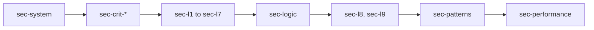

# ADR-0001 — Section order by catalog id, with `after` on sections

> Status: Accepted
> Date: 2026-11-07
> Layer: L3
> Context ticket: 178
> Forks: a-keys, d2-sec-logic

## Context

AC-003 needs the sections in catalog order. Page format 2 is frozen and has no order field, and a new entry goes to the end of its list; only a question takes `after` (SDD §4, §14).

## Driven by

AC-003, AC-005, AC-006; the PRD out-of-scope line "a new page format".

## Decision

Each section id names its catalog part in page order: `sec-system`, `sec-crit-<slug>`, `sec-l1` to `sec-l7`, `sec-logic` (key logic, after the modules), `sec-l8`, `sec-l9`, `sec-patterns`, `sec-performance`. The shared builder accepts `after` on a section, as on a question. The section catalog is 1 named table in DRAFT.md; the design build checks the merged list against it, refuses a list out of order (`section-order`) or an id the catalog does not name, and fills the level links.

## Alternatives Considered

| Alternative | Pros | Cons | Reason rejected |
|-------------|------|------|-----------------|
| Seed every section once, in order, in round 1 | no builder change | a critical part found late cannot go in its place | breaks AC-006 for late critical parts |
| A new page format with an order field | explicit order | a new format and engine work | the PRD puts a new page format out of scope |

## Consequences

- **Positive** — the order holds without a format change; the grill may use `after` too.
- **Negative** — 1 small change in the shared builder.
- **Follow-ups** — none.
