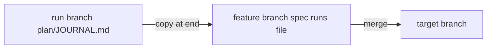

# ADR-0002 — Autopilot copies its journal into the spec folder

> Status: Accepted
> Date: 2026-11-07
> Layer: L6
> Context ticket: 178
> Forks: a-cascade, d2-journal-path, d2-journal-time

## Context

The estimate (AC-039) reads past run times. The journal lives only on the orphan run branch, and gc deletes that branch after the merge, so no afkv2 journal survives (SDD §4, §14; the premise row on the orphan run branch).

## Driven by

AC-038, AC-039, AC-040; requirement ADR-0003.

## Decision

After `end`, an `archive` verb copies `plan/JOURNAL.md` to `<spec dir>/runs/<run branch>.md` in the feature worktree, and commits it on the feature branch when it changed; `ship` stays false until `archive` passed. When a subtask starts, autopilot writes 1 `complexity <class>` line, so the copy keeps the class. The copy merges with the feature; gc never touches it.

## Alternatives Considered

| Alternative | Pros | Cons | Reason rejected |
|-------------|------|------|-----------------|
| A per-machine run-times file in LOCALAPPDATA | no repository change | lost on a new machine; not shared with the team | the estimate would differ per developer |
| Read only journals that still exist | no change | almost always 0 runs after gc | AC-039 would never apply |

## Consequences

- **Positive** — run times survive cleanup and are shared with the repository.
- **Negative** — 1 small Markdown file per run in the spec folder.
- **Follow-ups** — none.
