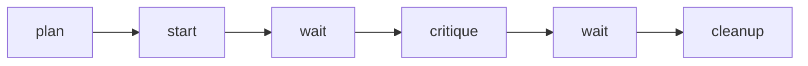

# ADR-0003 — A proposers script drives both tools through herdr

> Status: Accepted
> Date: 2026-11-07
> Layer: L2
> Context ticket: 178
> Forks: none

## Context

AC-017 to AC-026 need 2 solution proposers, 1 per tool, each in a visible pane and a throwaway worktree, with a fallback to 1. The design skill holds only an off stub (SDD §14).

## Driven by

AC-017, AC-019, AC-020, AC-024, AC-025, AC-026; requirement ADR-0001 and ADR-0002.

## Decision

`proposers.py` with the verbs `plan`, `start`, `wait`, `critique` and `cleanup`, over 1 `HerdrRunner` that calls the herdr CLI and git. A versioned state file beside the page document is the ledger of each pane and worktree. One `start` launches both tools; with 1 tool, nothing starts and the agent in charge drafts. `cleanup` must succeed before a draft round builds. Both proposers run in panes, the session's own tool too; the agent in charge only reconciles.

## Alternatives Considered

| Alternative | Pros | Cons | Reason rejected |
|-------------|------|------|-----------------|
| The agent in charge drafts as 1 proposer; only the other tool in a pane | 1 pane less | the drafter also reconciles, with a bias toward its own draft | AC-023 and the grill finding on that bias |
| Each tool's headless mode (`claude -p`, `codex exec`) | no herdr needed | the developer cannot watch it | AC-019 |

## Consequences

- **Positive** — visible, testable with a fake Runner, 1 place for herdr calls.
- **Negative** — 2 panes per session.
- **Follow-ups** — a time cap if a hang shows up (PRD out of scope).
