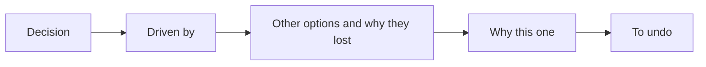

# ADR-0004 — A required "Driven by" block on design decisions

> Status: Accepted
> Date: 2026-11-07
> Layer: L5
> Context ticket: 178
> Forks: none

## Context

AC-009 to AC-011 need 5 blocks per decision, with the requirement text on hover. The decided card has 6 fields and no driven-by block (SDD §14).

## Driven by

AC-009, AC-010, AC-011.

## Decision

A decided card may send `driven_by`: requirement, record or page ids. The shared builder renders it as a "Driven by" labelled block when it is present. The design build requires it, requires a ` — ` reason on each alternative, adds a hover tip per id from the PRD and the records, and degrades a card that misses a block. Design ADRs gain a `## Driven by` section that the gate checks.

## Alternatives Considered

| Alternative | Pros | Cons | Reason rejected |
|-------------|------|------|-----------------|
| Reuse `depends_on` for requirement ids | no new field | it accepts only page ids, and means a card dependency | 2 meanings in 1 field |
| Required in the shared builder for every skill | 1 rule | changes the grill's cards | the PRD keeps the grill unchanged |

## Consequences

- **Positive** — every design decision can be audited on the page and in its record.
- **Negative** — the design round input grows by 1 field per decided card.
- **Follow-ups** — the grill may adopt the block later.
