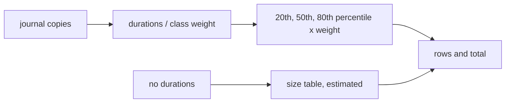

# ADR-0005 — The estimate: weighted percentiles of past run times

> Status: Accepted
> Date: 2026-11-07
> Layer: L8
> Context ticket: 178
> Forks: none

## Context

AC-038 to AC-040 need a low, likely and high agent run time per subtask and in total: from past runs when any exist, else from size. Each subtask contract has a Complexity heading (SDD §14).

## Driven by

AC-038, AC-039, AC-040, AC-041; requirement ADR-0003.

## Decision

The duration of a past subtask runs from its first `developing` line to its `done` line in a journal copy; a parked or incomplete interval is no sample. Each sample is divided by the weight of its complexity class (mechanical 0.5, standard 1, complex 2; a line with no class reads standard). Per subtask: low = 20th percentile, likely = median, high = 80th percentile of the normalised samples, times the subtask's own weight. With no sample, a fixed size table applies (mechanical 0.05 / 0.125 / 0.25, standard 0.25 / 0.5 / 1.0, complex 0.5 / 1.0 / 2.0 days), marked estimated. Totals are sums. Days = minutes / 1440, to 2 decimals. This merges the Codex draft's method, which the Claude critique accepted in writing (proposer trial, R-3).

## Alternatives Considered

| Alternative | Pros | Cons | Reason rejected |
|-------------|------|------|-----------------|
| A model call that judges each subtask | uses the contract text | not repeatable, not testable | the deterministic-first rule |
| Per-class quartiles, unweighted pooling under 3 samples (the Claude draft) | simple | with few runs, pooling mixes mechanical and complex samples unscaled | the Codex weights use every sample from the first run |
| Mean plus or minus the standard deviation | simple | skewed by 1 long parked run | parked time is in the journal, so outliers are common |

## Consequences

- **Positive** — repeatable, testable with fake journals.
- **Negative** — few runs give a wide range.
- **Follow-ups** — none.
