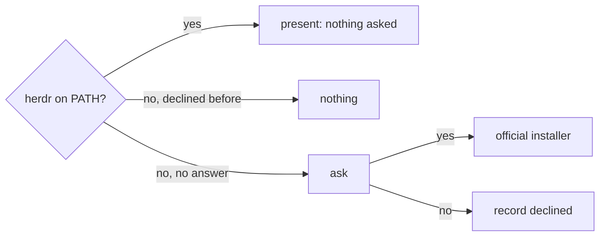

# ADR-0006 — Setup asks once, then installs herdr through its official installer

> Status: Accepted
> Date: 2026-11-07
> Layer: L4
> Context ticket: 178
> Forks: d2-setup-decline

## Context

AC-028 to AC-030: herdr missing → ask once; a yes → the official installer or a package manager; a no → nothing; never copy a program into a temporary folder (SDD §5, §14).

## Driven by

AC-028, AC-029, AC-030.

## Decision

Setup checks for `herdr` on PATH. When it is missing and no answer is recorded, setup answers `ask`, and the agent asks the developer in session. A read-only status step reports it; the agent asks; `setup.py herdr --answer yes` runs the official installer (`install.ps1` through PowerShell on Windows, else `install.sh`, or `brew` when present); `--answer no` records `declined`. The skill owns the question; the script owns the consented install. The record key `herdr` stops a second question.

## Alternatives Considered

| Alternative | Pros | Cons | Reason rejected |
|-------------|------|------|-----------------|
| Download the release program into a temporary folder | no installer dependency | trips the endpoint scanner | AC-029 |
| Never install; only tell the developer | no risk | the 2-proposer flow rarely runs | AC-028 |

## Consequences

- **Positive** — consented, and it uses the vendor's path.
- **Negative** — depends on the installer staying at its address.
- **Follow-ups** — none.
