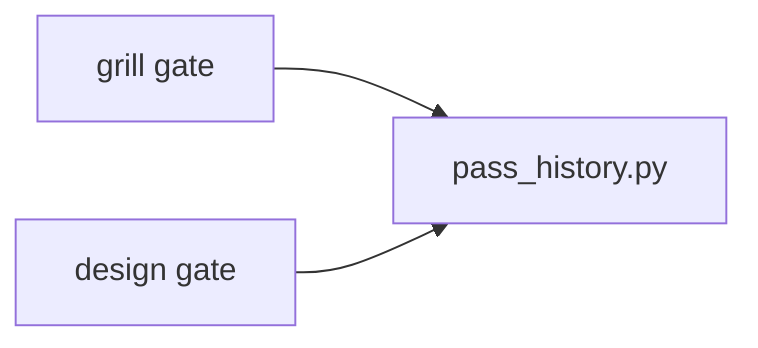

# ADR-0007 — A shared pass-history module for both gates

> Status: Accepted
> Date: 2026-11-07
> Layer: L7
> Context ticket: 178
> Forks: d2-pass-history

## Context

AC-031, AC-032 and AC-035 need, on the design gate, what the grill gate already has: the take-over of a passed session, the stale and changed lists, and the refusal on an open question for others. Those live as private helpers in the grill's log script (SDD §14 row "grill log helpers").

## Driven by

AC-031, AC-032, AC-035.

## Decision

Move the helpers into `pass_history.py` in the shared use-lavish scripts, with public names. Both gates call it; the grill's answers stay byte for byte the same.

## Alternatives Considered

| Alternative | Pros | Cons | Reason rejected |
|-------------|------|------|-----------------|
| Import the grill's private helpers (the Claude draft) | no move | the design skill depends on another skill's private code | the Codex critique; a later grill change would break the design gate unseen |
| Copy the helpers into the design files | no coupling | 2 copies drift | the one-fact-one-home rule |

## Consequences

- **Positive** — 1 home for the pass history of both skills.
- **Negative** — the grill's log script changes in a refactor with no behaviour change.
- **Follow-ups** — none.
