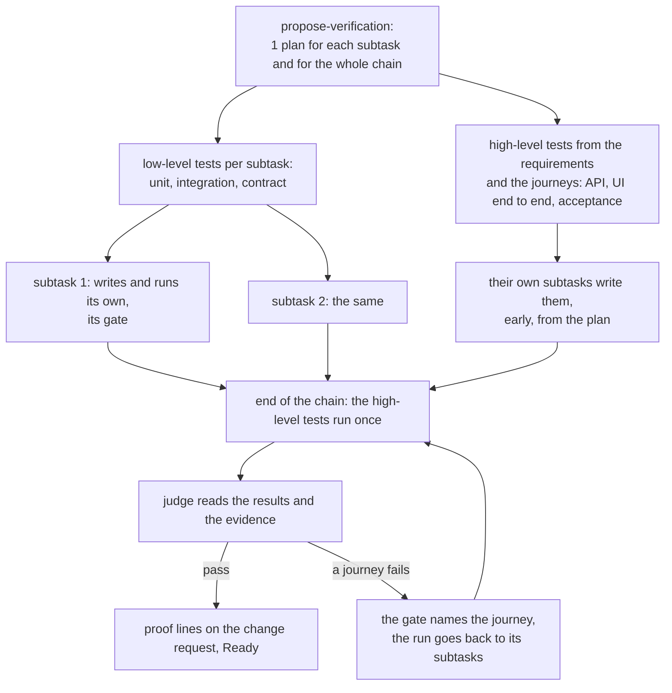
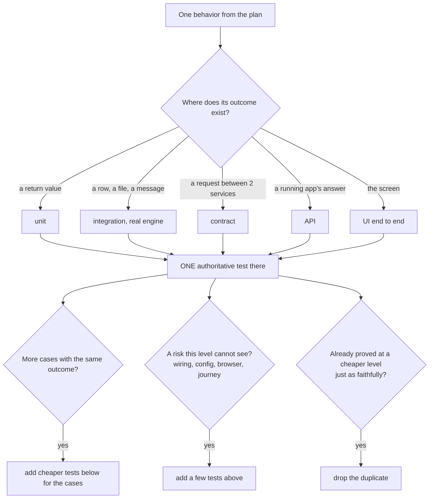

# PRD — #185 Verification in every task

## Problem Statement

1. **Done without proof.** An agent says a change is done, but it never ran the change the way a user meets it. The developer finds the defect. In the motivating incident, an agent made ticket keys on the page clickable, proved it with unit tests only, and said done. In a real browser, the click did nothing.
2. **The medium lane plans no verification.** afkv2 plans and builds a feature. No step designs what to test at which level, and nothing runs the whole feature before ship.
3. **A small task has no light path.** A small fix gets either the full chain, which is too heavy, or nothing: no talk, no test plan, no proof.

The owner's binding spirit for every point: "nothing too heavy, no extra friction, no extra time cost".

## Solution

Every development task gets a test plan and a proof, sized to its lane.

- **Medium lane.** `/afkv2:propose-verification` runs after the design on every medium feature. Claude and Codex each draft a verification plan, critique the other's, and reconcile. The developer steers the whole plan, from user journeys down to unit tests, on the page. The skill writes `VERIFICATION.md`.
- **Small lane.** A short mini-grill on the page for a bug or a small enhancement. The page shows how the bug happens, or the current behavior against the proposed one, then the fix and the test plan. The developer gives a go, the agent fixes test first, and shows the proof.
- **2 kinds of tests.** Low-level tests (unit, integration, contract) are planned, written and run per subtask, as the subtask's gate. High-level tests (API, UI end to end, acceptance) are planned from the requirements and journeys, written in their own subtasks, and run once at the end of the chain, as the ship gate. Only high-level results are proofs.
- **Ship check.** No change request becomes Ready without proof lines. A script checks that every planned proof exists, and a judge agent on the other provider reads the evidence and says whether it shows the feature works.
- **Browser driver.** Setup installs one browser driver for both harnesses, so every UI check can run.
- **Pictures.** Every page skill shows information as pictures wherever a picture helps, and the artifacts written from a page carry those pictures.

## Catalog

### Test levels

| Id | Level | Tier | Proves what no cheaper level proves | A valuable test at this level | Signs of no value |
|---|---|---|---|---|---|
| TL-1 | static (types, lint, schema) | low | a whole class of defect is absent, without a run | blocks only on real defects; says how to fix; under 10% ignored findings | a new suppress comment in the diff; lint cited as proof of a behavior |
| TL-2 | unit | low | logic, edge cases and branches, in milliseconds | public interface only; asserts state, not calls; doubles only for external systems; no I/O, no sleep | expected value copied from the code under test; a double of the unit itself; only "was called" asserts; a snapshot nobody reads |
| TL-3 | integration | low | the code and a real boundary agree: database, file, queue | real engine of the production type; reads the effect back; owns its data; local only | the database is a double; another engine than production; fails when run alone |
| TL-4 | contract | low | 2 services agree on their messages, with no shared environment | the real client makes the call; only the fields the consumer reads; loose matchers; named provider states; a deploy gate | asserts side effects of the provider; raw HTTP in place of the client; never verified by the provider |
| TL-5 | API | high | the wired app, with real configuration, routing and authentication, answers as specified | status, body and effect; owns its data; error and permission paths; polls, never sleeps | status-only assert; a shared environment; fixed sleeps |
| TL-6 | UI end to end | high | a user journey through the real screen and backend | asserts what the user sees; role or label locators; waiting assertions; isolated; a trace on failure | sleeps; structural selectors; a screenshot nobody asserts; depends on the test before |
| TL-7 | acceptance | high | the feature does what was meant, in business words | business language; a few key examples; a concrete outcome; each outcome bound to its own evidence | a click script as the spec; a vague outcome; screenshots with no verdict |

A UI is any surface a person uses: a web page, a terminal command, or a skill run in a real session.

### Value checks

| Id | Check | A valuable test | Checked by |
|---|---|---|---|
| VC-1 | revert | fails without the change | the red step that test-first records; mutation on the changed lines in CI, where the repository has a tool |
| VC-2 | refactor | still passes after a change that keeps behavior | the judge agent |
| VC-3 | rerun | gives the same verdict on every run | script: each high-level test runs twice |
| VC-4 | outcome | asserts on a result, not only "no error" | the judge agent |
| VC-5 | trace | maps to a plan row, and each plan row has a test | script |
| VC-6 | no logic | expected values are literals | the judge agent |
| VC-7 | clear failure | the failure shows expected, actual and input | the judge agent |

## User Stories

1. As a developer, I want to ask for a bug fix and see how the bug happens, the fix and the proof before it ships, so that I trust the fix without testing it myself.
2. As a developer, I want to ask for a small enhancement and see the current behavior against the proposed one, and the proof, so that a small change gets a light path that still proves itself.
3. As a developer, I want to steer the verification plan of a medium feature on the page, and have the feature ship only after every planned high-level test ran, so that the whole feature is proven as a user meets it.
4. As a developer, I want the agent to propose the medium lane when a small task grows past small, so that a big change does not slip through the light path.
5. As a developer, I want the agent to tell me when it cannot reach a test level, so that I supply what is missing or accept a lower level, and no proof is silently dropped.
6. As a developer, I want to set up the browser driver once, so that every later UI check uses it.
7. As a developer, I want a plain chat request to start the entry skill of its lane, so that a change I ask for in passing gets a test plan and a proof too.

## Acceptance Criteria

### Medium lane

- [ ] AC-001 A medium feature whose spec folder has no `VERIFICATION.md` → the plan cut refuses and names `/afkv2:propose-verification`.
- [ ] AC-002 `/afkv2:propose-verification` → Claude and Codex each draft a plan in parallel, each critiques the other's draft, and one reconciled plan comes to the page.
- [ ] AC-003 A point where the 2 providers still disagree after the reconcile → the page shows it as a debate card with both sides.
- [ ] AC-004 The verification page → shows the whole plan from high to low: the user journeys and API scenarios per story, the level of each test, the test data and the environment; the developer steers it with notes, with no question form.
- [ ] AC-005 The end of a `/afkv2:propose-verification` session → the skill writes `VERIFICATION.md`; each plan row holds given, when, what you should see, and the level.
- [ ] AC-006 The plan → names, per subtask, its low-level tests (TL-1 to TL-4), and, for the whole chain, its high-level tests (TL-5 to TL-7).
- [ ] AC-007 The plan cut → gives each subtask the low-level plan rows it owns, and puts the high-level tests in subtasks of their own.
- [ ] AC-008 A subtask whose planned low-level tests do not all pass → it is not done.
- [ ] AC-009 All subtasks done → the high-level tests run once, at the end of the chain; ship refuses Ready until every planned high-level test passed.
- [ ] AC-010 A high-level test fails at the end gate → the gate names the failed journey and the subtasks behind it, and the run goes back to them.
- [ ] AC-011 A hands-off run reaches the end gate and cannot reach a surface it needs → the gate waits for the developer at ship; no subtask stops for it.

### Proofs and the ship check

- [ ] AC-012 A change request, from any lane or from a plain chat request, with a changed user-visible behavior that has no proof line → the ship step refuses Ready and names the behavior.
- [ ] AC-013 A proof line that lacks the behavior, the level, what ran or the evidence link → the ship step refuses Ready and names the missing field.
- [ ] AC-014 A planned proof with no record, a missing evidence file, or a named test that did not pass in CI → the script refuses ship and names the proof.
- [ ] AC-015 The judge agent → gets only the plan rows and the evidence, never the conversation or the builder's claims, and runs once per ship.
- [ ] AC-016 A judged proof → the judge first describes, in its own words, what it sees in each screenshot or answer, then compares it with what you should see; a verdict with no description counts as a fail.
- [ ] AC-017 A judge fail → the proof goes back to the builder with the failed check named; the developer sees each verdict with its description on the page.
- [ ] AC-018 The judge agent tries to accept a lower level, change a test or the evidence, or overrule a failed script check → the attempt is refused.
- [ ] AC-019 The judge agent and the grill's devil's-advocate pass → run on the other provider (Codex for a Claude session, Claude for a Codex session); with one provider set up, on a higher-tier model of that provider at medium effort, which setup names per provider; the page states which provider and model ran.

### Value checks

- [ ] AC-020 A new test with no recorded red step before its change → refused, naming VC-1.
- [ ] AC-021 A repository with a mutation tool → CI runs mutation on the changed lines only; a mutant that survives on a changed line → the test goes back to the builder, naming VC-1. A repository with no mutation tool → the test runs on the parent commit and must fail there.
- [ ] AC-022 Each high-level test → runs twice at the end gate; 2 different verdicts → it counts as flaky, not passed, naming VC-3.
- [ ] AC-023 A test with no plan row, or a plan row with no test → refused, naming VC-5.
- [ ] AC-024 The judge pass → checks VC-2, VC-4, VC-6 and VC-7, the attributes of the test's level, and its signs of no value, from the test levels table; each fail names the check.
- [ ] AC-025 Each plan row's level → is its highest-value level (see Further Notes, terms); a test that repeats a cheaper test just as faithfully is flagged by the critique.

### Contract tests

- [ ] AC-026 A repository config that declares a contract level, and a change at a boundary it covers → the plan adds or updates the contract test, and it runs as a low-level test of that subtask.
- [ ] AC-027 A change across a service boundary with no contract test → the plan proposes a ticket to set one up; the API level stays the floor for that boundary.

### Out of reach

- [ ] AC-028 A planned level the agent cannot reach → the agent names what is missing, fixes what it safely can (starts the app, opens the browser driver), and else asks the developer to supply it or to accept a lower level.
- [ ] AC-029 A lower level → only the developer accepts it; the acceptance and the lower-level proof stand on the change request; `not applicable: <any reason>` no longer skips a live level.

### Small lane

- [ ] AC-030 A bug or a small enhancement → both take the small lane.
- [ ] AC-031 The start of a task → the agent reads the code, then states the lane and the reason in 1 line; the developer confirms or changes it.
- [ ] AC-032 A small-lane bug → before the page round, the agent proves the cause by the diagnosis loop: the merge diff first when the bug started after a merge, a fast pass/fail loop, the exact symptom reproduced on a clean base, a path trace, 3 to 5 ranked hypotheses, one change per probe, and one of the 5 verdicts (one clear fix, several fixes, a gap in the spec, works as specified, cannot reproduce).
- [ ] AC-033 The small-lane page round → shows a picture of the problem (for a bug: how it happens, its flow and the conditions that reach it; for an enhancement: now against proposed, with kept, changed, added and removed), the fix, the test plan with its levels, and open questions.
- [ ] AC-034 The small lane → writes no code before the developer's go.
- [ ] AC-035 A small-lane fix → is written test first; its proof is one high-level test at the end of the fix; for a bug, before and after evidence goes on the page and on the change request.
- [ ] AC-036 Small work that grows past small (a format other skills read, a new module, a design choice) → the agent stops before more code and proposes the medium lane on the page, with the reason; the developer decides.

### Plain chat

- [ ] AC-037 In a new real session, 3 plain requests ("fix X", "add a link to Y", "build feature Z") → each starts the matching entry skill, by its trigger description alone; no core-behavior line is added.

### Bugs found along the way

- [ ] AC-038 An agent sees a bug outside its task → it changes no code for it, and adds it to the "Found along the way" section of the change request description: what, where, and how it saw it; a hands-off run adds to the same section.
- [ ] AC-039 A found bug that blocks a planned proof, or corrupts data or the running app → the agent fixes it in place, as its own task with its own test plan and proof.
- [ ] AC-040 At ship → the page lists the found bugs; the developer picks, for each, fix now, ticket, or drop with a reason.

### Browser driver

- [ ] AC-041 `/afkv2:setup` → installs Chrome DevTools MCP for Claude and for Codex, started with usage statistics off, and proves it: it opens a test page, clicks, takes a screenshot and reads the console, then reports the driver green or names the step that failed. (unverified premise: Chrome DevTools MCP and Playwright MCP each register in Claude Code and Codex CLI, drive a local URL, click, screenshot and read the console; Chrome DevTools MCP officially supports Chrome only)
- [ ] AC-042 The driver → drives Chrome and Edge, headless and in a visible window.
- [ ] AC-043 The developer allows remote debugging in a signed-in Chrome or Edge, and asks the agent to drive it → the agent attaches to that browser; an attach that fails → the agent says why, and offers to watch the developer run the steps, or to reproduce on a local app.
- [ ] AC-044 The driver install → puts no executable file in a temporary or scratch folder.

### Pages and pictures

- [ ] AC-045 Each page skill (requirements grill, design, verification, small lane) → tells the agent to show information as pictures wherever a picture helps the developer understand or decide; no skill fixes a count; the forms table stays as suggestions; the design skill keeps its one required picture per design section.
- [ ] AC-046 Each card on a page → starts its body with its heading, so a note on the whole card shows what it noted.
- [ ] AC-047 A card or section that changed in the current round → shows a "changed this round" mark next to its title; one that did not change shows none.
- [ ] AC-048 Round chips → have one color per round; the current round has the strongest color, and older rounds fade.
- [ ] AC-049 An artifact written from a page (PRD, SDD, ADR, `VERIFICATION.md`) → carries the page pictures the agent judges helpful, as the same rendered image the page showed, with its Mermaid source in a fold below it.

## Worked examples

### WE-01 — frequent: make ticket keys clickable on the page

| Input | Result |
|---|---|
| Plain chat: "make ticket keys on the page clickable". A page shows the key P2P-123 as plain text. | The small lane starts (AC-037, AC-030). The page shows now (plain text) against proposed (a link). Test plan: UI end to end. After the fix, the agent opens the page through the browser driver and clicks P2P-123. |
| The click | A new tab opens at `<jira>/browse/P2P-123`. The screenshot and the tab address go on the change request as a proof line. In the incident, this click did nothing; this proof catches it. |

### WE-02 — frequent: the side-question button does nothing

| Input | Result |
|---|---|
| Report: "the btw? button on the page does nothing". | The agent reproduces it in the browser driver, runs the diagnosis loop, and shows the flow on the page: button, listener, terminal pane, answer, with the failing step marked. |
| The developer's go | Fix test first. Proof at UI level: a click on btw? shows the answer. Before and after screenshots go on the change request. |

### WE-03 — edge: a small fix needs a page-format change

| Input | Result |
|---|---|
| A small bug in note replies. | The agent finds that the fix changes the page document format, which 3 skills read. |
| — | It stops before code and proposes the medium lane on the page, with the reason. The developer decides (AC-036). |

### WE-04 — edge: the app does not start on the laptop

| Input | Result |
|---|---|
| A small UI fix in AP. The environment start command fails: no container runtime. | The agent names what is missing and cannot fix it safely, so it asks the developer (AC-028). |
| The developer accepts the API level | The API test runs as the proof. The acceptance stands on the change request next to it (AC-029). |

### WE-05 — risky: a medium feature changes an AP invoice answer

| Input | Result |
|---|---|
| An AP feature renames a field in the invoice answer. The vendor portal reads that answer. | The plan lists the UI journey, the API scenarios, and the AP provider contract test against the broker (AC-026). |
| The contract test runs in its subtask | It fails on the vendor portal's contract, before ship. The plan names the 2 ways out: keep the old field, or change the consumer first. |

### WE-06 — frequent: the browser driver on a new machine

| Input | Result |
|---|---|
| A developer runs `/afkv2:setup` on a laptop with Chrome. | Setup finds Chrome, registers the driver for Claude and Codex, opens a test page, clicks, takes a screenshot and reads the console (AC-041). |
| — | Setup reports the driver green. Each later UI check uses it with no setup step. |

### WE-07 — risky: the judge rejects a screenshot

| Input | Result |
|---|---|
| Plan row: the invoice list shows the new Status column with the value Approved. The builder attaches a screenshot. | The judge describes it: "the invoice list, a loading spinner covers the table, no column headers visible". The column is not in frame (AC-016). |
| — | Fail, with that description. The proof goes back to the builder, which waits for the table and captures again. The developer sees both verdicts (AC-017). |

### WE-08 — frequent: a bug seen while doing other work

| Input | Result |
|---|---|
| While adding a page section, the agent sees a fold header that shows its id in place of its title. | It changes nothing. It adds the bug to "Found along the way": what, the file, how it saw it (AC-038). |
| Ship | The page lists it; the developer picks ticket (AC-040). |

### WE-09 — edge: reproduce a production bug in a signed-in browser

| Input | Result |
|---|---|
| The developer has the production app open in Edge, signed in, and asks for a reproduction there. | The agent asks the developer to allow remote debugging, attaches, and runs the steps (AC-043). |
| The attach fails | The agent says why, and offers to watch the developer run the steps, or to reproduce on a local app. |

## Access & validation policy

| Capability | Permitted | Denied | Data scope | Validation |
|---|---|---|---|---|
| Confirm or change the lane; approve the fix or the plan; accept a lower level; supply an environment or credentials | developer | agent in a session, hands-off executor, judge agent | every repository afkv2 serves, and the plugin | a lower level stands on the change request with its reason |
| Propose the lane; choose the test levels; start the app and the browser driver; run the checks | agent in a session | — (the developer may too) | the task's repository | no code before the developer's go; no ship without proof lines |
| Run the planned checks; start what it safely can | hands-off executor | asking the developer anything; accepting a lower level | its subtask, and the end gate | an unreachable surface at the end gate waits for the developer |
| Pass or fail a high-level proof | judge agent | accepting a lower level; changing a test or the evidence; overruling a failed script check; reading the conversation or the builder's claims | the plan rows and the evidence of one ship | a verdict without a description fails |

## Implementation Decisions

- Only high-level tests are proofs; they run once, at the end of the chain, as the ship gate: [ADR-0001](adr/requirements/0001-only-high-level-tests-are-proofs.md).
- The small lane takes small enhancements, not only bugs: [ADR-0002](adr/requirements/0002-small-lane-takes-small-enhancements.md).
- Every change request needs proof lines before Ready, in every lane: [ADR-0003](adr/requirements/0003-proof-lines-before-ready-in-every-lane.md).
- Setup installs Chrome DevTools MCP as the one browser driver: [ADR-0004](adr/requirements/0004-chrome-devtools-mcp-is-the-browser-driver.md).
- `/afkv2:propose-verification` is a new skill of the medium lane, after `/afkv2:propose-solution` and before `/afkv2:to-subtasks`. It reuses the 2-provider draft, critique and reconcile engine of `/afkv2:propose-solution`, and writes `VERIFICATION.md` itself, as `/afkv2:propose-solution` writes `SDD.md`.
- The small lane is one entry skill. It takes the ideas of the v1 small-lane branch, not its code: the 5 verdicts, agreement before code, a failing test first, and the proofs. It leaves out the v1 diagnosis check script, ship script, tracker attach, debug tag names, post-mortem and escape analysis.
- `/afkv2:create-change-request` owns the proof lines, the "Found along the way" section, and the refusal of Ready.
- The plan cut (`/afkv2:to-subtasks`) carries the low-level plan rows into each subtask and the high-level tests into their own subtasks; the autopilot runs the end gate.
- Each entry skill's trigger description is strong enough that an agent starts it from a plain request; no core-behavior line routes it.
- The page kit gets the "changed this round" mark and colored round chips; the page guide gets the general picture rule and "heading first" for cards.
- The text says "change request" for a merge request or pull request, never "change" alone.

## Testing Decisions

- This feature follows its own rule. Each acceptance criterion with a user-visible outcome gets a high-level test on a real surface: a skill run in a real session, a page opened and clicked in a real browser, or a command and its answer.
- AC-037 runs in a new real session, not in a unit test.
- The page features (AC-046 to AC-048) are proven by opening a page in the browser driver and looking at it; the judge agent reads the screenshots.
- AC-041 to AC-043 run live on this machine with Chrome and Edge.
- WE-01 is the acceptance test for the whole feature: the motivating incident, run again through the small lane, must end with a click that opens the ticket.
- Low-level tests cover the scripts: the ship refusal, the proof line fields, the plan row mapping, the plan cut, and the judge's input.
- Prior art: the 2-provider engine of `/afkv2:propose-solution` and its tests; the v1 small-lane branch's diagnosis loop.

## Out of Scope

- The large lane: issue #108, deferred to afkv2 2.1.
- Editing a lavish note after Send: no lavish version has it; it is a request for the lavish author.
- Moving the lavish pin: done in afkv2 2.0.0-beta.16 (0.1.86, the newest release at least 30 days old).
- The v1 small-lane scripts and the removal of `/afk:bug`: they stay in v1.

## Further Notes

- **Terms** (repository glossary): *Highest-value level* is the lowest test level where a behavior's outcome exists with fidelity; each behavior has one authoritative test there, cheaper tests below add cases, and a few tests above cover wiring, configuration, the browser or a journey. *Proof* is the result of one high-level test of a changed behavior where the user meets it, with its evidence. *Proof line* is one line on the change request per proof: the behavior, the level, what ran, and the evidence link. *Judged proof* is a proof whose evidence needs reading, such as a screenshot or an answer. *Plan row* is one row of `VERIFICATION.md`: given, when, what you should see, and the level. *Testable at a level* means the agent can reach that level here and now: the app starts, a browser tool exists, the credentials exist.
- The research behind the value checks: Kent Beck's Test Desiderata, Vladimir Khorikov's four pillars (read from a summary), Software Engineering at Google chapters 11 to 14 and 20, The Practical Test Pyramid, the Pact documentation, Playwright best practices, and Gojko Adzic on key examples. The rules for judged screenshot proofs are an inference: no source defines that format.
- The browser driver ran live on this machine: Chrome DevTools MCP drove Chrome and Edge, headless and attached to a throwaway profile; Playwright MCP failed a click after Back when attached. The attach to the developer's own signed-in profile timed out twice and is not proven.
- Assumptions this PRD rests on:
  - Chrome DevTools MCP and Playwright MCP each register in Claude Code and Codex CLI, drive a local URL, click, screenshot and read the console; Chrome DevTools MCP officially supports Chrome only (unverified-external).
