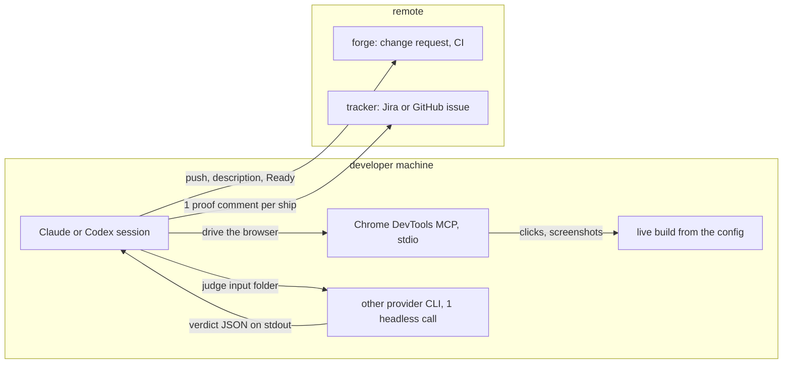
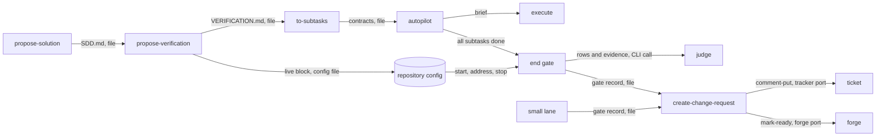
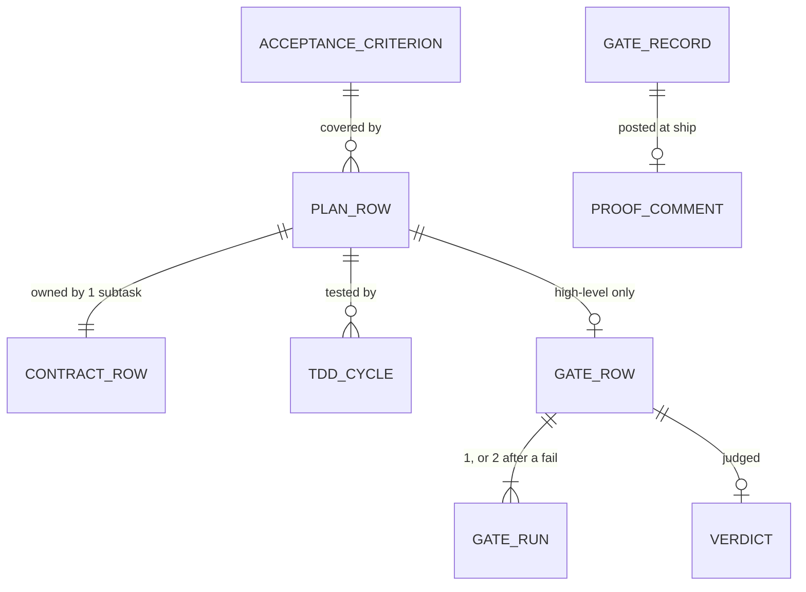
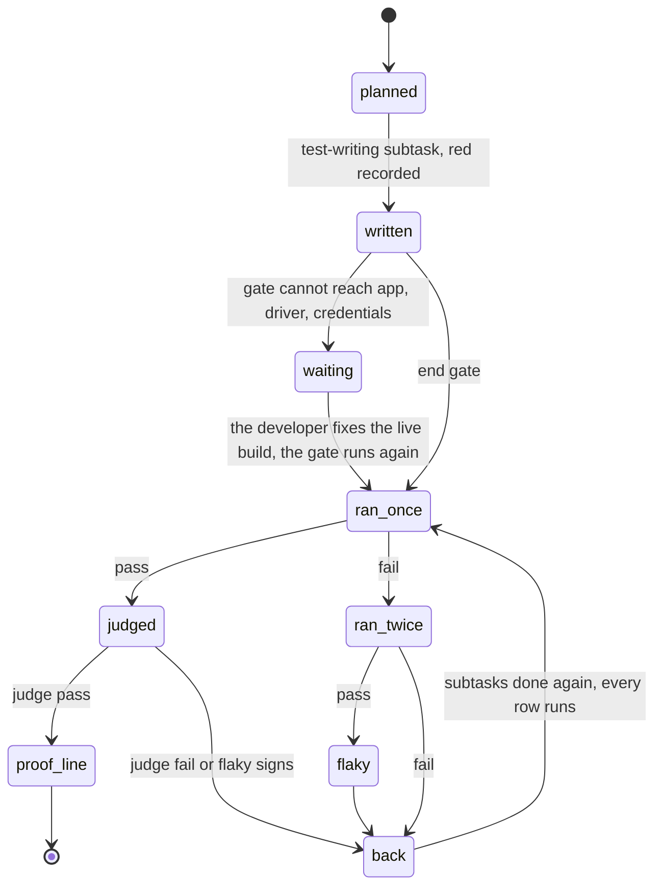
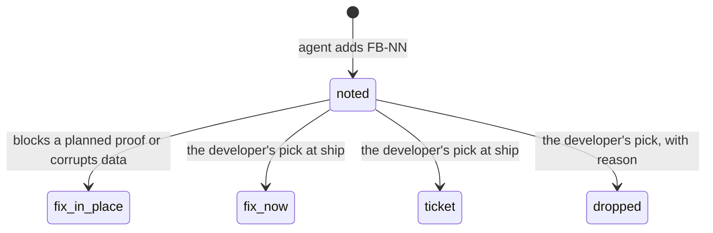
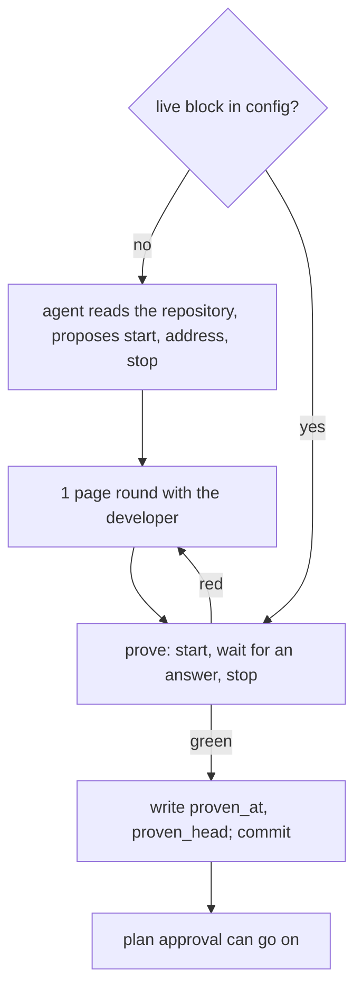
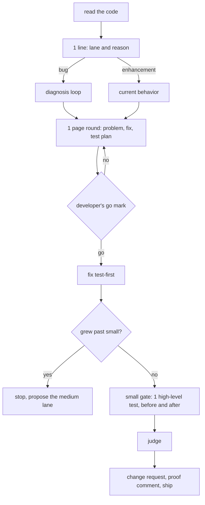
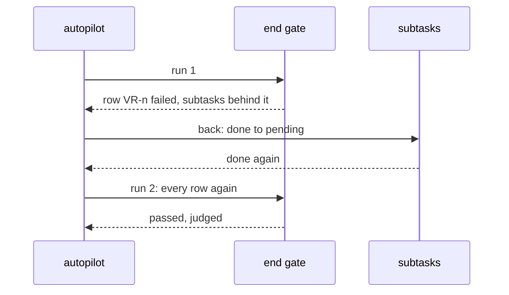
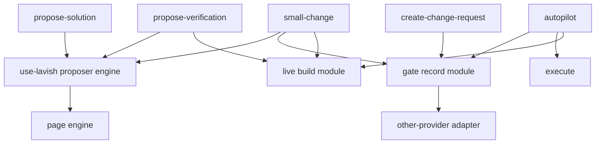

# SDD — Verification in every task

> Parent PRD: `PRD.md`
> Status: Draft
> Last updated: 2026-11-11

## §0 Binding Contract

This SDD and its accepted ADRs are binding on implementing agents and reviewers.

| Aspect | Locked by SDD/ADR | Executor latitude |
|--------|-------------------|-------------------|
| Pattern choice | yes | no |
| Module public interface | yes | no |
| API contract and schema | yes | no |
| Persisted schema (§4) | yes | no |
| Life cycle states and legal moves (§6) | yes | no |
| Roles per surface (§5) | yes | no |
| Transaction and idempotency strategy | yes | no |
| External-seam contract (§9b) | yes | no |
| File layout inside a named module | no | yes |
| Private helpers, internal names, control flow | no | yes |
| Test fixture structure | no | yes |

**Conflict procedure.** An executor finds a binding decision wrong, infeasible or against reality. A two-way-door correction is recorded in `plan/DECISIONS.md` and built. A one-way door or a tie parks the subtask and returns to `/afkv2:propose-solution` for a new ADR that supersedes the old one. Never override off the record.

**Human sign-off register.** One row per human-locked aspect (`DRAFT.md`).

| Aspect | Section | Status | Signed by / date | Approved wording |
|--------|---------|--------|------------------|------------------|
| HL-1 Persistence and entity design | §4 | signed | developer / 2026-11-11 | sign mark on card sign-hl-1, round 4, on the 6 records and their fields as written in §4; no note |
| HL-2 API surface | §3 | signed | developer / 2026-11-11 | sign mark on card sign-hl-2, round 4, on surfaces S-1 to S-16 and their refusal codes as written in §3; no note |
| HL-3 Authorization and data scoping | §5 | signed | developer / 2026-11-11 | sign mark on card sign-hl-3, round 4, on the 5 developer-only acts and their 2 guards as written in §5; no note |
| HL-4 Life cycle and invariants | §6 | signed | developer / 2026-11-11 | sign mark on card sign-hl-4, round 4, on the proof life cycle and invariants I-1 to I-14 as written in §6; no note |
| HL-5 Irreversible and outward side effects | §7 | signed | developer / 2026-11-11 | sign mark on card sign-hl-5, round 4, on the 6 outward effects as written in §7; no note |
| HL-6 Change to existing behaviour | §14 | signed | developer / 2026-11-11 | sign mark on card sign-hl-6, round 4, on the 5 reworked seams as written in §14; no note |

## §1 Context Summary

An agent declared a change done that it never ran through its real entry point, and nothing in afkv2 stopped it. This design makes every rule of the PRD a script check: a plan with one row per behavior, low-level tests that gate each subtask, high-level tests that run once at an end gate against a live build proven before the run starts, a judge on the other provider that describes before it compares, and a ship step that reads a local gate record and posts one proof comment to the ticket. A lean small lane gives bugs and small enhancements the same proof with one page round and the developer's go. Two solution proposers, Claude and Codex, drafted the design; each critiqued the other, and the developer steered it on the page in 4 rounds.

## §2 L1 — System Topology

Inherited: skills plus Python scripts in a local worktree of the developer's machine. New runtime parts: the browser driver, the judge as 1 headless call of the other provider, the live build of the repository config, and 1 proof comment on the ticket per ship.



*Everything new runs on the developer's machine; only the change request and the proof comment leave it.*

| # | Decision | Why | Not taken |
|---|----------|-----|-----------|
| L1-1 | Chrome DevTools MCP, global npm install at an exact pin, started by each harness from its MCP entry | requirement ADR-0004; same install path as the diagram renderer; no executable in a temp folder (AC-044) | npx at start: unpacks into the npm cache on each cold start |
| L1-2 | The judge and the grill's devil pass: 1 headless call of the other provider's CLI, read-only, verdict on stdout (design ADR-0001) | AC-015, AC-019; works hands-off and outside herdr | a herdr pane, as the proposers use |
| L1-3 | High-level tests run on the developer's machine at the end gate, against the live build of the config | requirement ADR-0001; the forge gives 1 overall CI status (fork f-ci, design ADR-0004) | a CI job with an app in CI for every served repository |
| L1-4 | The live build is a `live` block of the repository config, proven before plan approval (design ADR-0007) | the developer's round 3 note; today the app line is free text no step proves | a start line per plan |
| L1-5 | The proof comment goes to the ticket through the tracker port (design ADR-0005) | the developer's round 3 note: the ticket is the source of truth | a link to the run branch, which is local and deleted by gc |

## §3 L2 — Service Boundaries & Integration



*Skills talk through files and script verbs; the only network calls are the forge, the tracker and the judge CLI.*

```mermaid
sequenceDiagram
  participant AP as autopilot
  participant EG as end gate
  participant APP as live build and driver
  participant OP as other provider
  participant CR as create-change-request
  AP->>EG: run (all subtasks done)
  EG->>APP: start from the live block, probe
  EG->>APP: each row: 1 run; a fail runs once more
  EG->>OP: rows and evidence, when every row passed
  OP-->>EG: verdict: describe, then compare
  EG-->>AP: passed, failed rows with their subtasks, or waiting rows
  AP->>CR: ship page: proof lines, proof comment, found bugs
  CR->>CR: mark-ready verifies the gate record
  CR->>CR: comment-put after the developer's ship mark, then Ready
```

*The judge runs only when every row passed its script checks; the proof comment goes out before Ready.*

**Single writers.**

| Area | Single writer | Readers |
|------|---------------|---------|
| VERIFICATION.md | propose-verification | plan cut, plan check, end gate, judge input |
| contract Verification table | to-subtasks | start gate, execute, done check, end gate |
| test-first record | execute | done check |
| gate record and evidence | end gate or small lane, through the gate record module | mark-ready, the ship page, the proof comment |
| change request description | create-change-request | the developer, reviewers |
| live block of the repository config | the live build module, run by propose-verification (later by setup) | start gate, end gate, small gate |
| proof comment on the ticket | create-change-request at ship, through the tracker verb comment-put | the team; gc checks it exists |
| MCP entries, judge model lines | setup | the harnesses, the other-provider adapter |

**Surfaces (HL-2 grade).** Every surface is a script verb with the existing JSON envelope: `{"ok": true, ...}`, or `{"ok": false, "error": {"code", "reason"}}`; exit 0 ok, 1 refused, 2 unreadable input. No surface pages. Each verb is idempotent by its key or by a receipt.

| # | Surface | Request | Success answer | Refusal codes | Existing callers |
|---|---------|---------|----------------|---------------|------------------|
| S-1 | plan cut `plan_files.py start` | as today | as today | `missing-input` naming VERIFICATION.md, writer propose-verification, on a medium plan | a cut plan never runs start again |
| S-2 | `check_plan.py` | as today | as today | `row-unknown`, `row-unowned`, `row-two-owners`, `row-no-test-subtask`, `ac-no-high-row`, `row-on-retired-ac`, `live-not-applicable`, `lower-level-unmarked`, `contract-row-missing` | the new checks run only on plans with `> Rules: 2` (fork f-rules) |
| S-3 | `start_gate.py` | as today | as today | `live-not-applicable` | old plans as today |
| S-4 | `tdd_log.py red`, `no-test` | + `row` (VR-NNN), `test` (file::name), `level` | as today | `bad-payload` when `row` is missing on a new plan | old calls still work |
| S-5 | `walk.py done` | as today | as today | `row-not-green`, `row-no-test`, `test-no-row` | new plans only |
| S-6 | `end_gate.py run` (new) | plan | gate record path, result per row | `not-finished`, `gate-cap-reached` after 3 failed gate runs | none |
| S-7 | `end_gate.py back` (new) | plan, failed rows | the reopened subtasks | none new | none |
| S-8 | `small_lane.py start`, `go`, `gate` (new) | the small-lane record | record path | `no-go-mark`, `code-before-go` | none |
| S-9 | `change_request.py open` | proofs `{row, behavior, level, ran, evidence}`; found `{what, where, how}` | as today | `bad-payload` naming the field | the old `{claim, evidence}` refuses with a fix hint |
| S-10 | `ci_watch.py mark-ready` | plan optional; gate record required | as today | `no-gate`, `gate-not-passed`, `proof-missing`, `proof-field-missing`, `evidence-changed`, `verdict-no-description`, `gate-head-stale`, `found-open`, `proof-not-posted` | plan-folder plans keep the review check |
| S-11 | `other_provider.py judge`, `attack` (new) | input folder or log | verdict JSON | `no-provider`, `judge-timeout`, `judge-unreadable` | none |
| S-12 | `setup.py browser-driver`, `judge` (new verbs) | none | the driver proof, the judge model per provider | `no-browser`, `driver-install-failed`, `register-failed`, `proof-failed`, `no-provider` | the install record keeps its other lines |
| S-13 | page schema `session.skill` | + `propose-verification`, `small-change` | — | none | every stored page stays valid |
| S-14 | `live_build.py prove`, `check` (new) | repository | prove: start, wait for an HTTP answer, stop, then write the block; check: the same with no write | `live-undefined`, `live-start-failed`, `live-no-answer`, `live-stop-failed` | none |
| S-15 | tracker port `comment-put` (new) | `{key, body, pictures[], receipt}` | `{comment_id, url, attached[]}` | `bad-receipt`, `too-large`, `gh-too-old`, `no-push-access`, `not-supported` (GitHub Enterprise Server) | the port's other verbs do not change |
| S-16 | `gc list` | as today | as today | `proof-not-posted` for a run branch whose proof comment is not on the ticket | a run with no gate record (an old plan) is not checked |

The forge port does not change. The CLI flags of S-11 were checked on 2026-11-11: `codex exec` takes `-m`, `-s`, `-i`, `-C`, `--output-schema`; `claude -p` takes `--model`, `--effort`, `--output-format`. The tracker limits behind S-15 were checked in the vendor documents on 2026-11-11 (design ADR-0005).

## §4 L3 — Data Architecture

Files only, no database. VERIFICATION.md is the plan; the gate record on the run branch is the proof, local only; the proof comment on the ticket is what lasts. Ids `VR-NNN` and `FB-NN` are never reused.

| State | Datastore | Partitioning | Replication | Retention | Schema-evolution policy | PII? | Audited? |
|-------|-----------|--------------|-------------|-----------|-------------------------|------|----------|
| VERIFICATION.md | spec folder, feature branch | 1 per feature | git | forever, as the PRD | ids never reused; retired rows stay; new columns at the right end | no | git history |
| contract Verification table | run branch plan folder | 1 per subtask | none | until gc after merge | new column Plan row; read by header name | no | git history |
| test-first record | run branch, per subtask | 1 per subtask | none | until gc | new optional keys; old records read as before | no | git history |
| gate record and evidence | run branch gate folder, local, never pushed | 1 per gate run | none | until gc, after the proof comment is on the ticket | `version` field; an unknown major version refuses | screenshots may show app data | sha256 per file |
| proof comment | the ticket (Jira, or GitHub issue) | 1 per ship | the tracker's | the tracker's | first line `afkv2 proof v1 <receipt>` | screenshots may show app data | the tracker's history |
| live block | repository config, committed | 1 per repository | git | until the developer changes the build | `proven_at`, `proven_head` move at each proof | variable names only, no values | git history |
| change request description | forge | 1 per change | the forge's | the forge's | new sections; old ones untouched until the next open | no | the forge's history |

**Plan row** (VERIFICATION.md).

| Field | Type | Null? | Default | Unit / precision | Constraint | Indexed / unique | Note |
|-------|------|-------|---------|------------------|------------|------------------|------|
| Id | `VR-NNN` | no | — | 3 digits | never changed or reused | unique | retired in place |
| Criteria | list of `AC-NNN` | only for a low-level row with no user-visible outcome | — | — | each id exists in the PRD | — | |
| Story | story number or journey | yes | null | — | — | — | |
| Given, When, Then | 1 sentence each | no | — | — | Then is what you should see | — | the judge compares to Then |
| Level | static, unit, integration, contract, api, ui-e2e, acceptance | no | — | — | TL-1 to TL-7 | — | |
| Tier | low or high | no | derived from Level | — | a mismatch refuses | — | |
| Data, Environment | text | yes | null | — | AC-004 | — | the gate's reach check reads Environment |
| Status | `active`, `retired: <why>`, `lower: <from> to <to> · <card>` | no | active | — | lower needs the developer's mark | — | |
| Owner | not stored | — | — | — | derived from the Plan row column of the contracts | — | fork f-owner = b, design ADR-0002 |

**Gate record** (run branch, local).

| Field | Type | Null? | Default | Unit / precision | Constraint | Indexed / unique | Note |
|-------|------|-------|---------|------------------|------------|------------------|------|
| version | integer | no | 1 | — | unknown major refuses | — | |
| lane | medium or small | no | — | — | — | — | |
| head | commit | no | — | full hash | the commit the tests ran at | key with digest | |
| verification_digest | sha256 | no | — | hex | of VERIFICATION.md | key with head | a second run at the same key runs nothing |
| rows[].runs[] | `{n, exit, started, seconds, log, evidence[{path, sha256, bytes}]}` | no | — | seconds, bytes | at most 2 per row per gate run | — | |
| rows[].result | pass, fail, flaky, waiting | no | — | — | flaky counts as a fail | — | |
| rows[].waiting, rows[].lower | text, `{level, mark or quote}` | yes | null | — | lower needs the developer's mark | — | |
| rows[].verdict | `{provider, model, effort, seen[], compare[], checks[], result}` | yes | null | — | `seen` before `compare`; empty `seen` fails | — | from the judge's stdout |
| found[] | `{id FB-NN, what, where, how, pick, by}` | no | [] | — | pick only by the developer | FB-NN unique | |
| go | `{card, head, at}` | small lane only | null | — | — | — | |
| failed_runs | integer | no | 0 | gate runs | at most 3 (design ADR-0006) | — | |

**Live block** (repository config).

| Field | Type | Null? | Default | Unit / precision | Constraint | Indexed / unique | Note |
|-------|------|-------|---------|------------------|------------|------------------|------|
| start | command line | no | — | — | runs from the repository root, in the background | — | |
| address | http or https URL | no | — | — | ready on any HTTP answer | — | |
| ready_seconds | integer | no | 120 | seconds | > 0 | — | the wait for the first answer |
| stop | command line | yes | null: stop the process tree the start began | — | — | — | |
| needs | list of variable names | yes | [] | — | names only; a value is never stored | — | |
| proven_at, proven_head | date, commit | no | — | day, full hash | written only after a green proof | — | |

**Proof comment** (ticket).

| Field | Type | Null? | Default | Unit / precision | Constraint | Indexed / unique | Note |
|-------|------|-------|---------|------------------|------------|------------------|------|
| first line | `afkv2 proof v1 <receipt>` | no | — | — | receipt of the ship-page preview | unique per ship | gc and a second post find it |
| row lines | VR id, behavior, level, result, 1 sentence of what the judge saw | no | — | 1 line per active high-level row | — | — | |
| pictures | attached screenshots of the last gate run | yes | none | GitHub: 10 MB each | GitHub: PNG, JPEG, GIF, WebP, SVG, MP4, MOV, WebM | — | |
| logs | name and sha256 | yes | none | — | the file stays local | — | |
| footer | head commit, change request link, judge provider and model | no | — | — | — | — | |

**Test-first record, changed keys:** `cycles[].row`, `test`, `level` are new and optional; old records read null, null, low. `no_test[].row` is new; a no-test reason covers only its row. A high-level cycle needs no green in its subtask: its green comes at the end gate.

| Relation | Target | Cardinality | Owning side | On delete / orphan | Fetch posture |
|----------|--------|-------------|-------------|--------------------|---------------|
| acceptance criterion → plan row | plan row | 1 to 0..n | plan row (Criteria) | a retired criterion retires its rows; the plan check refuses an active row on it | read by the plan check |
| plan row → contract row | contract Plan row column | 1 to 1 (low), 1 test-writing subtask (high) | contract | a dropped subtask is refused until each row has another owner or is retired | read by the plan check |
| plan row → test-first cycle | cycle | 1 to 0..n | cycle (`row`) | — | read by the done check |
| plan row → gate row | gate row | 1 to 0..1, high-level only | gate record | gone with the run branch | read by mark-ready |
| gate row → gate run | run | 1 to 1..2 | gate record | — | — |
| gate row → verdict | verdict | 1 to 0..1 | gate record | — | — |
| gate record → proof comment | comment | 1 to 0..1 | comment (receipt) | the comment outlives the record | read by gc |

**Surface reachability.** The new Plan row column is read only by the plan check, the start gate, the done check and the end gate; no other surface shows the contract. The new change-request sections show on the forge at the next open.

**Migration and backfill.** No file is rewritten. A plan without `> Rules: 2` keeps today's rules to its end (fork f-rules, design ADR-0003). Old test-first records read as before. An open change request keeps its free-text proofs until its next open. Going back means reverting the release; the extra rows of new plans are ignored by old code.



*Each plan row links a requirement to its owner, its test, its run and its proof.*

## §5 L4 — Cross-Cutting & Quality Attributes

**Authorization.** One role holds each act: the developer. An agent message never counts.

| Act | Permitted | Denied | Guard on the page | Guard in a script |
|-----|-----------|--------|-------------------|-------------------|
| accept a lower level | developer | every agent, the judge | a mark on the plan page or the ship page | check_plan, mark-ready: `lower-level-unmarked` |
| small-lane go | developer | every agent | a sign mark on the go card | small_lane go, mark-ready: `no-go-mark`, `code-before-go` |
| pick for a found bug | developer | every agent | a mark on the ship page | mark-ready: `found-open` |
| post the proof comment | developer | every agent | the ship mark on the exact comment and pictures | comment-put needs the preview receipt: `bad-receipt` |
| `> App: none` on a medium plan | developer | every agent | a mark | verification write: `live-unproven` |

In chat with no page, the developer's own message counts for the lower level, the found-bug pick and the go; it is quoted into the record.

**Data scoping.** The judge sees only plan rows, evidence and test files: no conversation, no builder claims. It runs in a read-only sandbox and answers on stdout only; a field outside the schema fails the row.

| Concern | Decision | Number or posture |
|---------|----------|-------------------|
| Evidence integrity | sha256 per evidence file | mark-ready hashes again; any change refuses |
| Flaky tests | 1 run; a fail runs once more; fail then pass is flaky and counts as a fail; the judge fails flaky signs | at most 2 runs per row per gate run |
| Head drift | Ready needs every change after the gate head to lie in the spec folder | else `gate-head-stale` |
| Provider | the other provider if its CLI is on the path and signed in; else the own provider at setup's judge model, medium effort | the page and the record name provider, model, effort (AC-019) |
| Proof comment consent | the developer's ship mark on the page that shows the exact comment | no comment without it |
| Public repositories | on a public GitHub repository anyone can open an attached picture | the ship page says so; the secret scan reads the comment first |
| gh floor | gh 2.99.0 or later for `--attach` when the tracker is GitHub | setup checks it; this machine had 2.92.0 on 2026-11-11 |

**Idempotency.**

| Surface | Key shape | Window | Ledger |
|---------|-----------|--------|--------|
| end gate run | (head, VERIFICATION.md digest) | the run branch's life | the gate record |
| judge call | the gate key | 1 per passed gate run | the verdict in the gate record |
| proof comment | the preview receipt on the first line | the ticket's life | the ticket's comments |
| live proof | proven_head | until the next proof | the live block |

**Retry and timeout.**

| Call | Attempts | Backoff (s) | Timeout (s) |
|------|----------|-------------|-------------|
| high-level test | 1, plus 1 after a fail | 0 | the test's own |
| judge call | 1, plus 1 on a transport failure; a verdict is never retried | 0 | 300 (estimated) |
| live build start | 1 | — | ready_seconds, default 120 |
| comment-put | 1; the developer posts again from the ship page | — | the tracker's |

Rate limit, feature flags: none. Observability: the gate record and the page. Secrets: none new; the live block stores variable names only; the browser attach reads only the debug port.

## §6 L5 — Domain Model

| # | Invariant | Owner | Guardian | Answer to a violation |
|---|-----------|-------|----------|----------------------|
| I-1 | a medium plan cut has VERIFICATION.md | plan cut | plan_files input check | `missing-input` |
| I-2 | each user-visible AC has an active high-level row | propose-verification | verification write, check_plan | `ac-no-high-row` |
| I-3 | each low-level row has 1 owner; each high-level row 1 test-writing subtask | to-subtasks | check_plan | `row-unowned`, `row-two-owners`, `row-no-test-subtask` |
| I-4 | not applicable never skips a live level | to-subtasks | check_plan, start_gate | `live-not-applicable` |
| I-5 | a subtask is done only with its low-level rows green | execute | walk done | `row-not-green` |
| I-6 | a new test has a red step; no-test covers only its row | execute | tdd_log verdict | `code-before-red` per row, `test-no-row` |
| I-7 | Ready only with a passed, judged gate row and a proof line per active high-level row | create-change-request | mark-ready | the S-10 codes |
| I-8 | evidence never changes after the run | end gate | mark-ready | `evidence-changed` |
| I-9 | old plans keep old rules | plan cut | rules_of(plan) reads `> Rules: 2` | no line: old rules |
| I-10 | small lane: no code before the go | small lane | small_lane, mark-ready | `code-before-go` |
| I-11 | only the developer moves a found bug out of noted | create-change-request | mark-ready | `found-open` |
| I-12 | gc deletes no run branch before its proof comment is on the ticket | gc | gc checks | `proof-not-posted` |
| I-13 | a medium plan is approved only with a live block proven at a commit of this feature, or `> App: none` with the developer's mark | propose-verification | verification write | `live-unproven` |
| I-14 | a gate run starts only when fewer than 3 gate runs of this ship failed | autopilot | end_gate run | `gate-cap-reached` |



*A high-level proof: 1 run; a fail runs once more; fail then pass is flaky and goes back.* The subtask statuses stay; one move is new: `done` to `pending`, made only by `end_gate.py back`.



*A found bug: only the developer moves it out of noted, except a bug that blocks a planned proof.*

Domain events: none.

## §7 L6 — Process & Coordination

**Medium lane.** Draft, critique, steer, prove the live build, VERIFICATION.md, plan cut, low-level rows per subtask, end gate (at most 3 failed runs), judge, proof lines, proof comment, Ready. **Small lane.** 1 page round, the developer's go, 1 high-level proof.



*The live build is worked out with the developer once, then only checked (design ADR-0007).*



*The small lane: no code before the go; it stops and proposes the medium lane when it grows.*



*After a failed gate, every row runs again; after 3 failed gate runs the run waits for the developer (fork f-again, design ADR-0006).* Transaction boundary: each gate run writes its record once, at its end; a crash leaves no record and the run starts again.

| Failure point | Detection signal | Automatic recovery | Manual recovery | Owner |
|---------------|------------------|--------------------|-----------------|-------|
| live build not up at the gate | the start gate's app probe | start it from the live block, wait, stop it after | the developer fixes the build; prove again | end gate |
| live block missing or stale | `live-undefined`, `live-no-answer` | none | 1 page round with the developer in propose-verification | propose-verification |
| browser driver missing | no green driver proof in the install record | none | setup browser-driver | end gate |
| a test fails twice, or fail then pass | exit codes | back reopens its subtasks; every row runs again | after 3 failed gate runs the run waits for the developer | autopilot |
| judge absent, timeout, unreadable | `no-provider`, `judge-timeout`, `judge-unreadable` | the own provider's higher tier; 1 retry | the row waits at ship | other-provider adapter |
| judge fail | verdict result fail | back, with the failed check named (AC-017) | none | end gate |
| evidence edited after the run | hash mismatch | none | run the gate again | mark-ready |
| head moved after the gate | `gate-head-stale` | none | run the gate again | mark-ready |
| proof comment fails | a tracker error code | none | post again from the ship page; gc refuses until it lands | create-change-request |
| MCP registration fails | `register-failed` | restore the backup | the developer | setup |

**Outward effects (HL-5 grade).**

| Effect | Trigger | Order against local state | Idempotency key | Partial failure leaves | Recovery |
|--------|---------|---------------------------|-----------------|------------------------|----------|
| live block committed to the config | a green proof | after the proof | proven_head | nothing | revert the commit |
| call to the other provider | judge, devil pass | after every row passed | the gate key | no verdict: the row waits | run the judge step again |
| change request description | open | before Ready | the description | the old description | open again |
| proof comment on the ticket | the developer's ship mark | after the gate verify, before Ready | the receipt on the first line | pictures attached, no comment | post again; the receipt finds them |
| Ready | mark-ready | last | the change state | Draft | mark-ready again |
| Claude and Codex settings | setup browser-driver | backup first | the MCP entry name | 1 of 2 harnesses | run again; switch-back restores |

## §8 L7 — Module Decomposition



*Skills point to shared modules, never to each other; no cycle.*

| Module | Purpose | Public interface | Depends on |
|--------|---------|------------------|------------|
| proposer engine (use-lavish, moved from propose-solution) | 2-provider draft, critique, reconcile | plan_proposers, start, wait, critique, cleanup; a Skill adapter: state_path, ready, noun, prefix | herdr |
| propose-verification files | the session and VERIFICATION.md | start, sync, write | proposer engine, live build module |
| propose-verification round | the page round | build | page engine |
| small lane | the small-lane record | start, go, gate | gate record, live build, proposer engine |
| end gate (autopilot) | run the high-level rows | run, back, status | gate record, live build, other-provider adapter |
| gate record (shared) | the one reader and writer of the gate record | write_run, write_verdict, verify(gate, proofs, head), proof_lines(gate), proof_comment(gate) | other-provider adapter |
| other-provider adapter (shared) | 1 adapter per CLI | judge(input), attack(log), which() | the provider CLIs |
| live build (shared) | prove and check the live block | prove, check, start, stop | repository config reader |
| tracker port | ticket writes | + comment-put | Jira REST, gh |
| setup tools | install and prove | ensure_browser_driver, register_mcp, prove_driver, + gh floor | npm, harness settings |
| page engine | pages and pictures | changed mark, round chip fade, heading inside the body, export of a diagram | lavish |

## §9 L8 — Tactical Patterns

| Concern | Pattern | ADR |
|---------|---------|-----|
| 2-provider proposing in 2 skills | Strategy: one engine, a per-skill adapter; beat a copy of the proposer file | design ADR-0008 |
| the other provider | Adapter: 1 per CLI; beat inline calls in 3 callers | design ADR-0001 |
| the rules of the feature | a guardian script per rule (§6); beat prose, which the incident shows is skipped | requirement ADR-0003 |
| gate evidence | write-once record with content hashes, one writer; beat trusting the change request text | design ADR-0005 |
| old against new plans | one rules switch, rules_of(plan); beat date checks in each checker | design ADR-0003 |
| judge output | schema first: description before comparison; beat a free-text verdict | design ADR-0001 |

## §9b External Seams & Failure Affordance

| Boundary | Framework at its pin | What it does to our value | Failure surface | Seam test |
|----------|----------------------|---------------------------|-----------------|-----------|
| browser driver | Chrome DevTools MCP, exact npm pin set by setup | drives the live build, returns screenshots and console | `register-failed`, `proof-failed` | setup's live proof: open a test page, click, screenshot, read the console |
| judge CLI | `codex exec` or `claude -p` at the installed version | turns rows and evidence into a verdict JSON | `judge-timeout`, `judge-unreadable` | a judge call on a fixture folder whose verdict parses with `seen` before `compare` |
| GitHub attach | gh 2.99.0 or later, `gh issue comment --attach` | uploads pictures, inserts their links in the comment | `gh-too-old`, `no-push-access`, `not-supported` | a live post of 1 picture to a test issue, read back |
| Jira attach | Jira Cloud REST v3 attachments and comments | stores the pictures, the ADF comment links them | the site's size limit, 1 MB of comment text | a live post of 1 picture to a test ticket, read back |
| live build | the repository's own start command | serves the app at the address | `live-no-answer` | live_build prove on this repository |

## §10 NFRs

All numbers are design targets, estimated, not measured.

| Concern | Target | Measurement | Owner |
|---------|--------|-------------|-------|
| gate overhead above the tests | 30 s (estimated) | the gate record's seconds minus the rows' seconds | end gate |
| judge call | 300 s (estimated) | the verdict's seconds | other-provider adapter |
| setup browser-driver | 120 s (estimated) | setup's step time | setup |
| developer time in a green medium run | 1 ship page view (inferred) | page rounds in the session | create-change-request |
| evidence per gate run | 6 MB, local (estimated: 20 rows x 2 files x 150 KB) | bytes in the gate record | end gate |
| proof comment | about 3 MB of pictures per ship (estimated) | bytes attached | create-change-request |
| evidence per row | at most 5 files, 2 MB each | the gate record | end gate |
| mutation | changed lines only | CI time | the served repository's CI |

## §11 Out of Scope

The PRD's list, plus:

- Per-test results read from CI (fork f-ci = a): the end-gate record stands for "passed in CI".
- Pushing the run branch, or copying the evidence into the spec folder (fork f-evidence, design ADR-0005).
- Setup proving the live build for a new repository: a spinoff ticket.
- Pictures from the CLI on GitHub Enterprise Server: gh does not support it.

## §12 Reversed Decisions

| Prior ADR | Superseded by | Reason |
|-----------|---------------|--------|
| none | — | the round 1 aspect card a-api read "the approval date picks the rules"; fork f-rules = b replaced it with the `> Rules: 2` header (design ADR-0003); no ADR held the first reading |

## §13 Open Questions

| Question | Layer (L1-L9) | Blocks executor? | Owner | Target resolve date |
|----------|---------------|------------------|-------|---------------------|
| Does attach to a signed-in Chrome or Edge work (AC-043)? It timed out twice during the grill. | L1 | no: setup's live proof closes it; a failed attach falls back as AC-043 says | setup subtask | before the plan's last subtask |
| Do the Chrome DevTools MCP flags hold on both harnesses (AC-041)? | L1 | no: setup's live proof closes it | setup subtask | before the plan's last subtask |
| PRD AC-014 and AC-022 wording | L5 | no: corrected by a grill take-over after this session | developer | 2026-11-12 |

## §14 L9 — Implementation Seams & Change Impact

Paths are relative to the `afkv2` folder; lines were read on 2026-11-11.

| Seam | Existing contract | Planned change | Impacted flows | Conventions and landmines | Verdict |
|------|-------------------|----------------|----------------|---------------------------|---------|
| `skills/to-subtasks/scripts/plan_files.py:42` SPEC_FILES; `skills/to-prd/INDEX-FORMAT.md:28` | reserves VERIFICATION-PLAN.md | VERIFICATION.md | plan cut, index | rename in both | fits |
| `plan_files.py:80-93` `_check_inputs` | PRD, SDD, ADRs | + VERIFICATION.md on a medium plan | plan cut | | extends (ADR-0003) |
| `skills/to-subtasks/scripts/check_plan.py:65`, `skills/autopilot/scripts/start_gate.py:32` live tiers | lockstep copies | + acceptance (high), + contract (low) | plan check, start gate | change both copies in 1 commit | extends (ADR-0003) |
| `check_plan.py:504-520`, `start_gate.py:183-205` | `not applicable:` with any reason skips the row | `> Rules: 2` plans refuse it on a live level | plan check, start gate | | reworked |
| `skills/to-subtasks/SUBTASK-CONTRACT.md:40-46`, plan_contract 17-63 | Tier, Check, Proves | Tier, Plan row, Check, Proves, read by header | every contract reader | read by header name, never position | extends (ADR-0002) |
| `skills/execute/scripts/tdd_log.py:88-141` | 1 no_test entry turns code-before-red off | row, test, level; no-test covers its row only | execute | old calls still work | extends |
| `skills/autopilot/scripts/walk.py:409-438, 460-463` | no row check; ships when archived | + row checks; + gate record passed or waiting; `done` to `pending` by back | autopilot | the run branch is not pushed (419-420) | extends (ADR-0006) |
| `skills/create-change-request/scripts/change_request.py:56-69` | `{claim, evidence}` free text | `{row, behavior, level, ran, evidence}`; Found along the way | change request | | reworked |
| `skills/create-change-request/scripts/ci_watch.py:353-397` mark-ready | plan folder required (385-387); reviews and CI | plan optional; gate record and proof comment verified before CI | ship | | reworked |
| `skills/propose-solution/scripts/proposers.py` | imports design_round (55-59), gates on its phase (316-318) | generic part to the use-lavish proposer engine; CLI unchanged | propose-solution | | reworked |
| `skills/grill-requirements/ROUNDS.md:174-176` | devil pass: a fresh subagent | the other-provider adapter's attack | requirements grill | | extends (ADR-0001) |
| engine page, kit stylesheet, base card | changed = left shadow; chip muted; h4 outside the body | changed chip after the title; chip fade by round age; h4 first in the body | every page | | extends |
| engine diagrams | SVG cache, transparent background (97-98) | export(text, dest): light SVG on white into the spec pictures folder | artifacts from a page | | extends |
| setup tools, setup | no MCP code; no gh floor | browser-driver and judge verbs; gh 2.99.0 or later when the tracker is GitHub | setup | same npm path as the renderer (338-361) | extends |
| `skills/to-subtasks/PLAN-FORMAT.md:11` `> App:` | address or start command, free text, never proven | new plans: `> App: config`, the proven live block | plan cut, start gate | | extends (ADR-0007) |
| `scripts/afkv2_config.py` read_config | spec_folder, tracker, ownership, forge | + live | every config reader | | extends (ADR-0007) |
| `ports/tracker/CONTRACT.md:20` | no create, transition or comment verb | comment-put: Jira ADF with attachment-put; GitHub `gh issue comment --attach` | ship | GitHub: pictures and video only, 10 MB each | extends (ADR-0005) |
| `skills/to-prd/SKILL.md:8` | the only skill that writes to Jira | the proof comment is a second ticket write, at ship, after the developer's mark | ticket writes | | reworked |
| `skills/gc/scripts/gc_checks.py:65-182` | merge, clean, tips, platform | + proof comment on the ticket | gc | | extends (ADR-0005) |
| lavish dependency | pinned | changes only by a plugin release plus setup takeover, newest release at least 30 days old | every page | never install by hand | fits |

**Compatibility findings the developer accepted (card sign-hl-6, round 4):**

- `not applicable:` on a live level is refused only in `> Rules: 2` plans; old plans run as today.
- The old proof payload refuses with a fix hint.
- mark-ready keeps the review check for plan-folder plans; a plan without a gate record (an old plan) ships on today's rules.
- The proposer engine's CLI does not change.
- create-change-request becomes a second ticket writer, for the proof comment only; to-prd does not change.
- A served repository's CI does not change.
