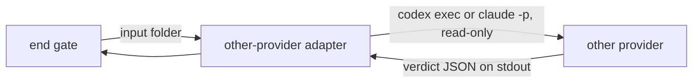

# ADR-0001 — The judge is 1 headless call of the other provider's CLI

> Status: Accepted
> Date: 2026-11-11
> Audited: 2026-11-11
> Layer: L1
> Context ticket: 185
> Forks: none

## Context

The judge and the grill's devil's-advocate pass must run on the other provider, or on a higher-tier model of the own provider at medium effort (SDD §2, §5). They must work in a hands-off run and outside herdr.

## Driven by

AC-015, AC-016, AC-018, AC-019; card l-1.

## Decision

The other-provider adapter runs 1 headless call, `codex exec` or `claude -p`, in a read-only sandbox, on an input folder that holds only plan rows, evidence and test files. The verdict comes back on stdout as JSON with `seen` before `compare`. A transport failure gets 1 retry; a verdict is never retried.

## Alternatives Considered

| Alternative | Pros | Cons | Reason rejected |
|-------------|------|------|-----------------|
| a herdr pane, as the proposers use | visible to the developer | needs herdr, a worktree and a submit check per call | a hands-off run must not need herdr |
| a subagent of the own provider | no second CLI | not the other provider; shares the builder's blind spots | AC-019 asks for the other provider |

## Consequences

- **Positive** — a judge with no view of the conversation; works in every run.
- **Negative** — 1 more CLI call per gate run; the CLI flags are a seam to test.
- **Follow-ups** — setup proves the judge model per provider.
