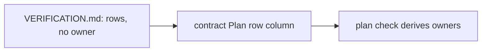

# ADR-0002 — The owner of a plan row is written only in the contracts

> Status: Accepted
> Date: 2026-11-11
> Layer: L3
> Context ticket: 185
> Forks: f-owner

## Context

VERIFICATION.md is written by propose-verification and merges with the spec. The owner subtask is known only at the plan cut (SDD §4).

## Driven by

AC-007, AC-023; fork f-owner.

## Decision

Each contract's Verification table gets a Plan row column. The plan check derives each row's owners from the contracts. VERIFICATION.md holds no owner.

## Alternatives Considered

| Alternative | Pros | Cons | Reason rejected |
|-------------|------|------|-----------------|
| a column in VERIFICATION.md filled by the plan cut | the owner in one file | a second writer on a spec file; a re-cut rewrites it | the developer picked b |

## Consequences

- **Positive** — one fact in one place; one writer per file.
- **Negative** — VERIFICATION.md alone does not say who owns a row.
- **Follow-ups** — none.
