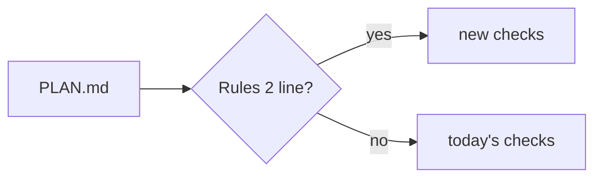

# ADR-0003 — A `> Rules: 2` header line selects the new rules

> Status: Accepted
> Date: 2026-11-11
> Layer: L9
> Context ticket: 185
> Forks: f-rules

## Context

Plans approved before the release must keep today's rules (SDD §4 Migration). The round 1 card read: the approval date picks the rules.

## Driven by

card a-migration, card a-api; fork f-rules.

## Decision

The plan cut writes `> Rules: 2` into PLAN.md. One switch, rules_of(plan), reads it; every checker asks the switch. A plan with no line keeps today's rules.

## Alternatives Considered

| Alternative | Pros | Cons | Reason rejected |
|-------------|------|------|-----------------|
| the approval date against the release date | no new line | a plan cut before the release and approved after it gets new rules on an old contract and refuses | the developer picked b |

## Consequences

- **Positive** — exact; no release date to set.
- **Negative** — 1 more header line.
- **Follow-ups** — none.
