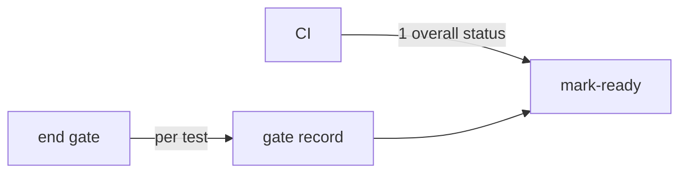

# ADR-0004 — The end-gate record stands for passed in CI for high-level tests

> Status: Accepted
> Date: 2026-11-11
> Layer: L2
> Context ticket: 185
> Forks: f-ci

## Context

AC-014 refuses ship for a named test that did not pass in CI. The forge gives 1 overall CI status. High-level tests run against a live build on the developer's machine (SDD §2).

## Driven by

AC-014; requirement ADR-0001; fork f-ci.

## Decision

Each high-level test's result is its row in the gate record. CI's overall status stays green-required at ship. The PRD wording of AC-014 changes from CI to the end gate.

## Alternatives Considered

| Alternative | Pros | Cons | Reason rejected |
|-------------|------|------|-----------------|
| read per-test results from CI | the forge is the record | 2 forge implementations; an app in CI for every served repository | the developer picked a |

## Consequences

- **Positive** — no forge change.
- **Negative** — a PRD correction.
- **Follow-ups** — correct AC-014 by a grill take-over.
