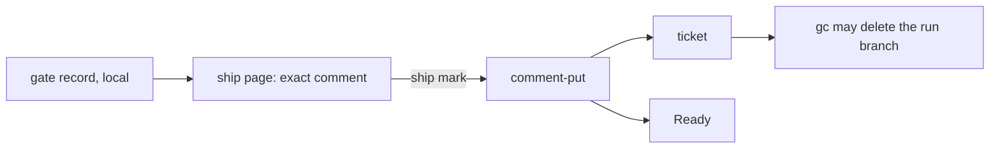

# ADR-0005 — Evidence stays local; 1 proof comment goes to the ticket at ship

> Status: Accepted
> Date: 2026-11-11
> Audited: 2026-11-11
> Layer: L6
> Context ticket: 185
> Forks: f-evidence

## Context

The change request must link each proof's evidence. The run branch is local and gc deletes it. The developer wrote in: full proofs stay local; the ticket is the source of truth and gets the proof as a comment before gc (SDD §3, §7).

## Driven by

AC-012, AC-013, AC-035; fork f-evidence; card ev-ticket; note N-3-m-aspects-2.

## Decision

The gate record and its evidence stay on the local run branch. At ship the page shows the exact comment and pictures; the developer's ship mark is the yes. create-change-request posts it with the tracker verb comment-put, then marks Ready. The comment's first line carries the preview receipt. Only pictures are attached; logs go as name and sha256. gc refuses `proof-not-posted`. A small-lane run with no ticket posts on the change request. Limits checked 2026-11-11: GitHub needs gh 2.99.0 or later and push access, takes pictures and video only, 10 MB per picture, and does not work on GitHub Enterprise Server (docs.github.com, Attaching files with GitHub CLI; GitHub changelog 2026-09-01). Jira allows 1 MB of rich text per comment, 5000 comments and 2000 attachments per work item, and a per-file limit set by the site admin (Atlassian KB, Work item field limits in Jira Cloud).

## Alternatives Considered

| Alternative | Pros | Cons | Reason rejected |
|-------------|------|------|-----------------|
| push the run branch | links to every file | links die at gc; skip-ci not verified for every forge | the developer wrote in |
| copy the evidence into the spec folder | links last forever | main grows about 6 MB per feature | the developer wrote in |
| keep it local; the proof line carries the summary | no growth | a reviewer cannot see a screenshot | the developer wrote in |

## Consequences

- **Positive** — the ticket holds the proof; no repository growth.
- **Negative** — a second ticket writer; logs are gone after gc; public pictures on a public GitHub repository.
- **Follow-ups** — the tracker port gets comment-put; setup checks the gh floor.
