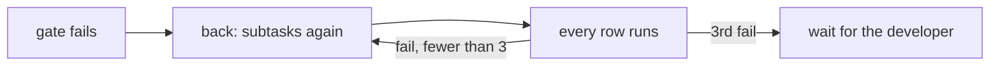

# ADR-0006 — After a failed gate every row runs again, at most 3 failed gate runs

> Status: Accepted
> Date: 2026-11-11
> Layer: L6
> Context ticket: 185
> Forks: f-again

## Context

A failed row sends its subtasks back. The proofs must stand at the head that ships (SDD §7).

## Driven by

AC-009, AC-010; fork f-again.

## Decision

After back, the next gate run runs every high-level row again. The gate record counts failed gate runs; at 3, end_gate run refuses `gate-cap-reached` and the run waits for the developer.

## Alternatives Considered

| Alternative | Pros | Cons | Reason rejected |
|-------------|------|------|-----------------|
| only the failed rows and those of reopened subtasks, no cap | cheaper; 1 judge call per ship | evidence from an older head; a test that keeps failing loops a hands-off run | the developer picked a |

## Consequences

- **Positive** — every proof at the shipped head; a bounded run.
- **Negative** — up to 3 full gate runs.
- **Follow-ups** — none.
