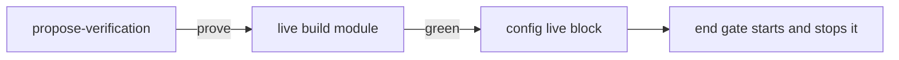

# ADR-0007 — The live build is proven before autopilot and kept in the repository config

> Status: Accepted
> Date: 2026-11-11
> Audited: 2026-11-11
> Layer: L6
> Context ticket: 185
> Forks: none

## Context

Today the app line of PLAN.md is free text that no step proves; a run that cannot start the app stops at the start gate (SDD §7). The developer asked that propose-verification work the process out, prove it live before autopilot, and keep it in the repository config.

## Driven by

AC-011, AC-028; card live-build; note N-3-m-aspects-1.

## Decision

The repository config gets a `live` block: start, address, ready_seconds, stop, needs, proven_at, proven_head. With no block, propose-verification proposes one from the repository and settles it with the developer in 1 page round. With a block, it checks it again. Only a green proof (start, HTTP answer, stop) writes the block. The plan is not approved without a green proof, or `> App: none` with the developer's mark. The end gate starts and stops the build from the block.

## Alternatives Considered

| Alternative | Pros | Cons | Reason rejected |
|-------------|------|------|-----------------|
| a start line per plan | no config change | each plan finds the start again; nothing proves it | the developer's note |
| setup proves it once | earlier | a build changes after setup; nothing checks it again | kept as a spinoff ticket |

## Consequences

- **Positive** — a smooth hands-off run; one home for the process.
- **Negative** — 1 proof per propose-verification session.
- **Follow-ups** — spinoff ticket: setup offers the same proof.
