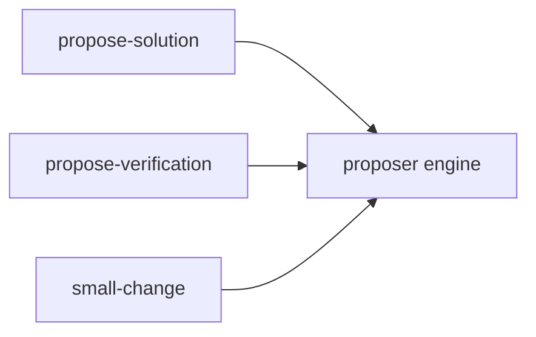

# ADR-0008 — One proposer engine with a per-skill adapter

> Status: Accepted
> Date: 2026-11-11
> Audited: 2026-11-11
> Layer: L7
> Context ticket: 185
> Forks: none

## Context

propose-verification needs the same draft, critique and reconcile as propose-solution. The proposer file imports design_round and gates on its phase (SDD §14).

## Driven by

AC-002, AC-003; card l-7.

## Decision

The generic part moves to a use-lavish proposer engine. Each skill passes an adapter: state_path, ready, noun, prefix. propose-solution's CLI does not change.

## Alternatives Considered

| Alternative | Pros | Cons | Reason rejected |
|-------------|------|------|-----------------|
| a copy of the proposer file | no move | 2 copies to fix | one fix point wins |

## Consequences

- **Positive** — one fix point.
- **Negative** — a move of tested code.
- **Follow-ups** — none.
