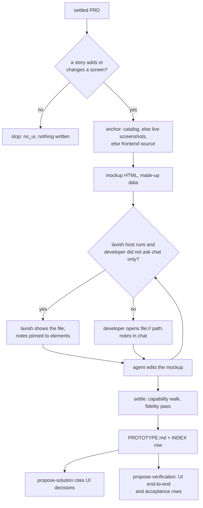

# PRD — #207 Prototype and design system in afkv2

## Problem Statement

1. **No way to settle new UI before the design.** afkv2 has no step that settles a new or changed screen before the design. Screen choices get made in heads, or late in the design, and are redone.
2. **Notes in chat lose the element.** In v1 the developer reacted to the mockup in chat. With several tables on one screen, a prose note misses which element the developer meant.

## Solution

afkv2 gets 2 new skills, ported from v1: `prototype` and `design-system`.

- **prototype** turns a settled PRD that adds or changes a screen into one clickable mockup: a self-contained HTML file that looks like the real app, with made-up data. The developer drives it, pins notes on its elements, and the agent edits it and shows it again. When the developer settles one direction, the skill writes `PROTOTYPE.md`.
- **Notes on the mockup.** Lavish shows the mockup file itself, with no grill page, cards or rounds. Each note comes back pinned to the element it is on. Lavish is the default when its host runs. The developer can say "chat only" at any time. With no host, the developer opens the file in a browser and gives notes in chat.
- **design-system** builds or refreshes a design catalog for one frontend: its tokens and one card per repeating shape, each checked against the live app. The catalog is committed in the repository. The prototype reads it first.
- **Readers.** `propose-solution` and `propose-verification` read `PROTOTYPE.md` when it exists. The design cites its screen decisions; the verification plan takes its screens and story paths for UI end-to-end and acceptance tests.

## Catalog

### Anchors

The prototype copies the look of the real app from the first anchor it can use.

| Id | Anchor | When it applies | Fidelity mark in PROTOTYPE.md |
|---|---|---|---|
| AN-1 | design catalog | the repository config names a catalog folder for the frontend, and it holds a catalog | `live-verified` when the app ran for the fidelity pass, else `catalog` |
| AN-2 | live screenshots | no catalog; the repository config has a `live` block, so the app starts | `live-verified` |
| AN-3 | frontend source | no catalog and no `live` block | `source-only` |

### Readers of PROTOTYPE.md

| Id | Reader | What it takes |
|---|---|---|
| RD-1 | `propose-solution` | the screen and interaction decisions, cited in the existing design sections where they change the design |
| RD-2 | `propose-verification` | the screens and story paths, as rows of the `ui-e2e` and `acceptance` levels |
| RD-3 | `INDEX.md` | the Prototype row, written only by `prototype` |

## User Stories

1. As a developer, I want to run the prototype on a ticket with a settled PRD that adds a screen, and get a clickable mockup that looks like my app, so that I settle the screen before the design.
2. As a developer, I want to pin notes on mockup elements in lavish, and have the agent edit and show the mockup again, so that each note keeps the element I meant.
3. As a developer with no lavish host, or who asks for chat only, I want to open the mockup file in a browser and give notes in chat, so that the prototype works without lavish.
4. As a developer, I want to settle one direction, with every story clickable or logged as a gap, and get `PROTOTYPE.md`, so that later skills read one settled record.
5. As a developer, I want to run the design-system skill for a frontend to create or refresh its catalog in the repository, so that every mockup copies the real look.
6. As `propose-solution`, I want to read `PROTOTYPE.md` when it exists and cite its UI decisions where they change the design, so that the design does not decide the screen again.
7. As `propose-verification`, I want to read `PROTOTYPE.md` when it exists and derive `ui-e2e` and `acceptance` rows from its screens and story paths, so that the UI tests follow the settled screen.
8. As a developer on a feature with no new screen, I want the prototype to stop and say there is nothing to draw, so that a backend-only feature costs nothing.

## Acceptance Criteria

### Prototype: start and anchor

- [ ] AC-001 A PRD where no story adds or changes a screen → the prototype stops with `no_ui`, writes no file, and leaves the `INDEX.md` Prototype row as it is.
- [ ] AC-002 A PRD where at least one story adds or changes a screen → the prototype writes one self-contained HTML mockup per screen in the ticket spec folder.
- [ ] AC-003 The anchor → the prototype uses the first anchor of the anchors table (AN-1 to AN-3) that applies, and records the fidelity mark of that row in `PROTOTYPE.md`.
- [ ] AC-004 The repository config has a `live` block → the prototype and design-system start the app through it; no other start command or address input is asked.
- [ ] AC-005 The repository config names no `live` block → no app starts; the mockup is built from the frontend source and `PROTOTYPE.md` marks it `source-only`.
- [ ] AC-006 The frontend and its catalog folder → come from the repository config; a frontend the config does not name → the skill stops and names the missing config entry; it does not ask for a path each run.

### Prototype: the mockup file

- [ ] AC-007 The mockup → is clickable from the entry screen inside the app shell, with stub pages for the neighbours the shell links to.
- [ ] AC-008 The mockup → holds only made-up data; no record copied from the live app or its database.
- [ ] AC-009 The mockup → opens as a `file://` page and makes no network call.
- [ ] AC-010 The mockup file committed in the repository → holds none of the lavish page runtime.

### Prototype: notes

- [ ] AC-011 The lavish host runs and the developer did not ask for chat only → lavish shows the mockup file itself, with no grill page, cards or rounds.
- [ ] AC-012 A note pinned in lavish → reaches the agent with the element it is on: a CSS selector, the tag and its text.
- [ ] AC-013 Each note → gets an edit of the mockup or a reply, and the mockup is shown again.
- [ ] AC-014 The developer says "chat only", at any time → the prototype stops using lavish for that run and takes notes in chat.
- [ ] AC-015 No lavish host → the prototype gives the `file://` path of the mockup and takes notes in chat.
- [ ] AC-016 Lavish is shown → the lavish version pin and the host-safety checks of afkv2 apply; a pin mismatch or an unsafe host → lavish is not used, and the run continues in chat.

### Prototype: settle

- [ ] AC-017 The developer settles one direction → the capability walk clicks every story and acceptance criterion through the mockup from its entry screen; each one is reachable or logged as a gap in `PROTOTYPE.md`.
- [ ] AC-018 A settle with the app running → a fidelity pass compares the mockup with the live app and records the result.
- [ ] AC-019 The settle → writes `PROTOTYPE.md` with a coverage table (one row per story) and the fidelity mark, and sets the `INDEX.md` Prototype row.
- [ ] AC-020 Every file the prototype writes → passes the secret scan before the skill reports done; a finding → the skill names the file and the finding and does not report done.

### Design system

- [ ] AC-021 A design-system run for a frontend the config names → writes or refreshes its catalog in the catalog folder: the tokens and one card per repeating shape (shell, components, page types).
- [ ] AC-022 Each catalog card → is checked side by side against a live screenshot of the shape it records; a card that cannot be checked → marked unchecked in the catalog.
- [ ] AC-023 A design-system run → covers one frontend; it writes nothing outside that frontend's catalog folder.
- [ ] AC-024 The catalog → holds only made-up data, and every written file passes the secret scan.
- [ ] AC-025 A design-system run → sends nothing to claude.ai/design or any other host.

### Access

- [ ] AC-026 A hands-off subagent runs prototype or design-system → it opens no page, writes no file, and parks with the reason that a developer must run it.

### Readers

- [ ] AC-027 `propose-solution` with a `PROTOTYPE.md` in the spec folder → the design cites each UI decision that changes the design, in its existing sections; the design format gets no new section.
- [ ] AC-028 `propose-verification` with a `PROTOTYPE.md` in the spec folder → the plan holds `ui-e2e` and `acceptance` rows that trace to the screens and story paths of `PROTOTYPE.md`.
- [ ] AC-029 `propose-solution` or `propose-verification` with no `PROTOTYPE.md` → each runs as it does today; no refusal and no new question.
- [ ] AC-030 Any skill other than `prototype` → writes neither `PROTOTYPE.md` nor the `INDEX.md` Prototype row.

## Worked examples

### WE-01 — frequent: a new list screen in an app with a catalog

| Input | Value |
|---|---|
| PRD | 2 stories: see orders, filter orders by status |
| Catalog | present for the frontend |
| `live` block | present |
| Lavish host | runs |

| Step | Result |
|---|---|
| Anchor | catalog (AN-1); the app starts for screenshots of the shell and the nearest page type |
| Mockup | one orders screen with 12 made-up orders |
| Note | the developer pins "filter too far right" on the filter bar; the agent moves it and shows the mockup again |
| Settle | both stories clickable from the nav entry; `PROTOTYPE.md` with a 2-row coverage table, fidelity `live-verified` |
| Later | `propose-verification` writes 2 `ui-e2e` rows that trace to `PROTOTYPE.md` |

### WE-02 — edge: no running app, no catalog, no lavish host

| Input | Value |
|---|---|
| Catalog | none |
| `live` block | none |
| Lavish host | not running |

| Step | Result |
|---|---|
| Anchor | frontend source (AN-3): tokens and components read from the code |
| Notes | the agent gives the `file://` path; the developer opens it in a browser and notes in chat |
| Settle | fidelity `source-only`, flagged in `PROTOTYPE.md` |

### WE-03 — risky: live screenshots hold real customer records

| Input | Value |
|---|---|
| Live app | runs against a shared database with real customer names |

| Risk | Result wanted |
|---|---|
| The agent lifts markup from the live page, and real names land in the committed mockup or catalog card | the mockup and the catalog hold only made-up data (AC-008, AC-024); the secret scan runs on every written file before the developer commits (AC-020) |

### WE-04 — edge: a backend-only feature

| Input | Value |
|---|---|
| PRD | 2 stories, both about an API export job; no story names or changes a screen |

| Step | Result |
|---|---|
| Start | the prototype reads the stories and finds no new or changed screen |
| Result | stops with `no_ui`, writes no file, leaves the `INDEX.md` Prototype row as it is (AC-001) |

## Access & validation policy

| Capability | Permitted | Denied | Data scope | Validation |
|---|---|---|---|---|
| Run prototype (stories 1 to 4, 8) | a developer at the keyboard | a hands-off subagent: opens no page, parks | the ticket spec folder | made-up data only; the mockup opens as `file://` with no network call; the committed file holds no lavish runtime; secret scan on every written file |
| Run design-system (story 5) | a developer at the keyboard | a hands-off subagent: opens no page, parks | one frontend per run, named in the repository config | made-up data only; secret scan on every written file |
| Read `PROTOTYPE.md` (stories 6, 7) | `propose-solution` and `propose-verification`, each in its own run | any writer of `PROTOTYPE.md` other than `prototype` | the ticket spec folder | optional input: an absent file changes nothing |

## Implementation Decisions

- Two new afkv2 skills, `prototype` and `design-system`, ported from their v1 counterparts; v1 names and the v1 plugin stay untouched.
- Lavish shows the mockup HTML natively, apart from the afkv2 grill page engine. [ADR-0001](adr/requirements/0001-lavish-shows-the-mockup-natively.md)
- The design catalog is committed in the consuming repository, one per frontend; nothing goes to claude.ai/design. [ADR-0002](adr/requirements/0002-design-catalog-lives-in-the-repository.md)
- The repository config names each frontend's source path and catalog folder. The exact keys are a design choice.
- Both skills start the app through the existing `live` block of the repository config.
- UI decisions reach the design as citations in its existing sections. [ADR-0003](adr/requirements/0003-ui-decisions-cited-in-existing-design-sections.md)
- `PROTOTYPE.md` is an optional input of `propose-solution` and `propose-verification`; `prototype` is the only writer of `PROTOTYPE.md` and of the `INDEX.md` Prototype row (decided by agent, accepted by the developer).
- The developer's "e2e, UAT" maps to the existing verification levels `ui-e2e` and `acceptance`; no new term.
- Screenshots come from the browser driver afkv2 already installs.

## Testing Decisions

- A good test runs a skill's scripts through their real entry point and checks what they write: the mockup file, `PROTOTYPE.md`, the INDEX row and the catalog files.
- Unit tests cover the anchor choice (AN-1 to AN-3), the `no_ui` stop, the config lookup of frontend and catalog, the hands-off refusal, and the check that the committed mockup holds no lavish runtime and no network call.
- The reader changes get tests in the existing `propose-solution` and `propose-verification` test suites: with `PROTOTYPE.md` present and absent.
- The lavish path gets a live check run by the developer in a real session, like the existing grill live check: open a mockup, pin a note, see the edit.
- Prior art: the v1 `prototype` and `design-system` skills, and the afkv2 lavish launcher tests.

## Out of Scope

- Any use of claude.ai/design: the share push of the chosen mockup and the catalog push.
- The logic and state-model branch of the prototype. The developer said "skip"; no spinoff ticket.
- A hosted share link for stakeholders. The committed HTML file is the share: anyone opens it in a browser from the change.
- The afkv2 chain order leaves out `propose-verification`. Logged as a spinoff in the grill log; not part of this port.

## Further Notes

- Actors: the developer runs the skills and drives the mockup; the agent anchors, writes and edits; `propose-solution` and `propose-verification` read `PROTOTYPE.md` later; stakeholders see the mockup only through the committed file.
- afkv2 has no PreToolUse guard against a direct lavish call (hooks: SessionStart, Stop, SubagentStart only). The pin and host checks apply through the afkv2 launcher.
- The page document `session.skill` value is a fixed list without `prototype`; the native lavish path uses no page document.
- No `STAPLES.md` exists in this repository; no staple applies.

### Assumptions this PRD rests on

- None unverified. Every claim of the grill ledger was verified in the code.
