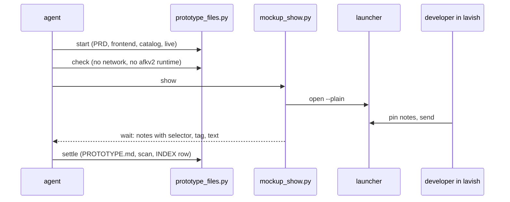
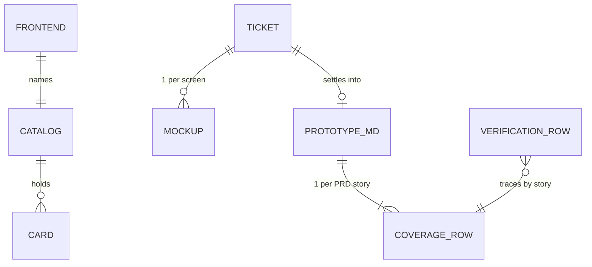
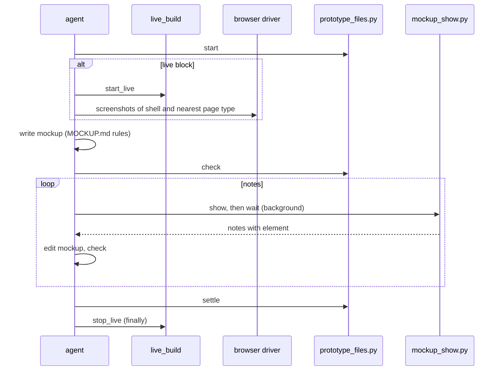

# SDD — Prototype and design system in afkv2

> Parent PRD: `PRD.md`
> Status: Draft
> Last updated: 2026-11-24

## §0 Binding Contract

This SDD and its accepted ADRs are binding on implementing agents and reviewers.

| Aspect | Locked by SDD/ADR | Executor latitude |
|--------|-------------------|-------------------|
| Pattern choice | yes | no |
| Module public interface | yes | no |
| API contract and schema | yes | no |
| Persisted schema (§4) | yes | no |
| Life cycle states and legal moves (§6) | yes | no |
| Roles per surface (§5) | yes | no |
| Transaction and idempotency strategy | yes | no |
| External-seam contract (§9b) | yes | no |
| File layout inside a named module | no | yes |
| Private helpers, internal names, control flow | no | yes |
| Test fixture structure | no | yes |

**Conflict procedure.** An executor finds a binding decision wrong, infeasible or against reality. A two-way-door correction is recorded in `plan/DECISIONS.md` and built. A one-way door or a tie parks the subtask and returns to `/afkv2:propose-solution` for a new ADR that supersedes the old one. Never override off the record.

**Human sign-off register.**

| Aspect | Section | Status | Signed by / date | Approved wording |
|--------|---------|--------|------------------|------------------|
| HL-1 Persistence and entity design | §4 | signed | developer / 2026-11-24 | sign mark on card sign-hl-1, R2: "Files only, no database. The frontends list in the config, the mockup, PROTOTYPE.md, the catalog." Risk accepted: a renamed frontend breaks the name an old PROTOTYPE.md holds. |
| HL-2 API surface | §3 | signed | developer / 2026-11-24 | sign mark on card sign-hl-2, R2: "Every surface is a script verb in the afkv2 JSON envelope … 12 new verbs and 4 changed surfaces, each an added flag or field." Risk accepted: refusal codes are a tested contract. |
| HL-3 Authorization and data scoping | §5 | signed | developer / 2026-11-24 | sign mark on card sign-hl-3, R2: "One role: you, at the keyboard. A hands-off subagent opens no page, writes no file and parks, by instruction." Risk accepted: no script stops a hands-off run. |
| HL-4 Life cycle and invariants | §6 | signed | developer / 2026-11-24 | sign mark on card sign-hl-4, R2: run states start, no_ui, drafting, notes loop, prd_gap, settled; card states checked, unchecked. Risk accepted: the single-writer rule of PROTOTYPE.md has no script guardian. |
| HL-5 Irreversible and outward side effects | §7 | n/a | — | Both skills write only their own new files and the INDEX row; the live app and the browser are local and stop at the end of the run (info card i-hl5, R2). |
| HL-6 Change to existing behaviour | §14 | signed | developer / 2026-11-24 | sign mark on card sign-hl-6, R2: "5 seams extend existing code", each opt-in. Risk accepted: the Codex hook change is proven only by the owner's live check on Codex. |

## §1 Context Summary

afkv2 has no step that settles a new screen before the design, and notes in chat lose the element they mean. This design ports the v1 `prototype` and `design-system` skills onto what afkv2 already runs: the lavish launcher with its pin and host checks, the `live` block, the browser driver, the engine secret scan and the INDEX writer. It adds only 3 scripts, 2 format files and 5 opt-in extensions of existing code. 2 solution proposers were planned; herdr did not start them (`agent_not_ready`), so 1 proposer (Claude) drafted alone.

## §2 L1 — System Topology

Inherited from afkv2: the skills and scripts run in the developer's agent session; lavish 0.1.86 runs on 127.0.0.1; the app starts through the `live` block; the browser driver is chrome-devtools-mcp 1.10.1. No new process or service.

## §3 L2 — Service Boundaries & Integration



One prototype run, from start to settle, through 2 new scripts.

Every surface answers one JSON object: `{"ok": true, ...}` or `{"ok": false, "error": {"code", "reason"}}`; exit 0 ok, 1 refused, 2 unreadable input. No paging. Each verb gives the same answer on the same files.

| Surface | Request | Success answer | Refusals |
|---------|---------|----------------|----------|
| `prototype_files.py start` | `--ticket K [--frontend NAME]` | `spec_dir, prd, index, prototype_md, mockup_dir, frontend {name, source, catalog}, catalog_exists, live, resume` | `missing-input` (no PRD; `writer` to-prd), `no-frontend` (reason names `catalog_files.py add-frontend`), `pick-frontend` (lists the names; several entries and no `--frontend`) |
| `prototype_files.py check` | `--mockup F` | `file` | `network-call` (each line), `afkv2-runtime` (the tooltip block), `unreadable` |
| `prototype_files.py settle` | `--ticket K` | `scanned` (files), `index_state` (`chosen <date>`) | `bad-prototype` (`problems`, for example a missing coverage row), `network-call`, `afkv2-runtime`, `secrets` (`file, line, shape`) |
| `mockup_show.py show` | `--mockup F` | `url`, `tab` (`reused` when a tab record shows the mockup already open, and the show adds `--no-open`; else null) | `no-host` (lavish missing, pin mismatch or `LAVISH_AXI_HOST` set; `reason`), `no-data-folder` (on Codex, `LOCALAPPDATA` not set) |
| `mockup_show.py wait` | `--mockup F --notes-file N` | `count`, `ended`; N holds `[{uid, prompt, selector, tag, text}]` | `no-session`, `no-host` as show, `notes-unwritten` (N cannot be written after the poll; the notes are in the `notes` field), `no-data-folder` (on Codex, `LOCALAPPDATA` not set) |
| `mockup_show.py reply` | `--mockup F --reply-file R` | ok | `no-session` |
| `mockup_show.py end` | `--mockup F` | ok | none |
| `catalog_files.py start` | `--frontend NAME` | `frontend, catalog_dir, catalog_exists, cards, live` | `no-frontend`, `pick-frontend` |
| `catalog_files.py add-frontend` | `--name N --source S --catalog C` | the entry written | `bad-value` (duplicate name or catalog, path outside the repository, source folder missing) |
| `catalog_files.py check` | `--frontend NAME` | `cards, checked, unchecked` | `bad-catalog` (`problems`), `network-call`, `secrets` |
| launcher `open` | `<page.html> [--no-open\|--reopen] [--plain]` | as today | as today |
| config read answer | as today; `read_config(with_frontends=False)` and `read --no-frontends` skip the list | adds `frontends`, `[]` when absent; no `frontends` key with the opt-out | `bad-value` for a broken `frontends` list by default. Only `prototype_files.py` and `catalog_files.py` read the list; every other reader opts out, so a bad list refuses only those 2 |
| propose-solution and propose-verification `start` | as today | adds `prototype` (path) and `prototype_exists` | as today; never refuses on a missing PROTOTYPE.md |
| Codex Stop hook | as today | a page with no page document: 1 line per note with its tag, selector and text | as today |

Existing callers: every change to an existing surface adds a flag or a field; nothing is renamed or removed (card a-api-2, R1; ADR-0001, ADR-0003).

## §4 L3 — Data Architecture

| State | Datastore | Partitioning | Replication | Retention | Schema-evolution policy | PII? | Audited? |
|-------|-----------|--------------|-------------|-----------|-------------------------|------|----------|
| `frontends` list | `.afkv2/config.json`, committed | per repository | git | until the developer removes it | new fields optional; unknown fields refused | no | git history |
| mockup | `<spec>/prototype/<screen>.html` | per ticket | git | forever, with the spec folder | edited in place | no: made-up data only | git history |
| `PROTOTYPE.md` | `<spec>/PROTOTYPE.md` | per ticket | git | forever | rewritten at each settle; coverage rows keep story numbers | no | git history |
| catalog | the catalog folder of the entry | per frontend | git | forever; a card for a gone shape removed only after the developer's yes | refreshed in place | no | git history |
| screenshots | `<afkv2 data folder>/shots/<run>/` | per run | none | deleted at the end of the run | none | possibly: live data, never committed | no |
| notes file | `<afkv2 data folder>/notes/<run>.json` | per run | none | deleted at the end of the run | none | no | no |
| tab record | `<afkv2 data folder>/mockup-tabs/<12 hex of the SHA-256 of the mockup path>.json`, `{page, url}` | per mockup | none | written by `show` when it opens a tab; deleted by `end`, by `wait` on `ended` or `no-session`, and by a `show` whose session status is not `opened`; best effort, no record without a data folder | none | no | no |

**frontends entry** (writer: `catalog_files.py add-frontend` only, ADR-0002, fork f-writer):

| Field | Type | Null? | Default | Unit / precision | Constraint | Indexed / unique | Note |
|-------|------|-------|---------|------------------|------------|------------------|------|
| name | text | no | none | — | lower case letters, digits and dashes | unique in the list | the key a ticket's PROTOTYPE.md names |
| source | relative path | no | none | — | inside the repository; folder exists at add-frontend | — | the frontend source folder |
| catalog | relative path | no | none | — | inside the repository | unique in the list | the catalog folder |

**PROTOTYPE.md** (format file `PROTOTYPE-FORMAT.md` in the prototype skill; only prototype writes it):

| Section | Holds |
|---------|-------|
| header | frontend name, fidelity mark (`live-verified`, `catalog` or `source-only`), date |
| Screens | 1 row per screen: name, mockup file, entry point, stories |
| Coverage | 1 row per PRD story: story number, path from the entry screen, `reachable` or `gap` |
| Fidelity | the anchor used, what was compared, each difference left |
| Decisions | 1 line per screen or interaction decision, with why |
| PRD gaps | each point the PRD could not answer, or `none` |

**Catalog README** (format file `CATALOG-FORMAT.md` in the design-system skill):

| Section | Holds |
|---------|-------|
| Scope | the frontend, its source path, the app address used |
| Cards | 1 row per card: file, shape kind (`token`, `component`, `shell`, `page`), state `checked` or `unchecked`, the screenshot it was checked against |
| Refresh | how to run design-system again |

| Relation | Target | Cardinality | Owning side | On delete / orphan | Fetch posture |
|----------|--------|-------------|-------------|--------------------|---------------|
| frontends entry → catalog folder | folder | 1 to 1 | config | entry removed: folder stays; the developer deletes it | read at start |
| ticket → mockup | file | 1 to many screens | PROTOTYPE.md Screens | settle deletes losing variants inside the file | read at settle |
| PROTOTYPE.md → PRD story | story | 1 coverage row per story | PROTOTYPE.md | a retired story keeps its row, marked retired | read at settle |
| VERIFICATION.md row → PROTOTYPE.md | screen path | many to 1 | VERIFICATION.md `story` and `criteria` columns | none | read by propose-verification |

**Surface reachability.** No field is added to an existing entity that a surface exposes, except the config read answer, which gains `frontends`.

**Migration and backfill.** None. A config without `frontends` reads as `[]`. A spec folder without PROTOTYPE.md runs both readers as today. v1 catalogs in claude.ai/design are not imported. A v1 PROTOTYPE.md is read as text. Each change goes back by revert.



The config owns the frontend link; PROTOTYPE.md owns the links to stories and screens.

## §5 L4 — Cross-Cutting & Quality Attributes

**Authorization.**

| Surface | Permitted roles | Denied roles | Guard above the UI | Guard below the UI |
|---------|-----------------|--------------|--------------------|--------------------|
| prototype skill and scripts | developer at the keyboard | hands-off subagent: opens no page, writes no file, parks | the skill instruction, as every lavish page (`afkv2/skills/use-lavish/SKILL.md:14`) | none: no script can tell a hands-off run (`tests/engine/fixtures/v0-page-with-notes.json:956`) |
| design-system skill and scripts | developer at the keyboard | hands-off subagent: parks | the skill instruction | none |
| reading PROTOTYPE.md | propose-solution, propose-verification, each in its own run | any writer of PROTOTYPE.md other than prototype | the format file rule | none |

**Data scoping.** prototype: the ticket spec folder. design-system: the catalog folder of 1 frontend per run.

**Idempotency.** `check`, `settle` and `catalog_files.py check` give the same answer on the same files; `settle` upserts the INDEX row by its first cell; `add-frontend` refuses a duplicate name.

**Retry and timeout.** No retry. The lavish wait has no time limit. A start of the live app waits its `ready_seconds`, 120 s by default.

**Rate limit, feature flags, observability.** None: everything is local and run by the developer.

**Secrets.** The engine secret scan runs on every file the skills write, at settle and at the catalog check; a finding refuses `secrets`. Screenshots stay outside the repository.

**Network.** A mockup and a catalog card make no network call; the check of §8 key logic enforces it.

Performance targets: see the Performance section of the page and §10.

## §6 L5 — Domain Model

| Invariant | Owner | Guardian | Answer to a violation |
|-----------|-------|----------|-----------------------|
| no network call in a mockup or a card | prototype skill | `prototype_files.py check`, `catalog_files.py check` | `network-call` with each line |
| no afkv2 runtime in a committed mockup | prototype skill | launcher `--plain`; `prototype_files.py check` | `afkv2-runtime` |
| no secret in a written file | both skills | `settle`, `catalog_files.py check` | `secrets`; the skill does not report done |
| 1 coverage row per PRD story | prototype skill | `settle` | `bad-prototype` names the missing story |
| frontend name unique | config | config read | `bad-value` |
| only prototype writes PROTOTYPE.md and its INDEX row | prototype skill | the rule in `PROTOTYPE-FORMAT.md` | review |

```mermaid
stateDiagram-v2
  [*] --> start
  start --> no_ui: no story adds or changes a screen; nothing written
  start --> drafting: a screen
  drafting --> notes_loop: 1 to 3 variants shown
  notes_loop --> notes_loop: a note, an edit, shown again
  notes_loop --> prd_gap: the PRD cannot answer; names /afkv2:grill-requirements
  notes_loop --> settled: the developer settles; INDEX row chosen <date>
  settled --> notes_loop: run again on the ticket
  no_ui --> [*]
  prd_gap --> [*]
```



Every move is the agent's, except the settle, which only the developer triggers. A catalog card is `checked` (compared with a live screenshot) or `unchecked`.

Domain events: none.

## §7 L6 — Process & Coordination



No transaction: each step writes its own file. The live app stops in a `finally` step, as small-change does (`afkv2/skills/small-change/scripts/small_lane.py:275-293`). A fidelity check is the agent's side-by-side reading of the mockup and the live screenshot, as in v1; a pixel diff would fail on every made-up row (card l-6, R2).

| Failure point | Detection signal | Automatic recovery | Manual recovery | Owner |
|---------------|------------------|--------------------|-----------------|-------|
| no lavish host, pin mismatch, `LAVISH_AXI_HOST` set | `show` refuses `no-host` | give the `file://` path; notes in chat | fix the install with `/afkv2:setup` | developer |
| the developer closes the browser | `wait` answers `ended` | none | `show` again | developer |
| the live app does not start | `start_live` refuses | next anchor: catalog or source; fidelity marked | fix the `live` block | developer |
| browser driver missing | the tool call fails | source anchor, `source-only` | run `/afkv2:setup` | developer |
| a check refuses at settle | `network-call`, `afkv2-runtime` or `secrets` | none | the agent fixes the file and settles again | agent |
| a PRD gap | the agent finds a story it cannot draw | stop with `prd_gap` | `/afkv2:grill-requirements` | developer |

HL-5: n/a (§0).

## §8 L7 — Module Decomposition

```mermaid
flowchart TB
  P[skills/prototype: SKILL.md, MOCKUP.md, PROTOTYPE-FORMAT.md, prototype_files.py, mockup_show.py] --> LA[engine/launcher.py]
  P --> CF[scripts/afkv2_config.py]
  P --> NO[engine/notices.py]
  P --> LB[scripts/live_build.py]
  P --> IX[to-prd prd_files.set_row]
  D[skills/design-system: SKILL.md, CATALOG-FORMAT.md, catalog_files.py] --> CF
  D --> NO
  D --> LB
  D --> P
  H[hooks/codex_stop.py] --> LA
  R[propose-solution, propose-verification] -. read PROTOTYPE.md .-> P
```

The new skills depend on existing modules; nothing existing depends on them except the readers, through the file PROTOTYPE.md. No cycle.

| Module | Purpose | Public interface | Depends on |
|--------|---------|------------------|------------|
| `skills/prototype` | the skill text, the canvas rules (`MOCKUP.md`), the PROTOTYPE.md format | `prototype_files.py start\|check\|settle`; `mockup_show.py show\|wait\|reply\|end` | launcher, afkv2_config, notices, live_build, prd_files.set_row |
| `skills/design-system` | the skill text, the catalog format | `catalog_files.py start\|add-frontend\|check` | afkv2_config, notices, live_build, the network check of prototype_files |
| `engine/launcher.py` | the one way to run lavish | `open ... --plain` added | as today |
| `hooks/codex_stop.py` | the Codex wait | no-document branch keeps the element | launcher |
| `scripts/afkv2_config.py` | the config reader | answer adds `frontends` | as today |
| propose-solution, propose-verification | the readers | start answers add `prototype`, `prototype_exists`; SKILL.md input rows | as today |

The canvas rules of `MOCKUP.md`: inline CSS and JS; made-up rows in 1 JSON script, at most 50 per screen; an `id` on every region the developer may note, since a lavish selector stops at the nearest id; variants through `?variant=` with a switcher bar; neighbour pages as stubs inside the app shell.

## §9 L8 — Tactical Patterns

| Concern | Pattern | ADR |
|---------|---------|-----|
| the rules a committed file must keep | guardian check at settle (beat: an instruction alone) | — |
| lavish for a page with no page document | thin wrapper over the launcher (beat: calling `engine.py poll`, which drops selectors) | ADR-0003 |
| the `frontends` config block | owned config block: 1 writing script, as live_build owns `live` (beat: editing by hand) | ADR-0002 |
| a skill's mechanical work | script verbs in the afkv2 JSON envelope | — |

## §9b External Seams & Failure Affordance

| Boundary | Framework at its pin | What it does to our value | Failure surface | Seam test |
|----------|----------------------|---------------------------|-----------------|-----------|
| lavish open | lavish-axi 0.1.86 | serves the file and injects its own SDK only when serving; leaves the file on disk unchanged | launcher exit 127 or 64 → `show` refuses `no-host` | open a mockup with `--plain` through a `.py` stub of lavish; the file bytes stay the same |
| lavish poll | lavish-axi 0.1.86 | each note: `selector` (at most 5 parts, cut at the nearest `#id`), `tag`, `text` (at most 240 characters); statuses feedback, ended, browser_disconnected, waiting (`dist/cli.mjs:5708-5734, 9404-9419, 13172-13209`) | `wait` answers `ended`, or refuses `no-session` | `wait` on recorded poll output (`tests/engine/fixtures/host-poll-two-prompts.txt`) writes 2 notes with selector, tag and text |
| Codex Stop hook | Codex Stop event | hands the hook's text back as the next prompt | a missing waiting record: no output | `codex_stop` with a null document and 2 recorded notes prints 2 lines with tag and selector |
| browser driver | chrome-devtools-mcp 1.10.1 | takes screenshots of the live app | tool error → source anchor | owner live check on a real frontend |
| live app | the `live` block | starts and stops the app | `live-start-failed`, `live-no-answer` → next anchor | existing `test_live_build.py` |

## §10 NFRs

| Concern | Target | Measurement | Owner |
|---------|--------|-------------|-------|
| check of 1 mockup | under 1 s (estimated) | timed in its unit test | prototype |
| settle of 5 files | under 5 s (estimated) | timed in its unit test | prototype |
| show to page open | under 3 s (estimated) | owner live check | prototype |
| mockup size | about 100 KB, at most 500 KB (estimated); at most 50 made-up rows per screen | `check` reports the size | prototype |
| catalog size | 20 to 60 card files of about 10 KB per frontend (estimated) | `catalog_files.py check` counts them | design-system |
| screenshots | about 150 KB each, at most 4.5 MB per run (estimated); deleted at the end of the run | the run folder is empty after `end` | both |

## §11 Out of Scope

- Any use of claude.ai/design: the share push and the catalog push.
- The logic and state-model branch of the prototype.
- A hosted share link for stakeholders; the committed HTML file is the share.
- The afkv2 chain order that leaves out propose-verification (spinoff in the grill log).
- A run marker that lets a script tell a hands-off run (card a-authorization, R1): a separate ticket if a real miss shows up.
- A pixel diff for the fidelity check (card l-6, R2).

## §12 Reversed Decisions

| Prior ADR | Superseded by | Reason |
|-----------|---------------|--------|
| none | — | — |

## §13 Open Questions

| Question | Layer (L1-L9) | Blocks executor? | Owner | Target resolve date |
|----------|---------------|------------------|-------|---------------------|
| none | — | no | — | — |

## §14 L9 — Implementation Seams & Change Impact

| Seam | Existing contract | Planned change | Impacted flows | Conventions and landmines | Verdict |
|------|-------------------|----------------|----------------|---------------------------|---------|
| launcher `plan` and `run` (`afkv2/engine/launcher.py:61-107, 296-300`) | `open` always writes the tooltip block into the original file (`engine/shell/inject.py:206-216, 257-267`) | `--plain` on `open` skips `inject_file`; the pin and host checks stay | every lavish page: unchanged without the flag | the flag is afkv2's own: strip it before the lavish command line; `tests/engine/test_page_tip_injection.py` keeps its cases | extends (ADR-0001) |
| Codex Stop hook `_raw` (`afkv2/hooks/codex_stop.py:39-47, 118-136`) | a page with no document hands back the note words only | 1 line per note with tag, selector and text; the waiting record is written by `mockup_show.py show` (`launcher.write_waiting_record`, `launcher.py:431-445`) when `CODEX_THREAD_ID` is set | no current page has no document | keep the branch for a page document as it is | extends (ADR-0003) |
| config read (`afkv2/scripts/afkv2_config.py:39-58, 97-137`) | no `frontends`; unknown top-level keys ignored | `frontends` parsed and checked, `[]` when absent; `with_frontends=False` (command flag `--no-frontends`) skips it | every config reader: an added field; each reader other than `prototype_files.py` and `catalog_files.py` opts out | refuse a bad list with `bad-value` by default, as the `live` block does (:140-170) | extends (ADR-0002) |
| propose-solution start and SKILL.md (`design_files.py:136-140`; `SKILL.md:10-17, 43, 72`) | no prototype input | `prototype`, `prototype_exists`; optional input row; step 2 and the proposer brief read it; each UI decision that changes the design is cited in its existing section (requirement ADR-0003) | the design session | never refuse a missing PROTOTYPE.md (AC-029) | extends (ADR-0004) |
| propose-verification start and SKILL.md (`verification_files.py:180-207, 47`; `SKILL.md:12-18, 36, 48`) | no prototype input | optional input, kept out of `WRITERS`; `ui-e2e` and `acceptance` rows from its Coverage rows, traced by the existing `story` and `criteria` columns | the verification session | no new column (`VERIFICATION-FORMAT.md:67`) | extends (ADR-0004) |
| INDEX-FORMAT.md writer table (`afkv2/skills/to-prd/INDEX-FORMAT.md:7-11, 24`) | Prototype row with no writer | prototype is its writer, through `prd_files.set_row` (`prd_files.py:176-190`) | none | state `chosen <date>` | fits |
| plugin registration (`afkv2/scripts/plugin_check.py:88-134`; `afkv2/tests/test_module_names.py:22`) | a skill folder registers itself | 2 folders; module names `prototype_files`, `mockup_show`, `catalog_files`, unique | none | no v1 name (`afk` without `v2`) in text or file names | fits |

Compatibility findings the human accepted (card sign-hl-6, R2): each extension is opt-in, so existing callers see no change; the Codex hook change is proven only by the owner's live check on Codex.
