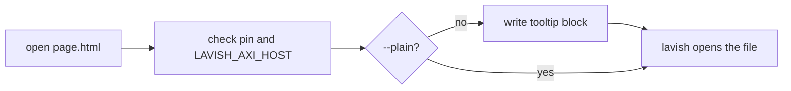

# ADR-0001 — The launcher opens a mockup with no tooltip block

> Status: Accepted
> Date: 2026-11-24
> Layer: L9
> Context ticket: 207
> Forks: a-api

## Context

The afkv2 launcher writes its tooltip block into the original file on every `open` (SDD §14; `afkv2/engine/launcher.py:296-300`). A committed mockup must hold no afkv2 runtime (AC-010), and lavish must still run through the launcher's pin and host checks (AC-016).

## Driven by

AC-010, AC-016, requirement ADR-0001, card a-api.

## Decision

`open` takes a new afkv2 flag `--plain`. With it, the launcher skips `inject_file` and runs lavish on the file as it is. The pin check and the `LAVISH_AXI_HOST` refusal stay. The launcher strips the flag before the lavish command line. Without it, every page opens as today.

## Alternatives Considered

| Alternative | Pros | Cons | Reason rejected |
|-------------|------|------|-----------------|
| show a copy in the run folder | no launcher change | each edit copies again; notes name elements of the copy | rejected by the developer on card a-api |
| strip the block at settle | no launcher change | the file is dirty through the loop; a commit in between carries the block | rejected by the developer on card a-api |

## Consequences

- **Positive** — the mockup on disk is the mockup lavish shows; the pin and host checks keep 1 home.
- **Negative** — a small change to shared launcher code, with its own test.
- **Follow-ups** — none.
