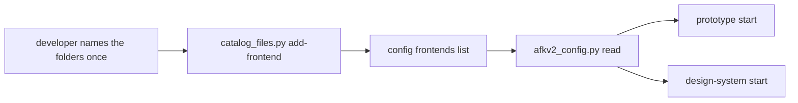

# ADR-0002 — design-system writes the frontends entries of the config

> Status: Accepted
> Date: 2026-11-24
> Layer: L3
> Context ticket: 207
> Forks: f-writer

## Context

Both skills find a frontend's source and catalog folders in the repository config (AC-006), and no config key names them today (SDD §4; `afkv2/scripts/afkv2_config.py:39-58`). The config has 2 writers, and each owns its block: setup, and live_build for `live` (`afkv2/scripts/live_build.py:407-416`).

## Driven by

AC-006, AC-021, AC-023, requirement ADR-0002, card f-writer.

## Decision

`catalog_files.py add-frontend --name --source --catalog` is the only writer of the `frontends` list. The agent asks the developer once for the 2 folders, then runs it. `afkv2_config.py` reads and checks the list, and answers `[]` when it is absent. When no entry exists, `prototype_files.py start` refuses `no-frontend`, and its reason names the add-frontend command.

## Alternatives Considered

| Alternative | Pros | Cons | Reason rejected |
|-------------|------|------|-----------------|
| setup asks at install | 1 place for all config | every repository gets the question, also a backend-only one; setup grows | rejected by the developer on card f-writer |
| edit by hand | no new code | a typo shows only at the next read | rejected by the developer on card f-writer |

## Consequences

- **Positive** — 1 writer per config block, as live_build owns `live`; the entry is checked when it is written.
- **Negative** — a repository with no catalog still runs 1 design-system command before its first prototype.
- **Follow-ups** — none.
