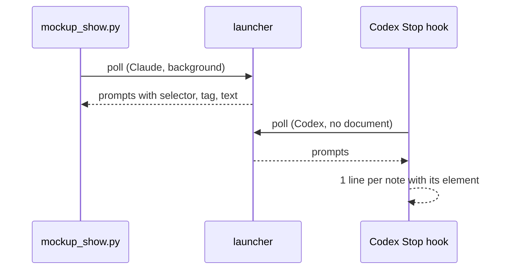

# ADR-0003 — The prototype reads notes with their element, on Claude and Codex

> Status: Accepted
> Date: 2026-11-24
> Audited: 2026-11-24
> Layer: L2
> Context ticket: 207
> Forks: none

## Context

For a page with no page document, the engine wait keeps only the note words (SDD §14; `afkv2/engine/engine.py:660-664`), and so does the Codex Stop hook (`afkv2/hooks/codex_stop.py:39-47`). A mockup has no page document, and the element of each note is the point of the feature (AC-012).

## Driven by

AC-012, AC-013, requirement ADR-0001, card a-api-2.

## Decision

`mockup_show.py` is a thin wrapper over the launcher. `show` opens with `--plain` and, on Codex, writes the waiting record with a null document. `wait` runs `poll` and writes each note as `{uid, prompt, selector, tag, text}` to the notes file. The no-document branch of the Codex Stop hook prints 1 line per note, with its tag, selector and text.

## Alternatives Considered

| Alternative | Pros | Cons | Reason rejected |
|-------------|------|------|-----------------|
| call `engine.py poll` | no new script | keeps only the words without a page document | loses the element |
| a minimal page document for the mockup | reuses the engine | the mockup becomes a grill page, against requirement ADR-0001 | settled in the grill |

## Consequences

- **Positive** — notes keep their element on both harnesses; pages with a document do not change.
- **Negative** — only the owner's live check proves the Codex path.
- **Follow-ups** — none.
